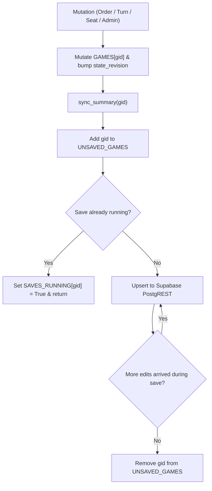

# Consistency & Persistence

Sloplomacy combines a sub-millisecond in-memory L1 store with write-through JSONB persistence in Supabase PostgreSQL. This page explains what is persisted versus ephemeral, how optimistic concurrency (`state_revision`) prevents lost updates, and how the server reconciles memory with the database across restarts and rollbacks.

## Contents

- [In-Memory L1 Store vs. Durable Database](#in-memory-l1-store-vs-durable-database)
- [Write-Through Persistence & Coalesced Saves](#write-through-persistence--coalesced-saves)
- [Optimistic Concurrency (`state_revision`)](#optimistic-concurrency-state_revision)
- [Atomic Admin Board Edits](#atomic-admin-board-edits)
- [Failure Modes & Restart Behavior](#failure-modes--restart-behavior)
- [Related Docs](#related-docs)

---

## In-Memory L1 Store vs. Durable Database

Not everything in process memory is saved to Supabase:

| Data | In-Memory Store (`storage/store.py`) | Persisted in Supabase? | Notes |
| :--- | :--- | :--- | :--- |
| **Live match & solo/saved sandbox state** | `GAMES[gid]` | Yes (`state` JSONB) | Derived `unit_options` are stripped before saving and rebuilt on load. |
| **Match metadata & board preview** | `GAME_SUMMARIES[gid]` | Yes (`multiplayer_games` columns + `board` preview) | Loaded on startup for the lobby without loading full game state. |
| **Resolved turn history** | `GAME_HISTORY[gid]` | Yes (`history` JSONB, capped at 30 turns) | Marked dirty in `HISTORY_UNSAVED` only when history changes (adjudication, rollback, admin edit). |
| **Private match passcodes** | `GAME_PASSCODES[gid]` | Yes (`passcode` column) | Never included in `MultiplayerGameSummary` or `GameState` responses. |
| **Press messages (chat)** | `GAME_PRESS[gid]` | Yes (`press` JSONB column) | Stored in its own column so board saves, history snapshots, and rollbacks never touch press. |
| **Profile display names** | `PROFILE_NAMES[uid]` | Yes (`public.profiles`) | Hydrated on startup and updated when users sign in or rename. |
| **Default local game (`proto_1901`)** | `GAMES["proto_1901"]` | No | Ephemeral local/default sandbox; never written to Supabase. |
| **Hypothetical branches (`sbx_*`, `SANDBOX_BRANCHES`)** | `PRIVATE_SANDBOXES`, `SANDBOX_CHECKPOINTS` | No | Ephemeral "what-if" branches; cleared when the real turn resolves or resets. |

---

## Write-Through Persistence & Coalesced Saves

Every authoritative mutation (order updates, seat changes, adjudication, timer changes, admin edits) mutates the in-memory `GameState` first, then calls `persist_game(game_id)` ([`backend/storage/store.py`](../../backend/storage/store.py)):

1. **Summary sync**: `sync_summary()` updates `GAME_SUMMARIES[gid]` (phase, finalized/surrendered powers, `BoardPreview`, timer deadline, winner/completed status).
2. **Coalesced async writes (`SAVES_RUNNING` + `UNSAVED_GAMES`)**: If a Supabase save is already in flight for `game_id`, a second concurrent `persist_game()` call marks `SAVES_RUNNING[game_id] = True` and returns immediately. When the active save finishes, it loops and writes the latest snapshot, preventing overlapping out-of-order HTTP PostgREST upserts.
3. **Selective history upload**: `history` is only serialized and sent to Supabase when `game_id` is in `HISTORY_UNSAVED`, keeping routine order submissions small and fast.
4. **Separate press persistence**: Press writes use their own `PRESS_UNSAVED` and `save_press_to_db` path ([`backend/storage/press.py`](../../backend/storage/press.py)) so chat traffic never contends with board saves.

---

## Optimistic Concurrency (`state_revision`)

`GameState.state_revision` is a monotonically increasing integer (starting at `1`) incremented on every authoritative state change:

- **Turn and order mutations**: Order submissions, finalizations, adjudications, seat claims/surrenders, rollbacks, and sandbox transitions all increment `state_revision`.
- **Conflict detection**: Operations that operate on a snapshot of the board—such as the creator's batch board editor (`POST /api/admin/board-edit`)—send `expected_revision`. If `req.expected_revision != game.state_revision`, the server rejects the request with `409 Conflict` instead of silently overwriting concurrent changes.
- **Turn-scoped staleness**: Order and finalization requests can also carry the expected turn string; `reject_stale_turn()` returns `409 Conflict` if the game has already adjudicated into a new phase.
- **Database load reconciliation**: When `load_game_from_db()` reads a row from Supabase, it ensures `state.state_revision = max(state.state_revision, row["state_revision"])` so the revision never regresses.

---

## Atomic Admin Board Edits

Because board editing in the UI lets a creator move, spawn, destroy units, and reassign province ownership together, applying those changes one HTTP request at a time would risk partial edits or mid-edit WebSocket broadcasts.

Instead, the frontend stages edits locally and submits a single `POST /api/admin/board-edit` batch with `expected_revision`:

1. Verify creator/admin access and check `expected_revision == game.state_revision` (`409` on mismatch).
2. Validate every staged change against province topology and unit rules before mutating state.
3. Apply all ownership changes, unit removals, teleports, and spawns in one pass, recomputing validation diagnostics, simulation preview, and `state_revision`.
4. Record a single consolidated `"Admin"` snapshot in `GAME_HISTORY` and an `AdminActionLogEntry`, persist once, and broadcast once.

---

## Failure Modes & Restart Behavior

- **Supabase read failure (`503`)**: If a game is not in `GAMES` and Supabase is unreachable, `load_saved_game()` raises `503 Service Unavailable` rather than returning `404` so clients do not mistake a transient outage for a deleted game.
- **Supabase write failure**: If `save_game_to_db()` fails, `game_id` remains in `UNSAVED_GAMES` (and `HISTORY_UNSAVED` if applicable). The next mutation retries, and the server's lifespan shutdown hook attempts a final flush of `UNSAVED_GAMES`.
- **Single-instance guarantee**: Because `GAMES` is authoritative while a container is running, Cloud Run's `max_instance_count = 1` ensures two containers never diverge on `state_revision` or overwrite each other's rows.

---

## Related Docs

- [Runtime & Infrastructure Model](runtime-and-infrastructure.md)
- [Database Setup & Row-Level Security](database.md)
- [Admin & Creator Controls](../features/admin-and-creator-controls.md)
- [Data Models & Schemas](data-models.md)
