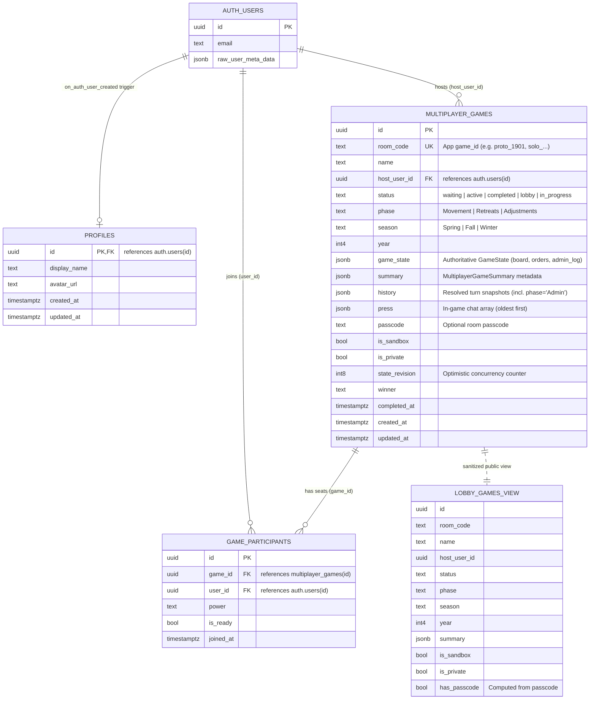
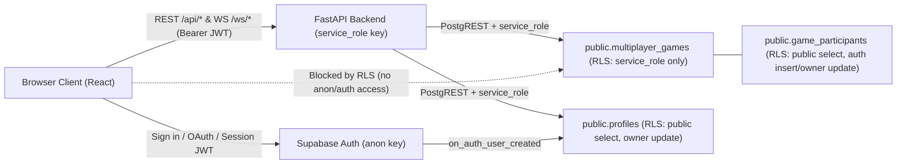
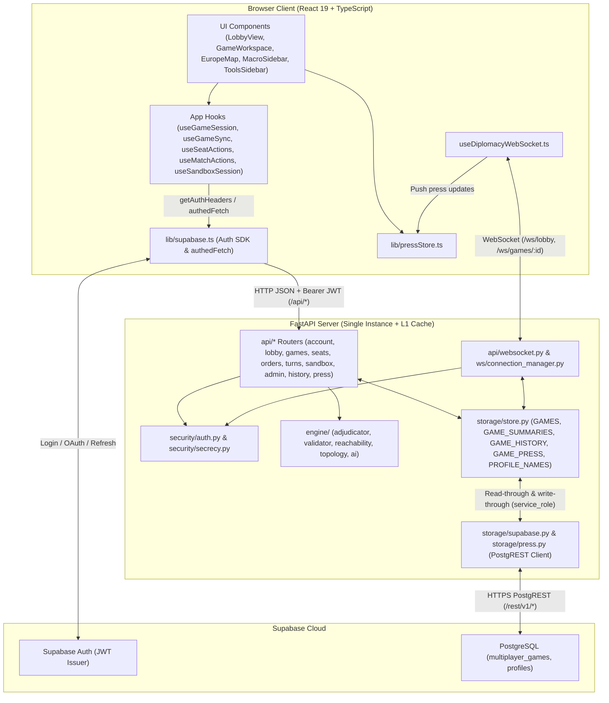
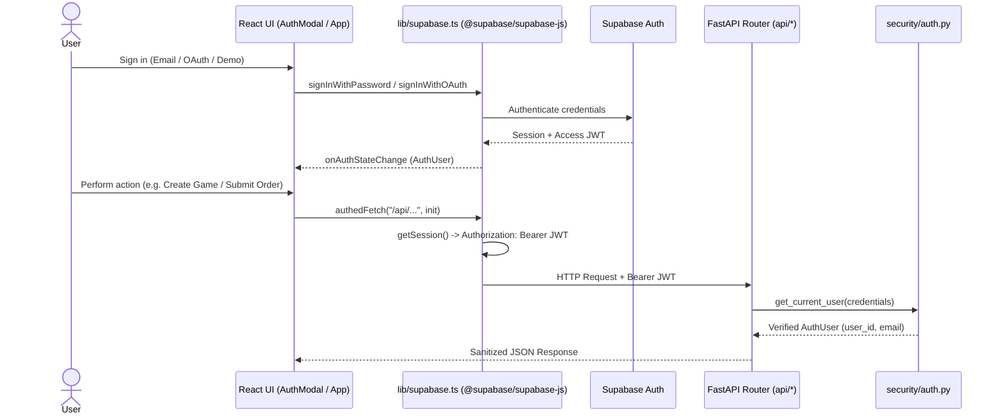
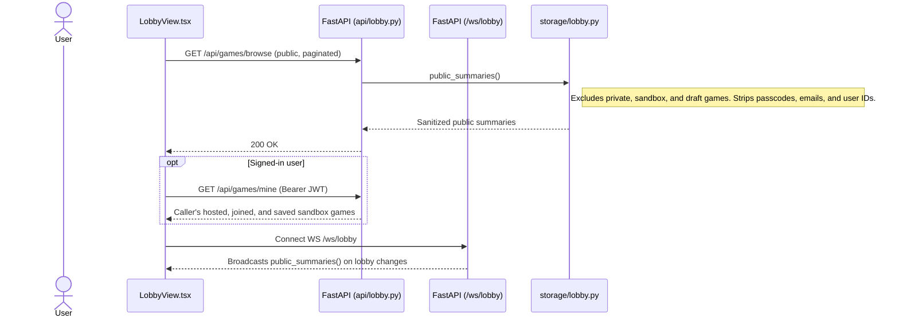
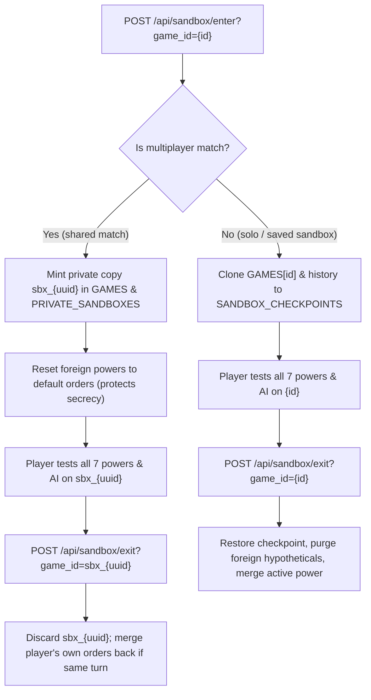

# Database Setup & Service Interactions

This document explains how **Sloplomacy** stores data in Supabase PostgreSQL, how Row-Level Security (RLS) protects secret simultaneous orders, and how the React frontend interacts with Supabase Auth and the FastAPI backend.

---

## 1. Database Schema & Entity Relationships

Supabase provides both **Authentication** (`auth.users`) and **PostgreSQL** (`public.*`). Rather than normalizing every unit, order, and turn snapshot into dozens of relational tables, Sloplomacy stores each match's authoritative board state, lobby summary, turn history, and press (chat) as structured JSONB columns on `public.multiplayer_games`, paired with relational metadata for indexing, filtering, and optimistic concurrency.



### Key Schema Design Choices

- **Separate `press` JSONB column**: `multiplayer_games.press` is stored in its own column (`backend/storage/press.py`) so saving chat messages never overwrites `game_state`, and saving a turn never clobbers press messages.
- **Authoritative Profiles (`public.profiles`)**: When persisting summaries to `multiplayer_games`, denormalized display names for registered UUID users are stripped (`backend/storage/supabase.py`). On load, `hydrate_summary_profiles` resolves current names from `public.profiles` (`PROFILE_NAMES` cache).
- **Optimistic Concurrency (`state_revision`)**: Incremented on mutations and checked by admin board-edit operations (`backend/api/admin_units.py`) to prevent stale overwrites.
- **Sanitized View (`public.lobby_games`)**: Excludes `game_state`, `history`, `press`, and plaintext `passcode` (exposing `has_passcode` boolean instead), and filters out sandboxes and private games.

---

## 2. Row-Level Security (RLS) & Trust Boundaries

In Diplomacy, orders are **simultaneous and secret** until adjudication. If the browser could query `public.multiplayer_games` directly with the public Supabase `anon` key, any player could inspect `game_state` and read opponents' unrevealed orders, private press, or room passcodes.

Therefore, **the frontend never queries game tables in Supabase directly**. All game reads and writes go through the FastAPI backend, which authenticates with Supabase using the privileged `service_role` key and sanitizes responses per viewer.



### Policy Summary

| Table | `anon` / `authenticated` (Browser) | `service_role` (FastAPI Backend) |
| :--- | :--- | :--- |
| `public.multiplayer_games` | **No access** (all SELECT/INSERT/UPDATE/DELETE blocked by RLS) | Full read/write access |
| `public.lobby_games` (view) | Sanitized public columns only (no `game_state`, `press`, `history`, or `passcode`) | Full access |
| `public.profiles` | `SELECT` everyone; `UPDATE` own row (`auth.uid() = id`) | Full read/write access |
| `public.game_participants` | `SELECT` everyone; `INSERT` authenticated; `UPDATE` own row | Full access |

---

## 3. Frontend-to-Services Architecture

The React frontend (`frontend/src/`) talks to **two** external interfaces:
1. **Supabase Auth (`frontend/src/lib/supabase.ts`)**: Used *only* for user authentication (email/password, magic link OTP, Google/Discord OAuth, session refresh, and updating auth user metadata).
2. **FastAPI Backend (`backend/main.py` & `backend/api/*`)**: Serves all game state, lobby browsing, order submission, adjudication, turn history, press, sandboxing, and real-time WebSockets. In production (Cloud Run), FastAPI also serves the built Vite SPA static assets.



### In-Memory L1 Cache vs. PostgreSQL

- **Memory is authoritative for loaded games**: `GAMES` (`backend/storage/store.py`) acts as an in-memory L1 cache so order validation, reachability, and simulation run with sub-millisecond latency.
- **Startup hydration**: On FastAPI startup (`lifespan` in `backend/main.py`), the server loads `PROFILE_NAMES` and `GAME_SUMMARIES` from Supabase so the lobby is immediately populated without loading every full `game_state` into memory.
- **Lazy game loading**: When a player opens or connects to a `game_id` not yet in `GAMES`, the backend loads it from `multiplayer_games`, rebuilds derived `unit_options` (which are stripped before DB storage to save space), and caches it in `GAMES`.
- **Single-instance invariant**: Because `GAMES` and WebSocket rooms live in process memory, Cloud Run runs with `--max-instances 1`.

---

## 4. Key Service Interaction Flows

### A. Authentication & Authenticated API Call



### B. Live Match Order Submission & WebSocket Broadcast

Because browsers cannot attach custom `Authorization` headers to a WebSocket upgrade request—and putting a JWT in the query string would leak it into server access logs—the game WebSocket uses a **post-connect auth handshake** (`?handshake=1`).

```mermaid
sequenceDiagram
    actor PlayerA as Player A (France)
    actor PlayerB as Player B (Germany)
    participant API as FastAPI (api/orders.py)
    participant Engine as validator & adjudicator
    participant DB as Supabase (multiplayer_games)
    participant WSMgr as ws/connection_manager.py

    Note over PlayerA,WSMgr: Socket Connection Handshake
    PlayerA->>WSMgr: Connect WS /ws/games/{id}?handshake=1
    WSMgr-->>PlayerA: accept()
    PlayerA->>WSMgr: Send {"type": "auth", "token": "<JWT>"}
    WSMgr->>WSMgr: Verify JWT -> bind socket to France seat

    Note over PlayerA,WSMgr: Order Submission & Per-Viewer Sanitization
    PlayerA->>API: POST /api/order?game_id={id} (Bearer JWT)
    API->>API: Verify caller holds France seat
    API->>Engine: validate_orders() + adjudicate_turn(is_simulation=True)
    API->>DB: persist_game() (JSONB upsert)
    API-->>PlayerA: 200 OK (France sees own orders; foreign orders masked)

    API->>WSMgr: broadcast_game_update(game_id)
    WSMgr->>WSMgr: sanitize_game_state_for_viewer(state, viewer=France)
    WSMgr-->>PlayerA: WS push (France sees updated France orders)
    WSMgr->>WSMgr: sanitize_game_state_for_viewer(state, viewer=Germany)
    WSMgr-->>PlayerB: WS push (Germany sees France's orders masked)
```

### C. Lobby Discovery & Public vs. Private Games



### D. Sandbox Isolation ("War Room" Mode)

Sandbox behavior differs depending on whether the player is in a **shared multiplayer match** or a **solo/saved sandbox**:


