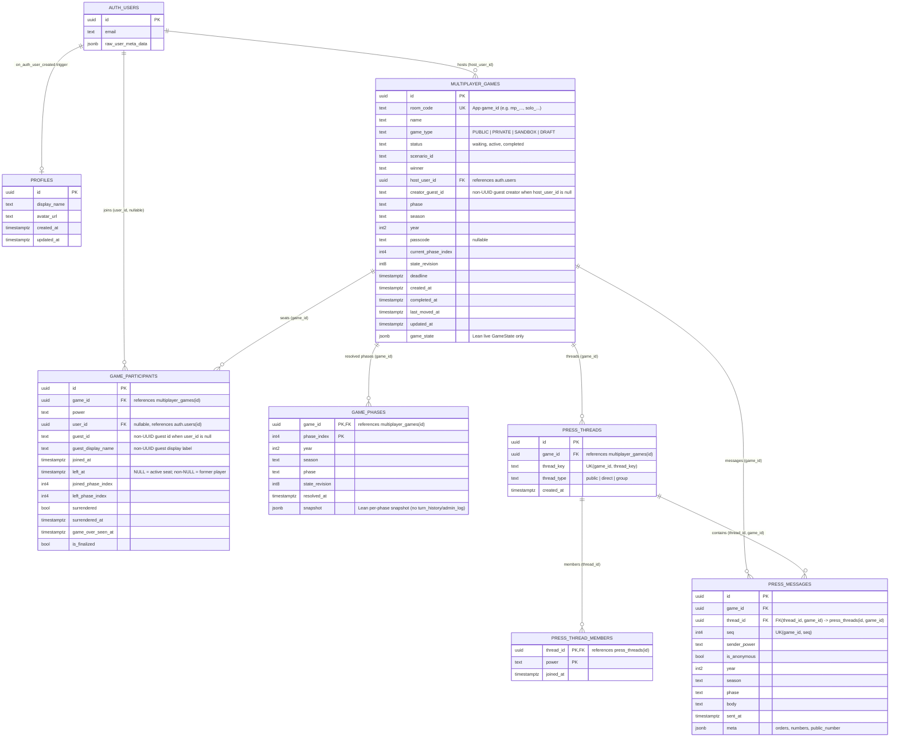
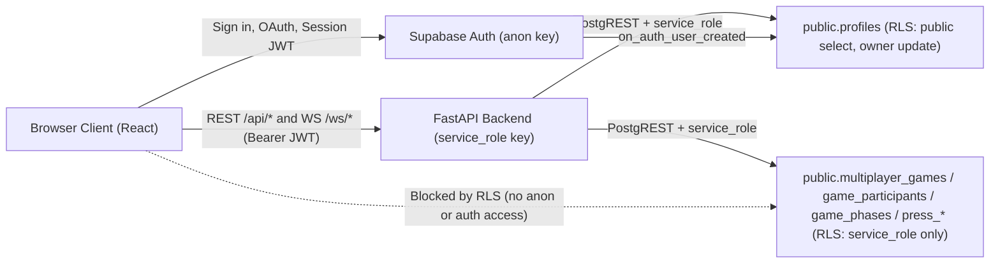

# Database Setup & Row-Level Security

This document describes how **Traitorous** stores data in Supabase PostgreSQL, how the normalized tables relate to each other, and how Row-Level Security (RLS) protects secret simultaneous orders.

For how the React frontend and FastAPI backend interact with these tables at runtime, see [Service Interactions](service-interactions.md).

## Contents

- [1. Database Schema & Entity Relationships](#1-database-schema--entity-relationships)
- [2. Row-Level Security (RLS) & Trust Boundaries](#2-row-level-security-rls--trust-boundaries)

---

## 1. Database Schema & Entity Relationships

Supabase provides both **Authentication** (`auth.users`) and **PostgreSQL** (`public.*`). Traitorous normalizes the relational spine (matches, seats with soft-leave history, per-phase history snapshots, and press threads/messages) while keeping the live simultaneous turn state as a single atomic `game_state` JSONB column on `public.multiplayer_games` and variable press metadata (`orders`, per-reader `numbers`) in `press_messages.meta`.

### Key Schema Design Choices

- **UUID Foreign Keys & Soft-Leave Seat History**: All child tables reference `multiplayer_games.id` (`uuid`) with `ON DELETE CASCADE`. `public.game_participants` uses a surrogate `id` PK plus a partial unique index `idx_game_participants_active_seat` on `(game_id, power) WHERE left_at IS NULL`. Leaving or surrendering-and-leaving stamps `left_at` and `left_phase_index` rather than deleting the row, preserving former-player tenure while freeing the seat for a replacement player.
- **Zero-Byte Virtual Computed Columns**: `public.has_passcode(g)` and `public.board_preview(g)` are `IMMUTABLE` SQL functions exposed as computed PostgREST columns (`?select=...,has_passcode,board_preview`) and restricted to `service_role`. Lobby refreshes never transfer plaintext passcodes, live orders, or redundant JSONB copies.
- **Per-Phase History (`public.game_phases`)**: Resolved phases (including `"Admin"` snapshots) are stored as append-only rows keyed by `(game_id, phase_index)` with no 30-phase cap. `snapshot` strips `unit_options`, `preview`, `issues`, `timer`, `finalized_powers`, `turn_history`, and `admin_log` to eliminate $O(N^2)$ cumulative log bloat.
- **Normalized Press (`press_threads`, `press_thread_members`, `press_messages`)**: Each message appends one row in $O(1)$ under a deterministic `(game_id, thread_key)` thread, with a composite FK `(thread_id, game_id) -> press_threads(id, game_id)` preventing cross-game thread links.
- **Authoritative Profiles & No-PII Constraints**: SQL `CHECK` constraints forbid `@` tokens in `creator_guest_id`, `guest_id`, and `guest_display_name`, and forbid storing `guest_display_name` on registered UUID seats. Registered display names live exclusively in `public.profiles` (`handle_new_user()` defaults invalid/email metadata to `'Envoy'`, enforced by `profiles_display_name_valid`).
- **Optimistic Concurrency (`state_revision` & `board_revision`)**: `state_revision` increments on every authoritative state mutation; `board_revision` (inside `game_state`) increments on board/turn changes and is checked by `POST /api/admin/board-edit`.
- **Two-Phase Migration Rollout**: Legacy columns `multiplayer_games.{summary, history, press, is_sandbox, is_private}` remain deprecated on disk during Phase 1 for zero-downtime Cloud Run deploys and are scheduled for removal in Phase 2.

---

## 2. Row-Level Security (RLS) & Trust Boundaries

In Diplomacy, orders are **simultaneous and secret** until adjudication. Therefore, **the frontend never queries game, participant, phase, or press tables in Supabase directly**. All game reads and writes go through the FastAPI backend using `service_role`, which sanitizes responses per viewer.

### Policy Summary

| Table | `anon` / `authenticated` (Browser) | `service_role` (FastAPI Backend) |
| :--- | :--- | :--- |
| `public.multiplayer_games` | **No access** (RLS blocks all SELECT/INSERT/UPDATE/DELETE) | Full read/write access |
| `public.game_participants` | **No access** (RLS blocks all SELECT/INSERT/UPDATE/DELETE) | Full read/write access |
| `public.game_phases` | **No access** (RLS blocks all SELECT/INSERT/UPDATE/DELETE) | Full read/write access |
| `public.press_threads`, `press_thread_members`, `press_messages` | **No access** (RLS blocks all SELECT/INSERT/UPDATE/DELETE) | Full read/write access |
| `public.profiles` | `SELECT` everyone; `UPDATE` own row (`(select auth.uid()) = id`) | Full read/write access |
