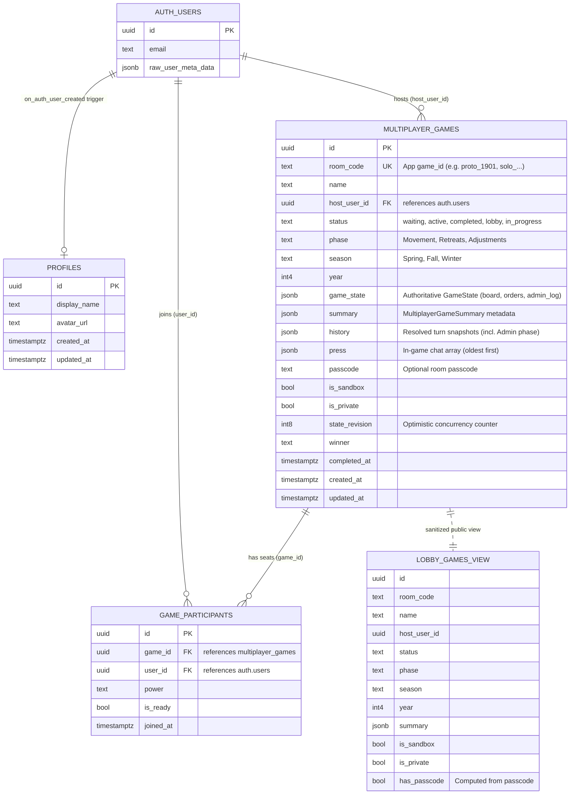
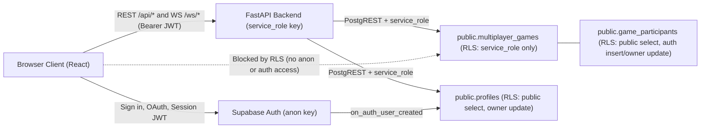

# Database Setup & Row-Level Security

This document describes how **Sloplomacy** stores data in Supabase PostgreSQL, how the tables and views relate to each other, and how Row-Level Security (RLS) protects secret simultaneous orders.

For how the React frontend and FastAPI backend interact with these tables at runtime, see [Service Interactions](service-interactions.md).

## Contents

- [1. Database Schema & Entity Relationships](#1-database-schema--entity-relationships)
- [2. Row-Level Security (RLS) & Trust Boundaries](#2-row-level-security-rls--trust-boundaries)

---

## 1. Database Schema & Entity Relationships

Supabase provides both **Authentication** (`auth.users`) and **PostgreSQL** (`public.*`). Rather than normalizing every unit, order, and turn snapshot into dozens of relational tables, Sloplomacy stores each match's authoritative board state, lobby summary, turn history, and press (chat) as structured JSONB columns on `public.multiplayer_games`, paired with relational metadata for indexing, filtering, and optimistic concurrency.

### Key Schema Design Choices

- **Separate `press` JSONB column**: `multiplayer_games.press` is stored in its own column (`backend/storage/press.py`) so saving chat messages never overwrites `game_state`, and saving a turn never clobbers press messages.
- **Authoritative Profiles (`public.profiles`)**: When persisting to `multiplayer_games`, `backend/storage/supabase_codec.py` strips `created_by`, participant `email`, UUID participant `display_name`, UUID `admin_log.actor`, and any `@` tokens from `summary`, `game_state`, and `history`. On load and viewer sanitization, `backend/storage/profiles.py` resolves display names strictly from `public.profiles` (`PROFILE_NAMES[user_id]` cache, defaulting to `"Envoy"`). The `handle_new_user()` trigger rejects email-like metadata and defaults new profiles to `'Envoy'`, and `public.profiles.display_name` is enforced at the database layer via `profiles_display_name_valid` (`CHECK`: trimmed, 2–24 characters, no `@`), matching `PATCH /api/account/profile`.
- **Optimistic Concurrency (`state_revision`)**: Incremented on mutations and checked by admin board-edit operations (`backend/api/admin_units.py`) to prevent stale overwrites.
- **Sanitized View (`public.lobby_games`)**: Excludes `game_state`, `history`, `press`, and plaintext `passcode` (exposing `has_passcode` boolean instead), and filters out sandboxes and private games.

### JSONB Column Breakdown (`public.multiplayer_games`)

For the full field-by-field schema of each model, see [Data Models & Contracts](data-models.md). In `public.multiplayer_games`, those models are persisted as:

| Column | Stored JSON Shape | Persistence & Stripping Rules |
| :--- | :--- | :--- |
| `game_state` | `{ "state": GameState, "summary": MultiplayerGameSummary, "passcode": string \| null }` | `unit_options` (`DERIVED_STATE_FIELDS`) is excluded and rebuilt on load; `preview` is never saved (`null`, rebuilt per viewer). `state.admin_log` stores `actor_id` (UUID `actor` strings and `@` tokens are stripped on save and resolved from `public.profiles` on read). |
| `summary` | `MultiplayerGameSummary` (metadata, `participants`, `finalized_powers`, `surrendered_powers`, `board` preview, `deadline`) | `created_by`, participant `email`, and UUID `participants[*].display_name` are stripped on save and resolved from `public.profiles` (`PROFILE_NAMES`) on read. |
| `history` | `GameState[]` (resolved phase snapshots + `phase: "Admin"` snapshots with `admin_resolution`, oldest first) | `unit_options` is excluded and `admin_log` is sanitized identically to `game_state.state`. Saving with `history=None` leaves existing DB history untouched. |
| `press` | `PressMessage[]` (in-game chat messages, oldest first: `id`, `seq`, `numbers`, `sender`, `anonymous`, `recipients`, `body`, `orders`, `sent_at`, `season`, `year`, `phase`) | Written independently by `backend/storage/press.py` so chat saves and turn saves never overwrite each other. |

---

## 2. Row-Level Security (RLS) & Trust Boundaries

In Diplomacy, orders are **simultaneous and secret** until adjudication. If the browser could query `public.multiplayer_games` directly with the public Supabase `anon` key, any player could inspect `game_state` and read opponents' unrevealed orders, private press, or room passcodes.

Therefore, **the frontend never queries game tables in Supabase directly**. All game reads and writes go through the FastAPI backend, which authenticates with Supabase using the privileged `service_role` key and sanitizes responses per viewer.

### Policy Summary

| Table | `anon` / `authenticated` (Browser) | `service_role` (FastAPI Backend) |
| :--- | :--- | :--- |
| `public.multiplayer_games` | **No access** (all SELECT/INSERT/UPDATE/DELETE blocked by RLS) | Full read/write access |
| `public.lobby_games` (view) | Sanitized public columns only (no `game_state`, `press`, `history`, or `passcode`) | Full access |
| `public.profiles` | `SELECT` everyone; `UPDATE` own row (`auth.uid() = id`) | Full read/write access |
| `public.game_participants` | `SELECT` everyone; `INSERT` authenticated; `UPDATE` own row | Full access |
