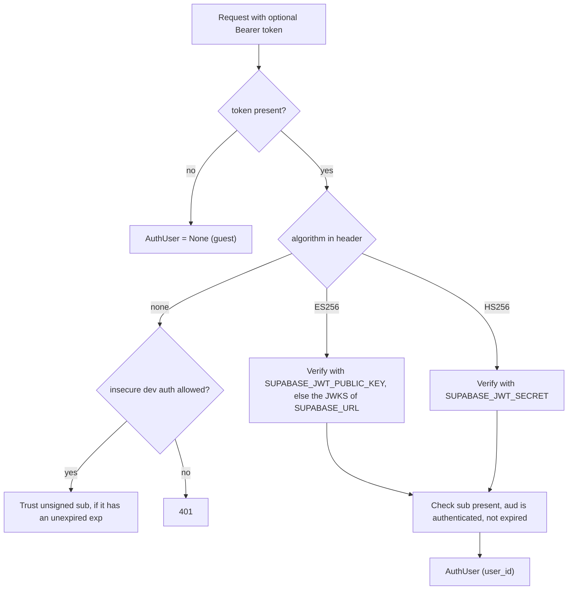
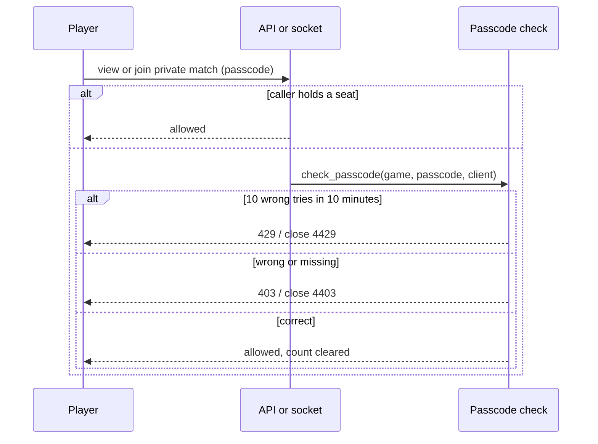

# Identity and Auth

This document explains who a caller is to the Traitorous backend: how Supabase JWTs are verified, how guests, signed-in players and the local development sign-in differ, how profiles supply public names, how seats are tied to identities, who counts as a match creator, how private-match passcodes and their wrong-guess limit work, and how personal data is stripped before it leaves the server. What each identity is then *allowed to see or do* is described in [Secrecy and Authorization](secrecy-and-authorization.md).

## Contents

- [Identity tiers](#identity-tiers)
- [Token verification](#token-verification)
- [Local demo and dev sign-in](#local-demo-and-dev-sign-in)
- [Profiles and display names](#profiles-and-display-names)
- [Seat ownership](#seat-ownership)
- [Creator and admin](#creator-and-admin)
- [Private match passcodes](#private-match-passcodes)
- [PII stripping](#pii-stripping)
- [Related docs](#related-docs)

## Identity tiers

Authentication is optional on most routes. The `get_current_user` dependency returns an `AuthUser` (`user_id`, `is_authenticated`) or `None`, and the rest of the backend treats `None` as a guest. Emails are never read from JWTs, stored in game/admin blobs, or used for identity matching.

| Tier | Token | How the backend treats it |
| :--- | :--- | :--- |
| **Guest** | none | Can play the sandbox and may hold a *guest seat* (a seat whose user id is not a Supabase UUID). Cannot command a seat held by a registered user. |
| **Signed in** | Supabase JWT | Holds seats strictly by `user_id` (UUID), can host matches, own saved sandboxes, and set a profile name. |
| **Local demo / dev** | unsigned token, local only | A throwaway identity for running without Supabase; accepted only when the backend allows insecure dev auth. |

A frontend request attaches the token through `authedFetch`; the server finds a player's seat and saved sandboxes from it, so a call without a token is treated as a stranger's.

## Token verification

`backend/security/auth.py` verifies Supabase-issued JWTs:

- **ES256** (asymmetric): verified with `SUPABASE_JWT_PUBLIC_KEY` when set, otherwise against the project's JWKS endpoint derived from `SUPABASE_URL` (the JWKS client is cached).
- **HS256** (symmetric): verified with `SUPABASE_JWT_SECRET`.
- Any other algorithm is rejected. A token needs a `sub`; an `aud` other than `authenticated` is rejected; expired or otherwise invalid tokens give 401.
- If no key, secret or Supabase URL is configured at all, a production server answers 500 ("authentication provider is not configured") rather than trusting anything.

**Identity comes only from the token.** No route reads an `X-User-Id` or `X-User-Email` header, and request bodies carry no `user_id` / `email` for admin actions. (A guest's `user_id` on create and join names the seat they claim, not who is calling.)

**Insecure dev fallback.** All unverified paths go through one helper, `decode_unverified_dev_token`, which requires an `exp` claim and refuses an expired one (401), so a demo token that leaks stops working and none lives forever. The unverified paths (an `alg: none` token, or a signed token with no matching key configured) are only taken when `ALLOW_INSECURE_DEV_AUTH=true`; `ENVIRONMENT=development` or `test` alone does not enable them. Even with the flag they stay off on Cloud Run (`K_SERVICE` or `K_REVISION` set) and under `ENVIRONMENT=production`, and the refusal is logged once at `ERROR`. Otherwise `alg: none` is rejected with 401. Treat this switch as a deployment-safety boundary: it must never be on in production.

The game WebSocket verifies the same token through the same function, but receives it in a first `auth` message rather than a header (see [the handshake](secrecy-and-authorization.md#websocket-handshake-and-broadcast)).

## Local demo and dev sign-in

When Supabase is not configured in the frontend (`VITE_SUPABASE_URL` and `VITE_SUPABASE_ANON_KEY` missing or placeholder), the auth modal falls back to a **local demo user** stored in `localStorage`. Its requests carry an unsigned `alg: none` token containing `sub` and an `exp` an hour ahead (no email), rebuilt on each request; the backend accepts it only under the dev-auth rule above.

On top of that, the Vite dev server (and only it, never a production build or Vitest) signs in a throwaway `Dev xxxx` player automatically, once per browser profile, so a local run can host and join immediately. Each browser profile or incognito window gets its own id, so two windows are two different players holding their own seats. `VITE_DEV_LOGIN=0` (the launcher's `--no-dev-login`) disables it to test the signed-out experience. See [Local Demo Sign-In](../guides/development.md#local-demo-sign-in).

With Supabase configured, sign-in is real Supabase Auth (email/password, magic link, OAuth), and the session's access token becomes the Bearer token.

## Profiles and display names

A player's public name is a **profile** (`public.profiles` keyed by UUID), completely separate from their private email. Email local-parts (`email.split("@")[0]`) and `@` characters in usernames are rejected across the database trigger (`handle_new_user`), backend API, and frontend forms. New users without a valid `display_name` default to `"Envoy"` and are prompted immediately upon sign-up or first sign-in to choose a public username.

Changing a name through the account profile endpoint (`PATCH /api/account/profile`) writes it to the in-memory `PROFILE_NAMES` map and upserts it into `public.profiles`, then broadcasts updated views for all games the user participates in, created, or acted on as admin. Centralized helpers in `backend/storage/profiles.py` (`resolve_display_name`, `resolve_participant_name`, `resolve_host_name`, `resolve_actor_name`, `ensure_profile_loaded`) resolve every registered UUID user strictly from `PROFILE_NAMES[user_id]` (defaulting to `"Envoy"` if missing), ignoring client-supplied or denormalized names. The lobby sync refreshes `PROFILE_NAMES` from the database on a short TTL (60 s), and `hydrate_summary_profiles` resolves each participant's `display_name` through `resolve_participant_name`.

## Seat ownership

A seat is a participant entry (`user_id`, `display_name`, `power`) keyed by power in the match summary.

- **Claiming** uses the token's `user_id` when present; without one, the request's `user_id` is used, which is what makes a *guest seat*. A caller cannot take two seats in the same match.
- **Holding** is judged by `caller_holds_seat`: exact `user_id` match (never email). A registered (UUID) seat can only be commanded with a valid token; a guest seat is open to token-less callers.
- **Leaving** checks the caller against the seat's holder (403 for someone else's seat, 401 for a UUID seat with no token). A sandbox's creator leaving closes the sandbox.

## Creator and admin

There is no separate admin role in a match: the **creator** is the admin. A caller is the creator when the summary's `creator_id` equals their `user_id` (UUID). Every route asks `security.creator.is_creator`, so the rule is written once; a missing value never matches another missing one. The default demo game and sandboxes are not restricted by `verify_admin_access` (and `DELETE /api/games/{game_id}` also skips the creator check for guest-created matches whose `creator_id` is `guest`). Admin routes (turn controls, rollback, board edits, clock) all call `verify_admin_access`, and the creator may also order for any seat. Admin actions store `actor_id` (UUID) in the game's admin log and resolve `actor` dynamically from `PROFILE_NAMES` (defaulting to `"Envoy"`) before leaving the server.

## Private match passcodes

A creator can make a match private with a passcode. The passcode is held in memory (`GAME_PASSCODES`) and persisted with the game; clients only ever see a `has_passcode` flag.

- Viewing, history, press, the game socket and joining all go through the same check. **Seated participants never need the passcode**; everyone else does.
- Comparison is constant-time and a match with no passcode matches nothing.
- **Wrong-guess limit**: wrong passcodes are counted per client address and match. After 10 wrong tries within 10 minutes the client gets 429 on HTTP (or WebSocket close `4429`) until the oldest try ages out, and the check happens *before* comparing, so a right guess cannot be found by continuing. A correct passcode clears the count; a missing one is refused but not counted, so a page that loads a private match before prompting does not burn a try.
- The client address is the **last** entry in `X-Forwarded-For` (the one Cloud Run's front end appends and a client cannot forge), falling back to the peer address.
- Counts live in memory, which is adequate because the service runs one instance.

## PII stripping

User emails are never stored in game or admin blobs, never read by the backend, and never returned to any client:

- `GameParticipant` and `AuthUser` carry no `email` field; legacy `email` keys in DB JSONB are ignored on read and stripped on save (`_serialize_summary_for_db`) and by migration.
- `created_by` is stripped from persisted summaries (`_serialize_summary_for_db`), and UUID `display_name` / `admin_log.actor` values are stripped from persisted state/history (`_serialize_state_for_db`).
- `sanitize_summary_for_viewer` resolves participant `display_name` (`resolve_participant_name`) and `created_by` (`resolve_host_name`) from `PROFILE_NAMES` by UUID (falling back to `"Envoy"` or `"Unknown host"`), and drops `board` except in `GET /api/games/mine`.
- `sanitize_admin_log` resolves `actor` from `actor_id` via `PROFILE_NAMES` (stripping `actor_id` and scrubbing legacy email actors to `"Envoy"`), and filters `acknowledged_by` to the viewer's own `user_id` and nameless tokens. Passcodes are never serialized to clients, only `has_passcode`.

## Related docs

- [Secrecy and Authorization](secrecy-and-authorization.md)
- [Database Setup and Row-Level Security](database.md)
- [Service Interactions](service-interactions.md)
- [System Overview](system-overview.md)
