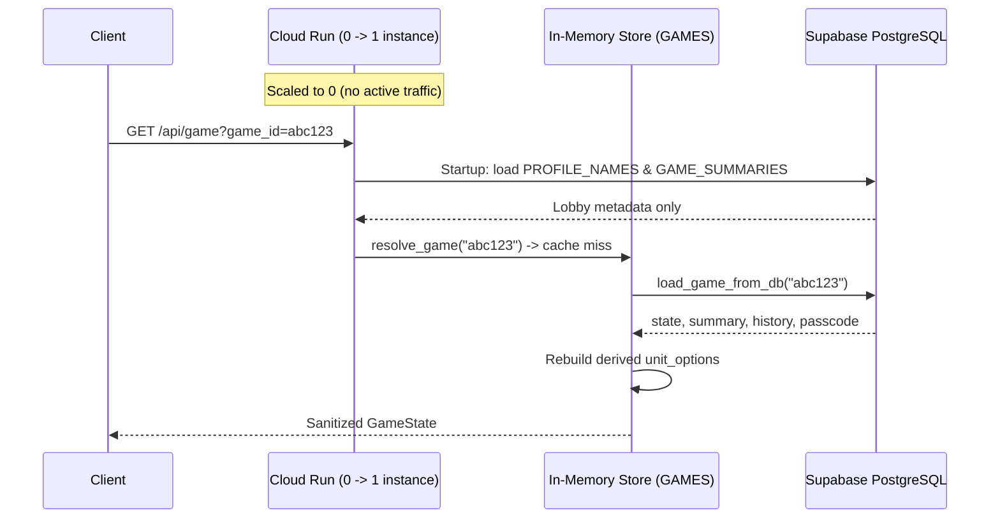
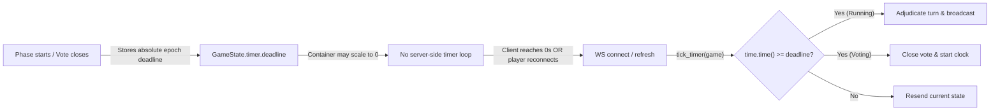

# Runtime & Infrastructure Model

Sloplomacy runs as a single-container FastAPI + static React service on Google Cloud Run (`min_instance_count = 0`, `max_instance_count = 1`). Because active game state and WebSocket rooms live in process memory while durable state lives in Supabase PostgreSQL, the runtime model directly shapes how games load, how WebSockets stay alive, and how phase deadlines expire without a background scheduler.

## Contents

- [Single-Instance Scale-to-Zero Model](#single-instance-scale-to-zero-model)
- [Cold Starts, Startup Hydration, and Lazy Loading](#cold-starts-startup-hydration-and-lazy-loading)
- [Why No Background Timer Runs (Phase Clock & Cloud Run)](#why-no-background-timer-runs-phase-clock--cloud-run)
- [WebSocket Heartbeats and Request Timeouts](#websocket-heartbeats-and-request-timeouts)
- [Deployment & Infrastructure Automation](#deployment--infrastructure-automation)
- [Related Docs](#related-docs)

---

## Single-Instance Scale-to-Zero Model

Google Cloud Run provisions the unified container with `min_instance_count = 0` and `max_instance_count = 1` ([`terraform/main.tf`](../../terraform/main.tf)):

- **Zero idle spend (`min_instance_count = 0`, `cpu_idle = true`)**: When no HTTP requests or WebSocket connections are active, Cloud Run scales the service down to zero containers and bills nothing. CPU is allocated only during active requests or open connections.
- **Single active instance (`max_instance_count = 1`)**: Active `GameState` objects, turn history, passcodes, and WebSocket room subscriptions live in process memory (`GAMES`, `GAME_HISTORY`, `ConnectionManager`). Running multiple concurrent containers against one Supabase database would let two instances mutate and overwrite the same game's JSONB row without seeing each other's in-memory state or WebSocket broadcasts.
- **Capacity guard**: To keep memory bounded inside the 512 MiB container (`memory = "512Mi"`), the in-memory store caps active games (`MAX_ACTIVE_GAMES = 250`) and evicts ephemeral private sandboxes, draft lobbies, and persisted completed games before rejecting new creations with HTTP 429.

---

## Cold Starts, Startup Hydration, and Lazy Loading

When a container starts (cold start), Cloud Run applies `startup_cpu_boost = true` to accelerate FastAPI boot, then runs the application lifespan hook ([`backend/main.py`](../../backend/main.py)):

1. **Startup hydration (lightweight)**: If Supabase persistence is enabled, the server loads `PROFILE_NAMES` and all `GAME_SUMMARIES` (lightweight lobby metadata and board previews, without full `GameState` or `GAME_HISTORY`).
2. **Lazy game loading**: Individual full `GameState`, `GAME_HISTORY`, and passcodes are **not** loaded on boot. They are loaded on demand by `resolve_game()` on HTTP requests (and directly via `load_game_from_db()` on `/ws/games/{game_id}` connects), then cached in `GAMES` for subsequent requests.
3. **Graceful shutdown flush**: On container shutdown, the lifespan `finally` block attempts to flush any game still marked in `UNSAVED_GAMES` to Supabase before closing the HTTP client.

---

## Why No Background Timer Runs (Phase Clock & Cloud Run)

Cloud Run with `cpu_idle = true` and `min_instance_count = 0` only grants CPU while a request or WebSocket connection is active. A server-side `asyncio` sleep loop or cron task waiting for a 20-minute Movement deadline would be throttled or killed when the container scales to zero.

Instead, the phase clock is **purely timestamp-driven and request-evaluated**:

- **Absolute Unix timestamps**: `PhaseTimer.deadline` stores an absolute UTC epoch timestamp (`now + seconds`), never a ticking countdown. It survives container restarts and scale-to-zero teardown unchanged.
- **Client-driven evaluation**: When a client's `PhaseTimerWidget` counts down to zero, it sends `{"type": "refresh"}` over the WebSocket. The server runs `tick_timer(game)` on receipt—checking `has_expired(timer, time.time())`—and either closes a finished duration vote or triggers `execute_adjudication(game)` for a running phase.
- **Expired clock while scaled to zero**: If all players disconnect and the container scales to zero before a deadline passes, nothing resolves at the exact deadline second. As soon as any player reconnects to `/ws/games/{game_id}` (which runs `tick_timer` on connect), loads `GET /api/game`, or sends `refresh`, the server sees `now >= deadline` and resolves the phase immediately.

---

## WebSocket Heartbeats and Request Timeouts

Cloud Run's request timeout is configured to `timeout = "3600s"` (60 minutes) in [`terraform/main.tf`](../../terraform/main.tf), allowing long-lived WebSocket sessions without premature proxy drops:

- **25-second client heartbeat**: Every connected WebSocket client sends `{"type": "ping"}` every 25 seconds. This keeps intermediate proxies and Cloud Run's HTTP/2 or WebSocket connection alive, and keeps the single instance warm while commanders are actively in a match.
- **Reconnection on 60-minute boundary**: If a socket hits Cloud Run's 3600-second maximum request lifetime or experiences a network drop, the client reconnects after a short fixed delay (`2s` on close, `3s` on instantiation error), re-authenticates via the first-message `auth` handshake, and receives the latest authoritative state (including any timer expiry checked on connect).

---

## Deployment & Infrastructure Automation

Infrastructure is provisioned declaratively in `terraform/` and deployed via `scripts/deploy.sh` / `scripts/deploy.ps1` or GitHub Actions. Every deploy target enforces `--max-instances 1` (or `max_instance_count = 1`) and routes structured JSON stdout logs into Cloud Logging log-based metrics and Cloud Monitoring dashboards.

---

## Related Docs

- [Consistency & Persistence](consistency-and-persistence.md)
- [Turn Clock Feature](../features/turn-clock.md)
- [Google Cloud Serverless Deployment Blueprint](../guides/google-cloud-deployment.md)
- [Observability & Dashboards](../guides/observability-and-dashboards.md)
