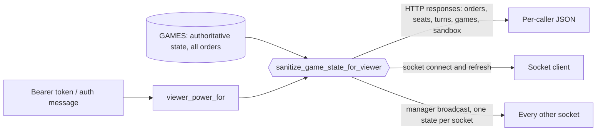
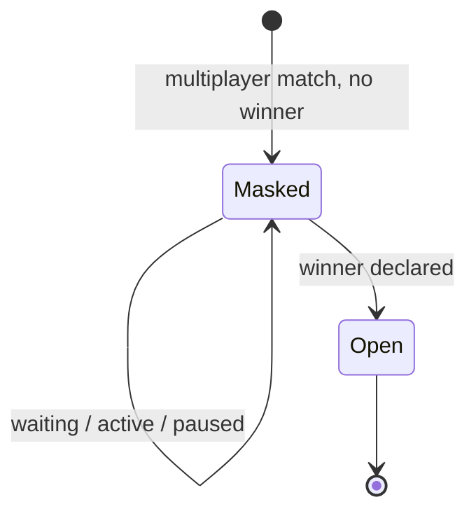
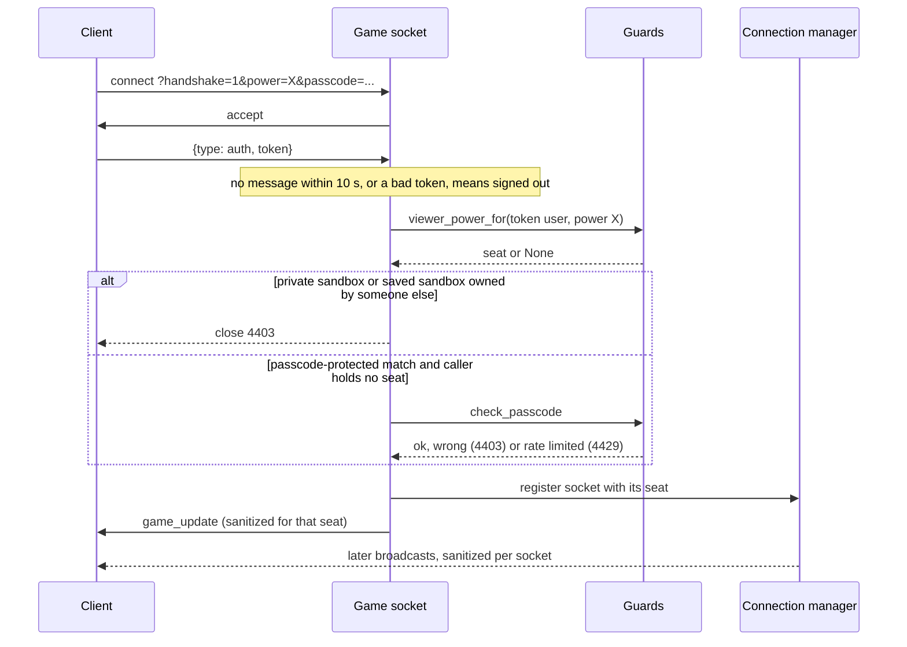

# Secrecy and Authorization

Sloplomacy is a simultaneous-move game, so the most important server guarantee is that a live match never leaks one power's orders (or anything derived from them) to another player. This document explains how that guarantee is built: how the server decides which seat a caller holds, the single sanitizer every outgoing game state passes through, how the WebSocket learns who is connecting, how press hides authors and private threads, and how each mutation is authorized per seat.

## Contents

- [The invariant](#the-invariant)
- [Who is the caller?](#who-is-the-caller)
- [The sanitizer: one exit for every game state](#the-sanitizer-one-exit-for-every-game-state)
- [Masking does not depend on status](#masking-does-not-depend-on-status)
- [A game with no summary fails closed](#a-game-with-no-summary-fails-closed)
- [WebSocket handshake and broadcast](#websocket-handshake-and-broadcast)
- [Per-seat mutation authorization](#per-seat-mutation-authorization)
- [Sandboxes and hypothetical work](#sandboxes-and-hypothetical-work)
- [Press visibility and anonymity](#press-visibility-and-anonymity)
- [Public summaries and PII](#public-summaries-and-pii)
- [Related docs](#related-docs)

## The invariant

> A caller sees hidden orders only for a seat they hold. The server finds that seat from their token; a `power` a client names is only a hint that picks among seats the caller really holds.

Everything below follows from it. Secrecy is enforced on the **server's outgoing side**: the authoritative `GameState` holds every power's orders, and nothing leaves the backend without being rebuilt for one specific viewer. The frontend is never trusted to hide anything. (The database's own RLS is a second, separate layer; see [Database](database.md).)

## Who is the caller?

Three small functions in `backend/security/secrecy.py` answer the question, all working from the match's participant list (`MultiplayerGameSummary.participants`, one entry per seat):

| Function | Question it answers |
| :--- | :--- |
| `caller_holds_seat` | Does this caller sit in power X's seat? Matches on user id, or on email (case-insensitive). With no token, only a *guest* seat (one whose id is not a Supabase UUID) counts as held. |
| `viewer_power_for` | Which power's hidden orders may this caller see? Honors the requested power only if the caller holds it; otherwise falls back to the first seat the signed-in caller holds; otherwise nobody (`None`). |
| `require_own_seat` | Raise 403 unless the caller holds that seat (live matches only). |

A `None` viewer power means "spectator or stranger": they see no one's orders. Identity itself (the token, guests, demo sign-in) is covered in [Identity and Auth](identity-and-auth.md).

## The sanitizer: one exit for every game state

`sanitize_game_state_for_viewer(game, viewer_power)` is the only way a live match's `GameState` reaches a client. For a live match it rebuilds, per viewer:

- **`orders`**: the viewer's own real orders, plus the *default* orders (the rulebook's "unordered units hold") for every other power. Foreign players look as though they have submitted nothing.
- **`issues`**: only validation issues belonging to the viewer's power.
- **`preview`**: re-adjudicated from the masked orders, so the stored preview (which reflects everyone's real orders) never leaves the server.
- **`unit_options`**: recomputed from the masked orders, so a foreign fleet's secret convoy never makes a destination "turn green".
- **`admin_log`**: actor emails are cut to the part before `@`.

Every HTTP response and WebSocket message that carries a live game goes through it.

For broadcasts, the connection manager keeps the seat each socket resolved at connect time and builds one masked state per *viewing power* within a broadcast (not one per socket: masking runs the adjudicator), so a single order submission produces a different payload for each seat and spectators share one. Sends run concurrently with a timeout, so one stalled client cannot delay the others; a socket that is slow or fails unexpectedly is dropped and logged.

## Masking does not depend on status

Masking applies whenever the game is a **multiplayer match** and has no winner. It deliberately ignores `status`:

- A lobby nobody has joined yet is `waiting`, yet the first player's orders are already theirs alone.
- A match that dropped back to one player is also `waiting` and still masks.
- Once a winner exists, the match is over, nothing is hidden any more, and only email stripping on the admin log still applies.
- Solo sandboxes and the default demo game are not multiplayer matches, so they are returned as-is.

## A game with no summary fails closed

Seats, owner and passcode live in a game's `MultiplayerGameSummary`. The shared default board (`proto_1901`) and a member's private `sbx_` sandbox copy have none by design. Any other game held in memory without one (`lacks_summary`) is a game with nothing on record about who may enter or administer it, so every check treats it as a **live match nobody may touch**, never as an open one: `is_multiplayer_match` is true (orders stay masked), `verify_admin_access`, `verify_power_authorization`, `require_view_access` and `require_own_seat` all refuse, and no one holds a seat. The same goes for a saved game whose stored summary cannot be read: it is not loaded at all (see [Lobby Sync & Eviction](consistency-and-persistence.md#lobby-sync--eviction)).

## WebSocket handshake and broadcast

Browsers cannot set an `Authorization` header on a WebSocket, and a token in the URL would land in request logs. So the game socket (`/ws/games/{game_id}`) identifies the caller with a first message instead:

Close codes `4004` (no such game), `4403` (not allowed) and `4429` (too many wrong passcodes) are ones the client must not reconnect after. A socket opened without `?handshake=1` is simply a stranger's. The lobby socket (`/ws/lobby`) never carries game state, only email-stripped public summaries.

## Per-seat mutation authorization

Reading is only half of it. Every mutation is checked against the caller's own seat:

| Check | Used by | Rule |
| :--- | :--- | :--- |
| `verify_power_authorization` | order submission, batch updates, confirmation, finalize, unfinalize | In a live match the caller must be the creator, or hold that power's seat (by id or email). A seat held by a registered user rejects an unauthenticated call with 401; a wrong user gets 403. |
| `require_timer_player` | timer votes, extension requests, ready-up | Caller must hold that power's seat in an active match (no creator override). |
| `verify_admin_access` | admin turn controls, board overrides, force-resolve, some sandbox operations | Only the match creator (matched by `creator_id`, or by `created_by` email), from the verified token alone. Sandboxes and the default demo game are open; an unknown game is 404, no token is 401, a non-creator is 403, and a game with no summary is 403 for everyone. |
| `require_own_seat` | reads and actions that would reveal a seat's orders | 403 unless the caller holds the seat. |
| `require_view_access` | viewing a private match | Seated participants pass; anyone else needs the passcode (see [Identity and Auth](identity-and-auth.md#private-match-passcodes)). |

Who is acting is always the verified token. The server reads no `X-User-Id` / `X-User-Email` header and no `user_id` / `email` in an admin request body: they are not even declared, so a client cannot claim to be the host, put another name in the admin log, or dismiss another player's admin warning. `POST /api/admin/acknowledge` records the token's user id, email and the seats that token holds; a caller with no token is a guest and can only speak for a seat claimed without an account (`caller_holds_seat` with no user).

The creator is allowed to act for any seat in `verify_power_authorization`, which is how admin tools work, but the sanitizer still shows a creator only the orders of a seat they actually hold.

## Sandboxes and hypothetical work

Hypothetical orders never run on a shared match: `reject_on_multiplayer_match` answers 409 and directs the player to a private sandbox. A private sandbox copied from a match is built from `sanitize_game_state_for_viewer(source, viewer_power)`, so it contains only what that seat could already see, and it is registered against the seat it came from. A saved or private sandbox is owner-only: `saved_sandbox_guard` is a router-level dependency that inspects every route's `game_id` (path or query), so a new endpoint cannot forget the check. A guest's saved sandbox stays open, in the same way a guest's seat does. History and exit of a private sandbox are exempt so it can always be closed.

## Press visibility and anonymity

Press (chat) has its own rules in `backend/security/press.py`, applied when messages are read and when they are pushed to sockets:

- **Public** messages (no recipients) are readable by every seated player. **Private** messages are readable by the sender and the recipients only.
- **Anonymous** messages keep the same readers, but the author is hidden from everyone except themself, the host included. In a group thread the recipients list is widened to the whole thread so the missing name is not deducible; a one-to-one anonymous message keeps just its recipient.
- **Per-viewer numbering**: each player is sent `seq` numbers 1, 2, 3... of the messages *they* can read, so gaps never reveal how much private press others exchange.
- **Reveal at game over**: once there is a winner, every seated player reads every message and sees every author, with the game-wide numbering.
- **Spectators** (no seat) read only the public box, numbered by its own public counter. Anonymous public authors stay hidden until reveal, private messages are never readable (even after game over) and spectators cannot send.

## Public summaries and PII

Lobby summaries go to everyone, so `sanitize_summary_for_viewer` returns a copy with every participant email blanked, display names reduced to the part before `@` (preferring the profile name), the host shown by public name (never an email), and the board preview dropped unless the caller is asking for their own games (`/api/games/mine`). Details of how identity data is stored live in [Identity and Auth](identity-and-auth.md#pii-stripping).

## Related docs

- [Identity and Auth](identity-and-auth.md)
- [Service Interactions](service-interactions.md)
- [Database Setup and Row-Level Security](database.md)
- [System Overview](system-overview.md)
