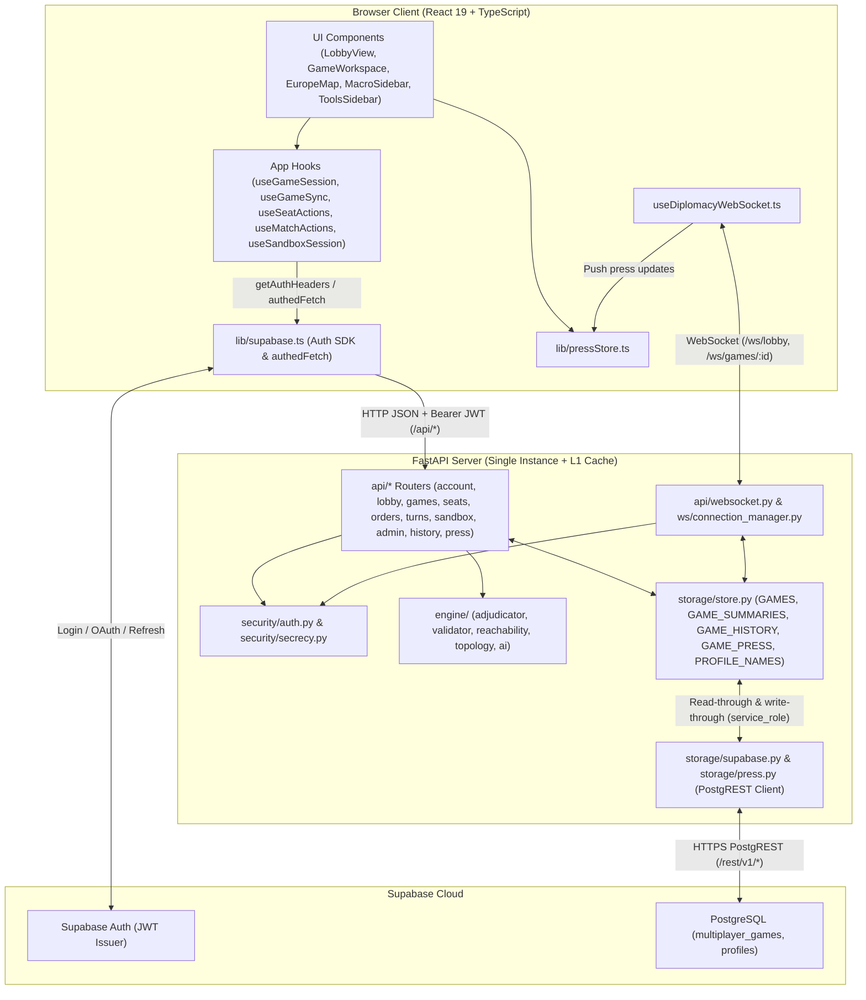
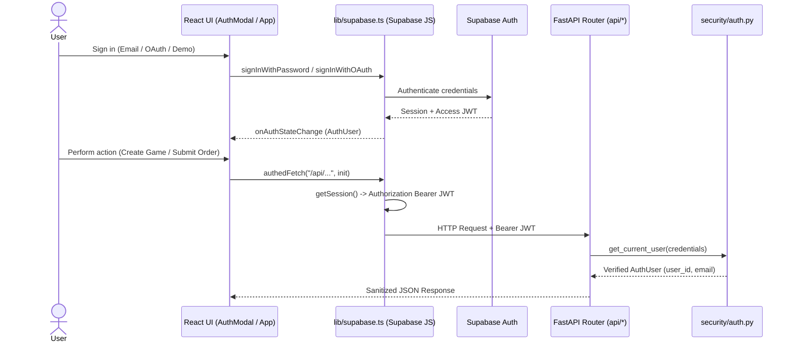
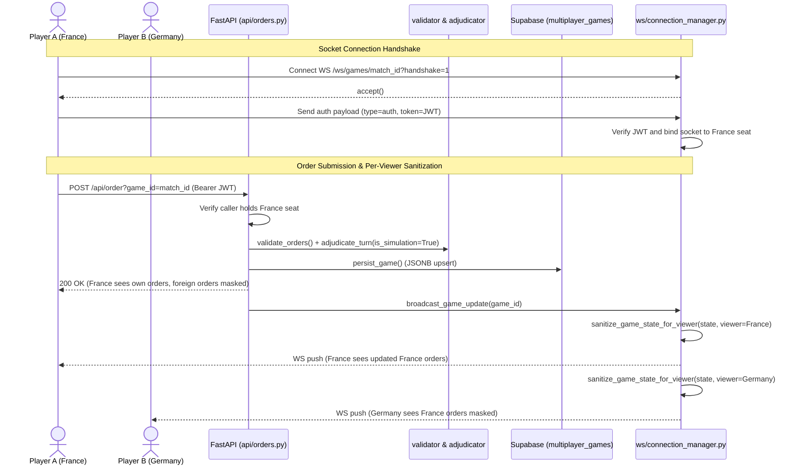
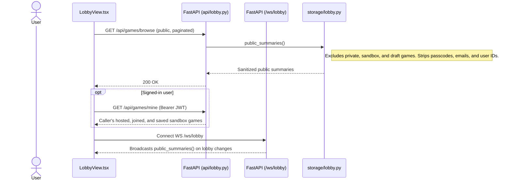
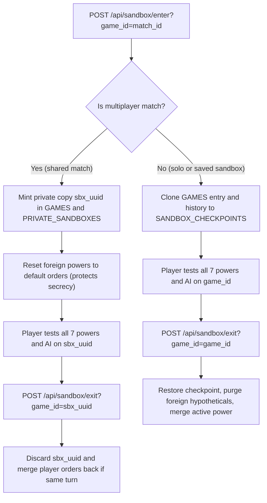

# Service Interactions & Frontend Communication

This document explains how the React frontend interacts with **Supabase Auth** and the **FastAPI backend** (REST APIs, WebSockets, L1 cache, and Sandbox isolation).

For the underlying PostgreSQL tables and Row-Level Security (RLS) policies, see [Database Setup & Row-Level Security](database.md).

---

## 1. Frontend-to-Services Topology

The React frontend (`frontend/src/`) talks to **two** external interfaces:
1. **Supabase Auth (`frontend/src/lib/supabase.ts`)**: Used *only* for user authentication (email/password, magic link OTP, Google/Discord OAuth, session refresh, and updating auth user metadata).
2. **FastAPI Backend (`backend/main.py` & `backend/api/*`)**: Serves all game state, lobby browsing, order submission, adjudication, turn history, press, sandboxing, and real-time WebSockets. In production (Cloud Run), FastAPI also serves the built Vite SPA static assets.

### In-Memory L1 Cache vs. PostgreSQL

- **Memory is authoritative for loaded games**: `GAMES` (`backend/storage/store.py`) acts as an in-memory L1 cache so order validation, reachability, and simulation run with sub-millisecond latency.
- **Startup hydration**: On FastAPI startup (`lifespan` in `backend/main.py`), the server loads `PROFILE_NAMES` and `GAME_SUMMARIES` from Supabase so the lobby is immediately populated without loading every full `game_state` into memory.
- **Lazy game loading**: When a player opens or connects to a `game_id` not yet in `GAMES`, the backend loads it from `multiplayer_games`, rebuilds derived `unit_options` (which are stripped before DB storage to save space), and caches it in `GAMES`.
- **Single-instance invariant**: Because `GAMES` and WebSocket rooms live in process memory, Cloud Run runs with `--max-instances 1`.

---

## 2. Key Service Interaction Flows

### A. Authentication & Authenticated API Call

### B. Live Match Order Submission & WebSocket Broadcast

Because browsers cannot attach custom `Authorization` headers to a WebSocket upgrade request—and putting a JWT in the query string would leak it into server access logs—the game WebSocket uses a **post-connect auth handshake** (`?handshake=1`).

### C. Lobby Discovery & Public vs. Private Games

### D. Sandbox Isolation ("War Room" Mode)

Sandbox behavior differs depending on whether the player is in a **shared multiplayer match** or a **solo/saved sandbox**:

