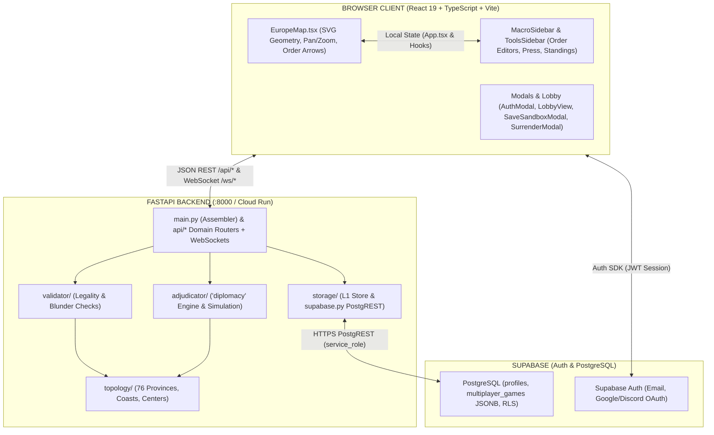

# System Overview & Architecture

The **Diplomacy 1901 Tactical Engine & Multiplayer Chancellery** is designed as a server-authoritative, real-time tactical workspace for standard 7-player *Diplomacy*. It pairs a lightweight, deterministic Python adjudication backend with an interactive, vectorized React client, a Supabase Auth/PostgreSQL persistence layer, and scale-to-zero Google Cloud Run hosting.

---

## Architectural Principles

1. **Stateless-Capable Adjudication with PostgreSQL Persistence**:
   - The adjudication engine treats each resolution step as a pure functional transition:
     $$\text{State}_{t+1} = \text{Adjudicate}(\text{State}_t, \text{Orders}_t)$$
   - Adjudication adheres strictly to official DATC rules via the Python `diplomacy` package.
   - When configured, game state is persisted to Supabase PostgreSQL (`public.multiplayer_games`) as JSONB on every mutation, while the FastAPI in-memory dictionary operates as a sub-millisecond L1 cache.
   - Survives Cloud Run container scale-to-zero teardown and multi-instance restarts with zero state loss.

2. **Client-Side Real-Time Responsiveness**:
   - Order validation, reachability checks, and tactical previews are rendered on the client canvas at 60 FPS without requiring round-trip network hops for intermediate dragging.
   - Live WebSocket synchronization connects commanders in the same match room or lobby.

3. **Zero Idle Cloud Spend**:
   - Unified single-container architecture deployed on Google Cloud Run with `--min-instances 0` allows the server to scale completely to zero when inactive, avoiding persistent database or compute fees.

---

## High-Level Topology

For detailed Mermaid diagrams, see [Database Setup & Row-Level Security](database.md) and [Service Interactions & Frontend Communication](service-interactions.md).



---

## State Synchronization Flow

The game client communicates with the server via scoped HTTP JSON endpoints:

```
User Action (e.g. Move Unit)
             │
             ▼
  App.handleUpdateOrder()
             │
             ▼
POST /api/order?game_id={id} { order: Order }
             │
             ├──► 1. Update order in GAMES[game_id].orders
             ├──► 2. Execute validator.validate_orders()
             ├──► 3. Execute adjudicator.adjudicate_turn(..., is_simulation=True)
             ├──► 4. Persist to Supabase storage/supabase.py (JSONB upsert into public.multiplayer_games)
             └──► 5. Return updated GameState
             │
             ▼
App.applyServerState(st)
             │
             ├──► Update units and orders in React state
             ├──► Update ValidationIssue list in MacroSidebar
             └──► Re-render SVG order arrows and simulation markers
```

---

## Sandbox Checkpointing Workflow

Hypothetical Mode lets commanders play out multi-power and multi-turn "what-if" branches without affecting real game state. A multiplayer match is shared, so each player works on an ephemeral private branch:

1. **Enter**: `POST /api/sandbox/enter?game_id={match}` creates (or resumes, if still on the same live turn) a private copy under its own `sbx_` game id in `PRIVATE_SANDBOXES` (`PRIVATE_SANDBOX_TURNS`), with every other power on default orders so it cannot reveal their plans. The live match is not touched.
2. **Explore & Step Turns Forward**: Order drafts, power switching, simulations, and `POST /api/adjudicate` turn steps use the `sbx_` id. The branch is private to that seat (`saved_sandbox_guard` rejects other callers with `403`), never saved or listed, and the real match carries on independently.
3. **Exit & Turn-End Cleanup**: `POST /api/sandbox/exit?game_id={sbx id}` returns the real match with the player's real orders untouched (never carrying hypothetical orders back to the real match). The `sbx_` branch stays available to re-enter during the same live turn (unless the seat is vacated) and is erased by `clear_ephemeral_sandboxes_for` once the live turn resolves or is reset by an admin.

A solo or saved sandbox has one player, so it stays on its own game id:

1. **Enter Sandbox (`POST /api/sandbox/enter?game_id={id}`)**:
   - The backend checkpoints `GAMES[game_id]` and `GAME_HISTORY[game_id]` in `SANDBOX_CHECKPOINTS[game_id]` / `SANDBOX_HISTORY_CHECKPOINTS[game_id]`, and restores `SANDBOX_BRANCHES[game_id]` if the real board is still on the same turn.
2. **Hypothetical Exploration**:
   - The commander can switch perspectives to any Great Power, plot hypothetical moves, toggle between `All Moves` and `Selected Nation`, and step hypothetical turns forward via `POST /api/adjudicate`.
3. **Exit Sandbox (`POST /api/sandbox/exit?game_id={id}`)**:
   - The hypothetical branch is stashed in `SANDBOX_BRANCHES[game_id]` and the pre-sandbox checkpoint and real turn history are restored unchanged.
   - The cleaned real state is persisted back to Supabase PostgreSQL, and `SANDBOX_BRANCHES[game_id]` clears whenever a real turn resolves or a scenario resets.
