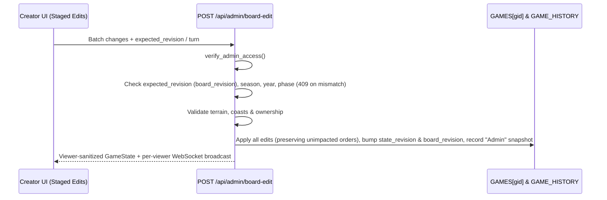

# Admin & Creator Controls

Match creators (hosts) and sandbox owners have administrative tools to correct misclicks, roll back turns, adjust the clock/finalizations, and edit the board directly. Every admin mutation in a multiplayer match is authorized by JWT creator identity, audited in an append-only action log, and broadcast to all connected players.

## Contents

- [Authorization & Scope](#authorization--scope)
- [Turn & Clock Controls](#turn--clock-controls)
- [Atomic Board Editing (`board-edit`)](#atomic-board-editing-board-edit)
- [Audit Log, History Snapshots & Player Acknowledgement](#audit-log-history-snapshots--player-acknowledgement)
- [Invariants](#invariants)
- [Related Docs](#related-docs)

---

## Authorization & Scope

- **Multiplayer matches**: `verify_admin_access()` ([`backend/security/secrecy.py`](../../backend/security/secrecy.py)) requires a valid Supabase JWT whose `user_id` matches the game's `creator_id` (or `created_by` email fallback when `creator_id` is unset). Guests and non-creator players receive `401` or `403`.
- **Sandboxes**: Solo sandboxes allow admin actions locally without creator restrictions (except private `sbx_*` hypothetical branches, which belong only to their owning player).
- **Test seeding**: `POST /api/test/seed` is gated behind `ENABLE_TEST_SEED_ENDPOINT=1` (or `true`) or insecure dev-auth environments (`403` in production).

---

## Turn & Clock Controls

From the Admin Turn & Clock sidebar (`AdminTurnClockSidebar.tsx`) and settings menu ([`backend/api/admin.py`](../../backend/api/admin.py)):

- **Rollback (`POST /api/admin/rollback`)**: Reverts the board to a selected snapshot index in `GAME_HISTORY`, pops newer snapshots, clears `winner`, resets `timer`, and records a rollback entry.
- **Set Turn (`POST /api/admin/set-turn`)**: Jumps the game's `season`, `year`, and `phase` (useful for testing or correcting phase state), clears ephemeral sandboxes, restarts the timer if active, and refreshes diagnostics and simulation preview.
- **Force Adjudicate (`POST /api/adjudicate`)**: Resolves the current phase immediately without waiting for remaining players or the phase clock.

---

## Atomic Board Editing (`board-edit`)

The Direct Board Editor (`AdminDirectEditSidebar.tsx`) lets a creator stage multiple changes on the map—moving/teleporting units, spawning units, destroying units, and reassigning province ownership—and commit them in a single atomic batch (`POST /api/admin/board-edit`, [`backend/api/admin_units.py`](../../backend/api/admin_units.py)):

- **Optimistic concurrency**: `expected_revision` is checked against `GameState.board_revision`, which increments on board/turn changes (adjudication, rollback, `set-turn`, `board-edit`, scenario load) rather than player order submissions or finalizations. If a board/turn change occurred while the creator was staging edits, the server rejects the batch with `409 Conflict` so nothing is silently overwritten; concurrent player orders on unimpacted units are preserved.
- **Terrain rules**: Armies cannot be placed at sea, fleets cannot be placed inland, and multi-coast provinces (`STP`, `SPA`, `BUL`) normalize or require valid coasts.

---

## Audit Log, History Snapshots & Player Acknowledgement

Every board edit or turn override records an `AdminActionLogEntry` (`id`, `timestamp`, `actor`, `season`, `year`, `phase`, `summary_lines`, `acknowledged_by`) on `GameState.admin_log` ([`backend/api/admin_utils.py`](../../backend/api/admin_utils.py)):

- **Consolidated `"Admin"` history snapshot**: Consecutive admin board edits on the same turn are consolidated into a single `"Admin"` entry in `GAME_HISTORY` with synthesized `BUILD` / `DISBAND` / `MOVE` diff orders so the Turn History view clearly highlights what the creator changed.
- **Player warning & acknowledgement**: Seated players see a warning modal (`AdminActionWarningModal.tsx`) when unacknowledged admin actions exist, and acknowledge them via `POST /api/admin/acknowledge`.

---

## Invariants

- **Never leak emails**: `resolve_admin_actor()` stores display names (or email local-parts as a last resort), never raw email addresses, in `admin_log`. `acknowledged_by` stores ids and emails, but is filtered per viewer on the way out (`security/secrecy.py`), so one player never sees another's.
- **Ephemeral sandbox cleanup**: Any turn rollback or set-turn clears attached `sbx_*` hypothetical branches (`clear_ephemeral_sandboxes_for`) so no player's "what-if" branch survives across a reset.
- **Press is untouched**: Admin rollbacks and board edits never modify or delete `GAME_PRESS`.

---

## Related Docs

- [Consistency & Persistence](../architecture/consistency-and-persistence.md)
- [Secrecy & Authorization](../architecture/secrecy-and-authorization.md)
- [Game Over & Turn History](game-over-and-history.md)
