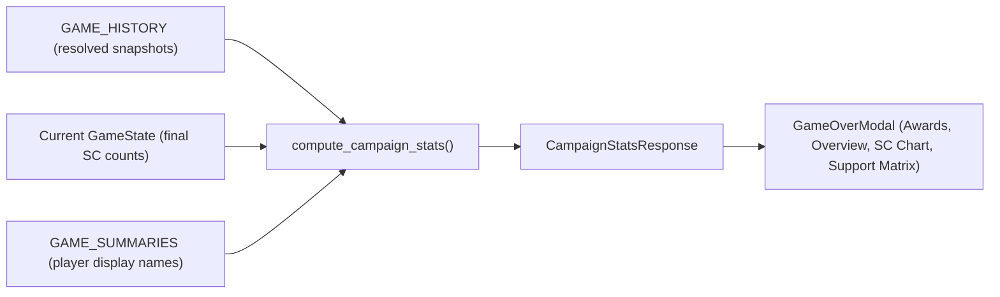

# Campaign Statistics & War Ledger

The Campaign Statistics & War Ledger aggregates tactical, diplomatic, and logistics metrics across a game's resolved turns and awards campaign superlatives. It powers the tabbed War Ledger inside the Game Over modal and is accessible via a dedicated read-only API endpoint.

## Contents

- [When and How Stats Are Computed](#when-and-how-stats-are-computed)
- [Per-Power Metrics & Support Matrix](#per-power-metrics--support-matrix)
- [Supply Center Timeline](#supply-center-timeline)
- [Campaign Awards](#campaign-awards)
- [Invariants & Access Control](#invariants--access-control)
- [Related Docs](#related-docs)

---

## When and How Stats Are Computed

Campaign stats are computed **on demand** by `compute_campaign_stats()` ([`backend/engine/stats.py`](../../backend/engine/stats.py)) when a client requests `GET /api/history/stats?game_id={id}` ([`backend/api/history.py`](../../backend/api/history.py)):

1. The backend resolves the game and lazy-loads its full campaign `GAME_HISTORY` from `public.game_phases` (skipping `"Admin"` override snapshots when counting tactical orders), caching the resulting `CampaignStatsResponse` in `STATS_CACHE` keyed by `(phase_count, board_revision, winner, player_names, surrendered_powers, press_count)`.
2. Each resolved phase is replayed/inspected against its adjudication outcome to accumulate per-power counters and Supply Center timeline points.
3. The resulting `CampaignStatsResponse` is returned to the frontend `useCampaignStats` hook, which feeds the Overview table, SC Timeline chart, Diplomatic Support Matrix, and Awards row inside `GameOverModal`.

---

## Per-Power Metrics & Support Matrix

For every Great Power (`PowerStats`), the engine tracks:

- **Territory & Logistics**: `peak_scs`, `current_scs`, `scs_captured`, `scs_lost`, `units_built` (`armies_built`, `fleets_built`), `builds_waived`, `units_disbanded`, `units_destroyed`, `is_eliminated`, `is_surrendered`.
- **Tactical**: `moves_succeeded`, `moves_bounced`, `move_success_rate`, `self_bounces`, `enemies_dislodged`, `convoys_executed`, `foreign_convoys`.
- **Diplomacy**: `foreign_supports_given`, `foreign_supports_effective`, `foreign_supports_received`, `supports_cut`, `press_messages_sent` (counted after game over from `GAME_PRESS`, including public, private, and anonymous messages), plus directional `support_matrix` (`supporter -> beneficiary -> count`) and `attack_matrix` on `CampaignStatsResponse`.

---

## Supply Center Timeline

`sc_timeline` records a sequence of `SCTimelinePoint` entries starting from the initial board (before the first resolved phase) and recording a checkpoint after each resolved snapshot in `GAME_HISTORY` (deduplicated by `(season, year)` unless a winning turn changes counts), plus the current live `GameState` if it differs. The frontend renders this as a multi-line chart showing each power's rise and fall toward the 18-SC victory threshold.

---

## Campaign Awards

`_compute_awards()` selects up to **4** `CampaignAward` leaders (requiring a strictly positive count; ties go to canonical `Power` order):

- **Primary awards**:
  - **Kingmaker** (`kingmaker`): Most foreign supports given
  - **Iron Chancellor** (`iron_chancellor`): Most enemy units dislodged
  - **Grand Admiral** (`grand_admiral`): Most convoys executed
  - **Attrition Magnet** (`attrition_magnet`): Most units lost & disbanded
  - **Silver Tongue** (`silver_tongue`): Most press messages sent (public, private, and anonymous; awarded only after game over)
- **Fallback awards** (used if fewer than 4 primary awards have a positive leader):
  - **Imperial Expansionist** (`expansionist`): Most Supply Centers captured
  - **War Industrialist** (`industrialist`): Most units commissioned
  - **Master Tactician** (`tactician`): Most successful offensives

---

## Invariants & Access Control

- **Resolved turns only**: Stats never read unrevealed live-turn `orders` from `GameState`, so inspecting `/api/history/stats` mid-match cannot leak another player's current-turn plans. Similarly, `press_messages_sent` and the `silver_tongue` award are only populated once `game.winner` is set, so mid-match stats calls never leak private or anonymous press volume.
- **View access**: `_resolve_accessible_history()` enforces `require_view_access` (including passcode checks on private matches) and rejects ephemeral `sbx_*` private sandboxes (`404`).

---

## Related Docs

- [Game Over & Turn History](game-over-and-history.md)
- [Data Models & Schemas](../architecture/data-models.md)
- [REST API Reference](../backend/api-reference.md)
