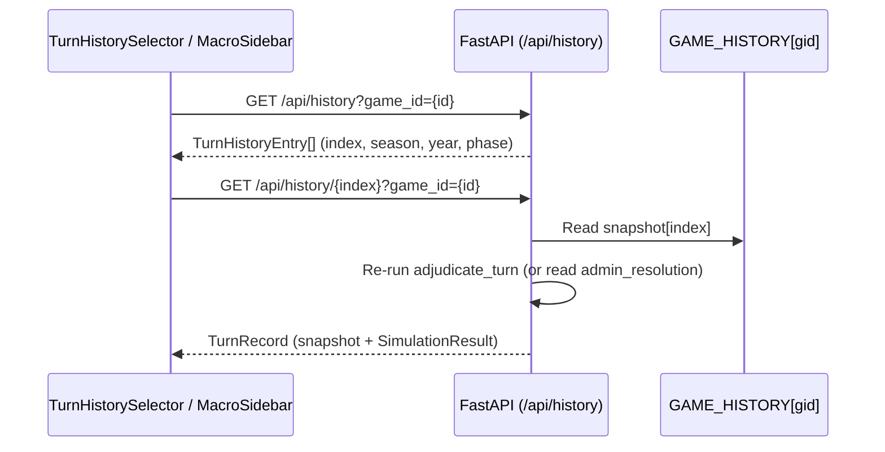

# Game Over & Turn History

Sloplomacy preserves a rolling log of resolved phases (`GAME_HISTORY`), lets players inspect any past turn's board, orders, and territory/ownership changes, and transitions cleanly into a read-only Game Over state with the War Ledger when a Great Power reaches 18 Supply Centers.

## Contents

- [Victory, Surrender & Game-Over Flow](#victory-surrender--game-over-flow)
- [Resolved Turn History (`GAME_HISTORY`)](#resolved-turn-history-game_history)
- [Inspecting Past Turns & Ownership Changes](#inspecting-past-turns--ownership-changes)
- [Invariants](#invariants)
- [Related Docs](#related-docs)

---

## Victory, Surrender & Game-Over Flow

- **Solo victory (18+ SCs)**: After adjudication, if any Great Power owns 18 or more Supply Centers, `GameState.winner` is set, `GameState.timer` is cleared (`null`), `sync_summary()` marks the match `status = "completed"` with `completed_at`, and further order/finalization mutations are rejected (`409`).
- **Surrender**: A player can surrender their seat via `POST /api/games/{game_id}/surrender` (with a confirmation modal). Surrendered powers are added to `surrendered_powers`, their orders default to Hold/Disband/Waive, and they no longer block turn finalization or phase-clock votes.
- **Game Over modal**: When `gameState.winner` becomes set (or when a seated participant reopens a completed match they have not yet acknowledged via `game_over_seen_at`), `useGameOverModal` opens `GameOverModal`, displaying the victor, final SC standings, and the tabbed War Ledger fetched from `/api/history/stats`.

---

## Resolved Turn History (`GAME_HISTORY`)

Just before each phase adjudicates (`execute_adjudication`), the backend appends a deep copy of the pre-resolution `GameState` (with `preview`, `issues`, and `timer` stripped) to `GAME_HISTORY[game_id]`, capped at the **last 30 snapshots**. Admin board overrides and turn edits also record a consolidated `"Admin"` snapshot with `admin_resolution` metadata and an `AdminActionLogEntry`.

History is stored in Supabase's `history` JSONB column on `multiplayer_games` and uploaded only when `HISTORY_UNSAVED` is marked dirty (adjudication, rollback, or admin edit).

---

## Inspecting Past Turns & Ownership Changes

Players can switch between the live turn and any resolved turn via `TurnHistorySelector` (and the header `TurnChronicle` / mobile peek):

- **Read-only board & arrows**: Selecting a past turn renders that turn's units, ownership, and resolved order arrows (succeeded, bounced, cut, dislodged) on `EuropeMap`, locking live order controls in `MacroSidebar`.
- **Ownership & territory changes**: `HistoryOwnershipSection` (using `historyOwnershipChanges.ts` and `historyTurnLog.ts`) compares `turn.ownership` against `turn.resolution.new_ownership` on the selected `TurnRecord` to list Supply Center captures/losses and territory shifts, as well as admin-applied ownership changes.
- **Turn log**: Summarizes the phase's movements, retreats, builds, and disbands alongside any admin action log entries.

---

## Invariants

- **Private sandboxes have no shared history**: `/api/history` and `/api/history/{index}` reject `sbx_*` private sandbox IDs with `404` so a player's live-turn private branch is never exposed through history endpoints.
- **Press is independent of history**: Chat messages live in `GAME_PRESS` (`press` column), never inside `GAME_HISTORY` snapshots, so a rollback or history cap never erases diplomatic messages.

---

## Related Docs

- [Campaign Statistics & War Ledger](campaign-stats-and-awards.md)
- [Admin & Creator Controls](admin-and-creator-controls.md)
- [Consistency & Persistence](../architecture/consistency-and-persistence.md)
