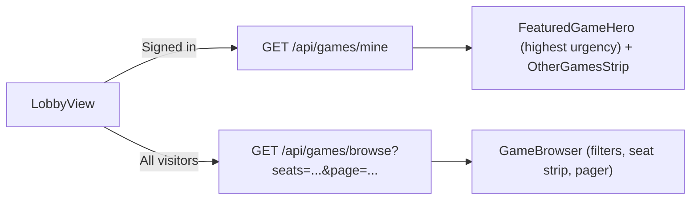

# Lobby Browse, Filtering & Featured Games

The lobby lets players discover public matches, resume their own active campaigns, host new games, or join a private campaign by room code and passcode. It separates a signed-in player's personal games ("My Games" + Featured Hero) from the public game browser, while keeping private games, sandboxes, and drafts out of public listings.

## Contents

- [Public Browser vs. Personal Games](#public-browser-vs-personal-games)
- [Featured Game Hero & Urgency Sorting](#featured-game-hero--urgency-sorting)
- [Filtering, Sorting & Paging](#filtering-sorting--paging)
- [Mini-Map Previews & Joining Seats](#mini-map-previews--joining-seats)
- [Invariants](#invariants)
- [Related Docs](#related-docs)

---

## Public Browser vs. Personal Games

Two separate endpoints power the lobby ([`backend/api/lobby.py`](../../backend/api/lobby.py), [`backend/storage/lobby.py`](../../backend/storage/lobby.py)):

- **Public browser (`GET /api/games/browse`)**: Returns paged, filtered `LobbyGameRow` entries for **public, non-sandbox, non-draft, non-completed** matches. No authentication is required to browse public listings.
- **My Games (`GET /api/games/mine`)**: Requires authentication (`401` for guests) and returns every game where the signed-in user holds a seat or is the creator—including private campaigns, completed games, and saved sandboxes.

---

## Featured Game Hero & Urgency Sorting

When a signed-in player has games in `My Games`, the lobby surfaces one **Featured Game Hero** at the top ([`frontend/src/utils/heroGame.ts`](../../frontend/src/utils/heroGame.ts)) and places the rest in a secondary strip:

- **Urgency tiers**: Games are classified into `'your-move'` (active match where the player's power still needs to finalize or vote), `'waiting'` (waiting for others or lobby), `'sandbox'` (saved sandbox), and `'finished'` (completed).
- **Tie-breaking**: Within `'your-move'`, games with the earliest running deadline come first; otherwise games sort by most recent update.
- **Hero action**: The hero card renders a live `MiniMap` preview, deadline/finalization summary, and a direct Resume action, while Leave remains tucked inside a secondary actions menu.

---

## Filtering, Sorting & Paging

The public browser supports server-side filtering and paging (`page_size` default `10`, max `50`):

- **Seat availability (`seats`)**: `'open'` (default—at least one unclaimed seat and not completed), `'full'`, or `'all'`.
- **Search (`search`)**: Case-insensitive match on game name, room code, or host display name.
- **Open countries (`countries`)**: Comma-separated list of Great Powers; matches games where **every** listed power is still unclaimed.
- **Turn filter (`turn_op`, `season`, `year`)**: Filter `'at'`, `'before'`, or `'after'` a given year (and optional season: `Spring`, `Fall`, `Winter`).
- **Sorting**: Open games and more recently updated games surface first, with consistent pagination metadata (`total`, `page`, `page_size`).

---

## Mini-Map Previews & Joining Seats

Each `MultiplayerGameSummary` and `LobbyGameRow` carries a compact `BoardPreview` (`board`: province ownership + non-dislodged units) maintained by `sync_summary()`. This lets `MiniMap.tsx` render an accurate map thumbnail in the Featured Hero, Other Games strip, and expanded browser rows without fetching full `GameState` payloads.

Expanding a public row shows its 7-power seat strip (`mine`, `free`, or `taken`), allowing a player to claim an open seat directly from the browser. Private campaigns are never listed here; players join them via the "Join with code" dialog and supply the room passcode (`403` on wrong passcode, with rate limiting on repeated guesses).

---

## Invariants

- **Privacy of listings**: Private matches (`is_private`), drafts (`is_draft`), sandboxes (`is_sandbox`), and completed games never appear in `GET /api/games/browse`.
- **No PII in public rows**: Public rows expose only display names (never email addresses or raw user IDs of other players).

---

## Related Docs

- [Identity & Authentication](../architecture/identity-and-auth.md)
- [Secrecy & Authorization](../architecture/secrecy-and-authorization.md)
- [REST API Reference](../backend/api-reference.md)
