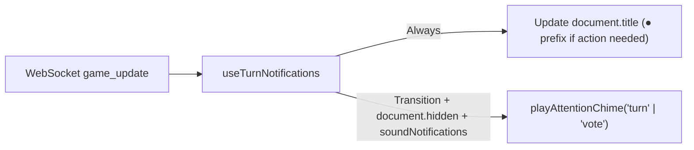

# Turn Notifications & Sound Effects

Traitorous alerts seated multiplayer commanders when their attention is required—either because a new phase needs orders or because a phase-clock vote has opened—using dynamic browser tab titles and synthesized Web Audio chimes when the tab is in the background.

## Contents

- [Attention Detection (`computeTurnAttention`)](#attention-detection-computeturnattention)
- [Browser Tab Title Indicators](#browser-tab-title-indicators)
- [Background-Tab Web Audio Chimes](#background-tab-web-audio-chimes)
- [User Controls & Browser Autoplay Rules](#user-controls--browser-autoplay-rules)
- [Invariants](#invariants)
- [Related Docs](#related-docs)

---

## Attention Detection (`computeTurnAttention`)

The `useTurnNotifications` hook ([`frontend/src/hooks/useTurnNotifications.ts`](../../frontend/src/hooks/useTurnNotifications.ts)) evaluates whether the local player currently owes an action in an active (non-completed) multiplayer match:

- **`needsVote`**: True when the effective match timer (including `hypotheticalMatchTimer` while inspecting Hypothetical Mode) is in the `'voting'` stage, includes the player's `lockedPower`, and `lockedPower` has not yet cast a vote.
- **`needsMove`**: True when not in a private hypothetical sandbox, the player's `lockedPower` is required to act in the current phase (`getRequiredPowers()`), and `lockedPower` is not in `finalized_powers`.

In the lobby, in solo sandboxes, or once a game has a `winner`, both flags are `false`.

---

## Browser Tab Title Indicators

`formatDocumentTitle()` updates `document.title` whenever the board phase or attention state changes (and restores the default title on unmount or in the lobby):

- Needs move & vote: `● Your Move & Vote — <Turn> · Traitorous`
- Needs move only: `● Your Move — <Turn> · Traitorous`
- Needs vote only: `● Vote Needed — <Turn> · Traitorous`
- Waiting / spectator: `<Turn> · Traitorous`

---

## Background-Tab Web Audio Chimes

When a multiplayer match transitions into a new turn (`turnAdvanced && needsMove`) or opens a new phase-length vote (`voteOpened && needsVote`) **while `document.hidden` is `true`** and `soundNotifications` is enabled, `playAttentionChime()` ([`frontend/src/utils/soundEffects.ts`](../../frontend/src/utils/soundEffects.ts)) plays a synthesized two-tone Web Audio sine chime:

- **Turn chime (`'turn'`)**: C5 → E5 (major third)
- **Vote chime (`'vote'`)**: G4 → C5 (perfect fourth)

Tones are scheduled directly on `AudioContext.currentTime` with no external audio files and no `setTimeout` chains (which browsers throttle in background tabs).

---

## User Controls & Browser Autoplay Rules

- **Sound toggle**: Players can enable or disable sound chimes in the top bar's Display Settings menu (`DisplaySettingsMenu.tsx`), persisted in `localStorage` via `displayPrefs.ts` (`soundNotifications`, default `true`).
- **Autoplay unlock**: `setupAudioUnlock()` registers one-time `pointerdown` and `keydown` listeners to create/resume the shared `AudioContext` on the player's first interaction, so later background chimes are permitted by browser autoplay policies without requesting OS Notification permissions.

---

## Invariants

- **No chime on initial load or game switch**: `useTurnNotifications` compares against the previous snapshot for the same `gameId`, so opening a match or refreshing the page never triggers a spurious chime.
- **No chime in active foreground tabs**: Audio chimes only fire when `document.hidden` is `true`.

---

## Related Docs

- [Turn Clock](turn-clock.md)
- [State Management & API Sync](../frontend/state-management.md)
- [Dual Collapsible Sidebars & Top Bar](../frontend/sidebar-and-controls.md)
