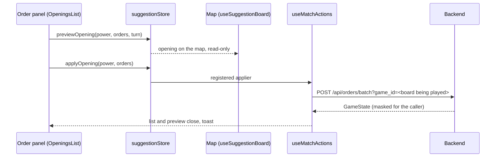

# Spring 1901 Openings

On the first turn the order panel offers the hobby's book openings for the power being ordered: each with its orders, how often it was played, two or three strengths and weaknesses, and links to the zine articles it comes from. Picking one shows it on the map; using one fills in the player's orders, which they still review and finalize themselves.

## Contents

- [Purpose and user-facing behavior](#purpose-and-user-facing-behavior)
- [Where the openings come from](#where-the-openings-come-from)
- [Sourcing and copyright](#sourcing-and-copyright)
- [Flow across the stack](#flow-across-the-stack)
- [When the button shows](#when-the-button-shows)
- [Invariants](#invariants)
- [Related docs](#related-docs)

## Purpose and user-facing behavior

- On **Spring 1901 Movement** an **Openings** button sits beside **Clear All Orders** in the order panel (the desktop quick-action row, and the phone sheet's utility bar).
- Pressing it swaps the unit cards for the list of the power's openings, most often played first. Openings with no recorded figure come last. The **×** in the list's header, or the button again, brings the unit cards back.
- Each row shows the opening's name, its share of recorded games, its approach tag, a flag for each power it is aimed against (crossed swords) or works with (a handshake), and its orders. The approach is one of five, so every tag covers several openings: **Standard** (the common line), **Defensive** (guards home first), **Flexible** (keeps choices open), **Aggressive** (strikes at a neighbour) and **Gambit** (gives something up, or takes a big risk, for position). Picking a row opens it: strengths (`+`), weaknesses (`−`), a note on the autumn moves where the spring is shared with another opening, and the source articles.
- An open row is drawn on the map the way a received move suggestion is: the opening's orders for that power, every other unit holding, and a pill reading **Viewing *Lepanto Opening***. The map is read-only meanwhile. Picking another row replaces it; picking the same row, or the pill's **×**, takes it off.
- **Use these orders** sends the opening's orders as the player's own, closes the list and the preview, and says so in a toast. Nothing is finalized. The orders can still be changed, and using an opening after finalizing unlocks the power, as any order change does.
- An opening whose units are no longer on their starting squares (a host's board edit) is greyed out and cannot be shown or used.

## Where the openings come from

The list is static data in `frontend/src/data/openings.ts`, gathered from the Opening Strategy section of the [UK Diplomacy Zine Archive](https://diplomacyzines.co.uk/?page_id=1771) and the [Library of Diplomacy Openings](https://diplom.org/Online/Openings/textversion/) (The Diplomatic Pouch), which adds common openings the zine articles skip. Where the two name an opening differently, the zine name is used: the Library's Bosphorus Opening is the Western Opening here, and its Crimean Crusher the Russian Attack. The names are the hobby's own, most from Richard Sharp's *Naming the Openings*. The strengths and weaknesses are short summaries written for this app, and every opening links the articles it came from, as the archive asks. The popularity figures are the ones the zine articles quote from UK postal games, or, for an opening only the Library lists, its share of the Library's online games.

Orders are written the adjudicator's way (`A VEN - TYR`, `F STP/SC - BOT`, `A MAR S A PAR - BUR`, `A VEN H`). Each opening's `approach` and `relations` (`{ kind: 'against' | 'with', power }`) are set by hand from its articles; a unit test keeps every approach on at least three openings. `utils/openings.ts` (`openingOrders`) turns the orders into `Order`s for the units on the board. An opening may leave a unit out when its article does, and that unit keeps whatever order it had.

## Sourcing and copyright

The data takes facts and ideas from the sources, never their text:

- **What is taken:** opening names (short hobby labels such as "Lepanto" or "Maginot"), the Spring 1901 orders (game moves), and the published popularity figures. These are facts about the game and how it has been played: a set of moves can't be copyrighted, any more than a chess opening can.
- **What is written here:** every strength, weakness and autumn note is a short summary written for this app. Some carry an author's idea, such as Burgundy being the way into France or the Jutland Gambit hiding its target, but never the author's wording. A check against the scraped text of both sources found no run of six or more words in common, except stock game phrases ("for the rest of the game") and order notation.
- **Credit:** each opening links the articles or Library pages it draws on, with the author's name, as the UK archive asks for material it hosts.
- **Not copied:** no article, table or excerpt is stored, quoted or served by the app. The scraped pages were working material and are not in the repo.

If an author or either site objects to an opening's summary, rewrite it in general terms or drop that opening's link to them; nothing else depends on the wording.

## Flow across the stack

- The preview never leaves the browser. It lives in `lib/suggestionStore.ts` beside the press suggestion (one or the other, never both) and `useSuggestionBoard` draws it with mode `opening`.
- Using an opening is one `POST /api/orders/batch`, the same atomic batch a press suggestion uses. It goes to the board being played: the match, a Solo Sandbox, or the private `sbx_` copy in Hypothetical Mode. The server checks the seat as it does for any order.
- No endpoint, model or saved field was added.

## When the button shows

| Condition | Openings |
| :--- | :--- |
| Spring 1901 Movement, a seat or a sandbox power | shown |
| Any later turn, or the game is over | hidden |
| Spectating, or the power has surrendered | hidden |
| A past turn or a press suggestion is on the board | hidden (the order panel is locked) |
| Hypothetical Mode or a Solo Sandbox | shown for the power being ordered |

Switching power or leaving the first turn closes the list and takes the preview off the map.

## Invariants

- **Invariant**: An opening preview is a picture, never orders. It is not sent, saved or shown to anyone else until **Use these orders**, and then only as the player's own orders through `POST /api/orders/batch`, which refuses units that are not theirs.
- **Invariant**: In Hypothetical Mode an opening goes to the private `sbx_` copy (`draftGameId`), never the live match.
- **Invariant**: Openings are offered only on Spring 1901 Movement (`isOpeningTurn`). The preview ends with the turn.

## Related docs

- [Press & Diplomacy](press-and-diplomacy.md): move suggestions, which share the map preview.
- [Sandbox & Hypothetical Mode](sandbox-and-hypothetical-mode.md)
- [Dual Collapsible Sidebars & Tactical Controls](../frontend/sidebar-and-controls.md)
- [State Management & API Sync](../frontend/state-management.md)
