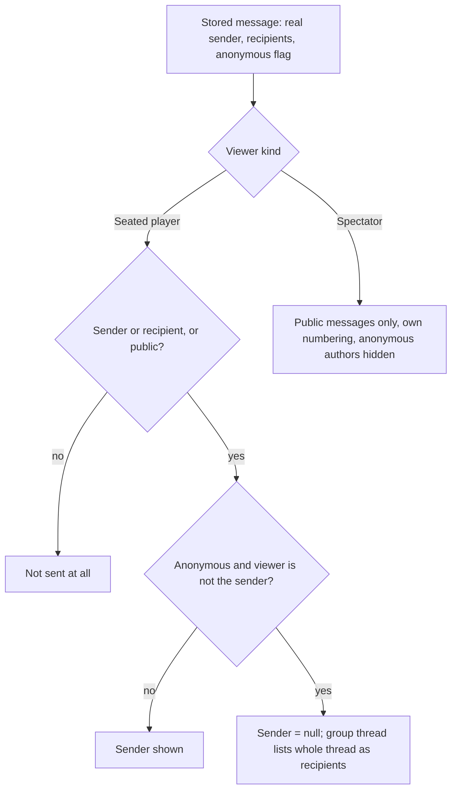
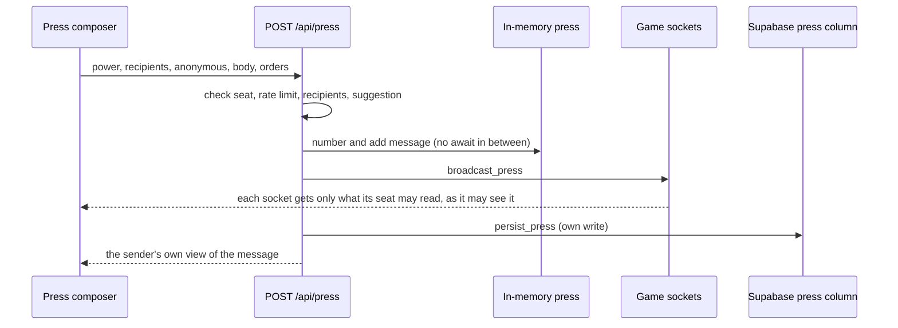

# Press and Diplomacy

Press is the in-match chat of a multiplayer game: a public box everyone reads, private threads between powers, optional anonymity for the author, and *order suggestions* a player can attach to a message. The server is the only party that knows who really wrote what, so every message is filtered per reader before it leaves the backend. Press lives outside the board state, in its own database column, so chatting and playing never overwrite each other.

## Contents

- [Purpose and user-facing behavior](#purpose-and-user-facing-behavior)
- [Message kinds](#message-kinds)
- [Who sees what](#who-sees-what)
- [Move suggestions](#move-suggestions)
- [Flow across the stack](#flow-across-the-stack)
- [Storage](#storage)
- [Unread tracking and the client store](#unread-tracking-and-the-client-store)
- [Invariants](#invariants)
- [Related docs](#related-docs)

## Purpose and user-facing behavior

Diplomacy is a negotiation game, so seated players need to talk without leaving the app. In a live match a player can:

- post to the **public box**, which every seated player (and any spectator) reads;
- open a **private thread** with one or more other powers by picking recipients (on the Diplomatic Standing rows, via the letter button);
- send either kind **signed** or **anonymous**;
- attach **suggested orders** to public press (signed or anonymous), a signed private message, or a one-to-one backchannel during any active phase (Movement, Retreats, or Adjustments);
- see an **unread** badge on the Press section, the collapsed rail and the phone's Press button.

Only multiplayer matches have press. A hypothetical private copy (`sbx_*`) answers `404`; a solo or saved sandbox (or other non-match game) answers `409`. Only players holding a seat may send; a spectator or a host with no seat is refused with `403` (see [Spectating](spectating.md)). A power that has surrendered can no longer send.

## Message kinds

| Kind | Recipients | Readers before the game ends |
| :--- | :--- | :--- |
| Public, signed | none | every seated player and spectators |
| Public, anonymous | none | same readers; author hidden |
| Private thread, signed | 1 or more powers | sender and recipients |
| Private thread, anonymous | 1 or more powers | sender and recipients; author hidden |

An anonymous one-to-one message appears as a *backchannel* in the recipient's feed. Rules enforced on send:

- body is trimmed; an empty body is only allowed when orders are attached; maximum 1000 characters;
- the sender is dropped from the recipient list; sending only to yourself is refused;
- every recipient power must actually be held by someone;
- a sender may post at most 8 messages per 10 seconds per game (`429` beyond that).

## Who sees what

Details that are easy to miss:

- **Hidden authors** are hidden from everyone but themselves, the host included.
- In an anonymous **group** thread the recipient list shown to others is the whole thread *including the author*, because the real list omits exactly the author and would give them away. In a **one-to-one** anonymous message the list stays just the recipient.
- **Numbering is per reader.** Each message carries a per-reader number (1, 2, 3 …) rather than the game-wide counter, whose gaps would reveal how much private press others exchange. Spectators have a separate public-only numbering.
- **Visibility never changes at game over.** Private threads stay private, anonymous authors stay hidden, and per-reader numbering stays unchanged after a winner is declared.
- A spectator never reads a private message, even after the game ends.

## Move suggestions

Public press (signed or anonymous), a signed private message, or a one-to-one anonymous backchannel may carry `orders`, proposed orders for the current phase. The server validates and rebuilds them:

- Active phases only (`Movement`, `Retreats`, or `Adjustments`; `409` if the game is over or in another phase):
  - `Movement`: `HOLD`, `MOVE`, `SUPPORT`, `CONVOY` on existing units.
  - `Retreats`: `RETREAT` (with target) and `DISBAND` on dislodged units only.
  - `Adjustments`: `DISBAND` on existing units, and `BUILD` or `WAIVE` on active `BUILD_<POWER>_<HOME>` build slots (inland fleet builds are refused with `422`).
- At most one order per unit or build slot.
- **Public press** (signed or anonymous): units or build slots of **any power** on the board, so anonymous public posts can never point back at the author. Spectators also receive public suggestion `orders` and can preview them read-only on the map.
- **Signed private thread**: units or build slots of the sender and the recipients.
- **Anonymous backchannel** (1-to-1): units or build slots of the **recipient only**, so the suggestion cannot point back at the author. Anonymous group threads (2+ recipients) cannot carry `orders` (`422`).
- Provinces and coasts must exist (same level of checking as `POST /api/order`); legality is *not* checked.
- A suggestion is just data on the message. It never reads or writes the game's real orders.

On the client, `useSuggestionBoard` swaps a suggestion onto the map the same way a past turn is shown, leaving the player's own orders untouched. The view ends automatically when the turn resolves, the game ends, or the board is needed for something else (Hypothetical Mode, Direct-Edit, a past turn). Units or build slots that have since moved or disappeared are dropped. Seated recipients can adopt the orders for their own units or build slots.

## Flow across the stack

- **Read**: `GET /api/press` returns the caller's feed oldest first; `after` returns only newer messages by the caller's own numbering. A caller naming a seat they do not hold is refused. A seatless caller gets the public box with `power` null, and a private match then requires its passcode.
- **Live**: new messages arrive on the game socket as a `press` message. A seated socket receives it only if it may read it; a seatless socket only receives public ones. The socket learns its seat from the `auth` handshake, never from the URL.
- **Fallback**: while the socket is down the client polls the feed and catches up with `after` when it reconnects.

## Storage

Press is kept per game in memory, separate from `GameState`, and saved to a dedicated `press` column of the game's `multiplayer_games` row by its own write.

- A game save never touches the press column and a press save never touches the board, so neither can overwrite the other with an older copy.
- Saves are coalesced per game: a save already running picks up messages added meanwhile.
- At most 2000 messages are kept; the oldest are dropped so a row cannot grow forever.
- Messages saved before per-reader numbering existed are numbered when loaded.
- If the load fails the API answers `503` rather than treating the press as empty (which could then overwrite saved press). If the column is missing (migration not applied) press works in memory only and a warning is logged once.

## Unread tracking and the client store

The client keeps press in a small store outside React so the socket, the Press section, the rail and the phone top bar share it without props. Unread is tracked per channel (the public box and each thread) as how far the player has read; reading never moves backwards. Switching match or seat starts from empty.

## Invariants

- The server never sends a stored message (real sender) to a client; every outgoing copy comes from the view functions in `security/press.py`.
- Anonymity holds against the host and against list-length and numbering leaks.
- A client-supplied `power` only chooses among seats the caller holds.
- Press and board persistence stay independent writes.
- Suggestions never mutate real orders.

## Related docs

- [Spectating](spectating.md)
- [Sandbox and Hypothetical Mode](sandbox-and-hypothetical-mode.md)
- [Admin and creator controls](admin-and-creator-controls.md)
- [Turn clock](turn-clock.md)
- [API reference](../backend/api-reference.md)
- [Database](../architecture/database.md)
- [Service interactions](../architecture/service-interactions.md)
