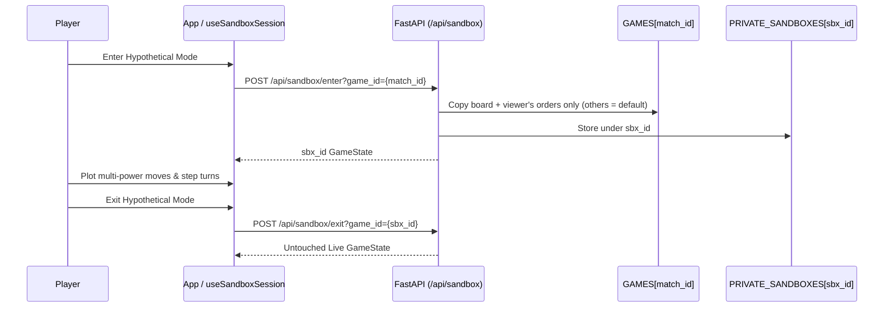

# Sandbox & Hypothetical Mode

Sloplomacy supports both **Solo Sandboxes** (freeform tactical boards, scenario presets, and board-state exports from live games) and **Multiplayer Hypothetical Mode** (an ephemeral private "what-if" copy of a live match where a player can test multi-power moves and step turns forward without affecting the real game).

## Contents

- [Solo Sandbox vs. Multiplayer Hypothetical Mode](#solo-sandbox-vs-multiplayer-hypothetical-mode)
- [Multiplayer Private Branch Lifecycle (`sbx_*`)](#multiplayer-private-branch-lifecycle-sbx_)
- [Solo Sandbox Checkpoints & Saving](#solo-sandbox-checkpoints--saving)
- [AI Heuristics & Step-Forward Simulation](#ai-heuristics--step-forward-simulation)
- [Board-State Export](#board-state-export)
- [Invariants](#invariants)
- [Related Docs](#related-docs)

---

## Solo Sandbox vs. Multiplayer Hypothetical Mode

| Aspect | Solo / Saved Sandbox | Multiplayer Hypothetical Mode |
| :--- | :--- | :--- |
| **Game ID** | Own ID (e.g. `proto_1901`, draft `solo_<8-hex>`, or saved `saved_<8-hex>` / `solo_<8-hex>`) | Ephemeral `sbx_<8-hex>` in `PRIVATE_SANDBOXES` |
| **Power switching** | Switch freely between all 7 Great Powers | Switch freely inside the private branch; locked on exit |
| **Persisted to DB?** | Yes, if saved to an account (`POST /api/games/save-sandbox`) | Never persisted to Supabase; lives only in memory |
| **Real match impact** | Standalone | Zero impact; live match continues independently (including clock & WS updates) |

---

## Multiplayer Private Branch Lifecycle (`sbx_*`)

When a seated player enters Hypothetical Mode from a live multiplayer match ([`backend/api/sandbox.py`](../../backend/api/sandbox.py)):

1. **Enter (`POST /api/sandbox/enter?game_id={match}`)**: `open_private_sandbox()` creates (or resumes, if still on the same live turn) a private copy in `PRIVATE_SANDBOXES` with `PRIVATE_SANDBOX_TURNS` tracking `(season, year, phase)`. All **other** powers are reset to default orders (`create_default_orders`) so the branch never reveals opponents' hidden orders.
2. **Explore**: The player switches powers, plots multi-power moves, runs AI heuristics, or steps turns forward via `POST /api/adjudicate` using the `sbx_` game ID. The live match's `PhaseTimer` continues to be tracked via `hypotheticalMatchTimer` in the frontend.
3. **Exit (`POST /api/sandbox/exit?game_id={sbx_id}`)**: Returns the untouched live match `GameState`. The `sbx_` branch remains resumable for the duration of that live turn and is automatically erased by `clear_ephemeral_sandboxes_for()` as soon as the real match adjudicates or rolls back (and evicted on exit or game eviction if the player leaves their seat).

---

## Solo Sandbox Checkpoints & Saving

- **Checkpoints**: In a solo or saved sandbox, `POST /api/sandbox/enter` checkpoints `GAMES[id]` and `GAME_HISTORY[id]` in `SANDBOX_CHECKPOINTS` / `SANDBOX_HISTORY_CHECKPOINTS`. Exiting restores the pre-sandbox state and stashes the hypothetical branch in `SANDBOX_BRANCHES[id]` so it can be resumed on the same real turn, and clears when a real turn resolves or a scenario resets.
- **Saving to an account**: Authenticated users can save a solo sandbox to their account via `POST /api/games/save-sandbox`, persisting it to Supabase with `is_sandbox = true` so it appears in "My Games" (never in the public lobby).

---

## AI Heuristics & Step-Forward Simulation

Inside a sandbox or hypothetical branch, players can use [`backend/engine/ai.py`](../../backend/engine/ai.py) tools:

- **`POST /api/sandbox/ai-orders`**: Generates heuristic orders for all non-selected (or specified) Great Powers for the current phase.
- **`POST /api/sandbox/ai-step`**: Generates AI orders for foreign powers (and `active_power` if it has no explicit orders yet) and immediately adjudicates one turn forward.
- **`POST /api/sandbox/clear-foreign`**: Resets all non-selected powers' orders back to defaults.
- **`POST /api/scenario`**: Resets a sandbox (or a live match, creator-only) to a named preset (`standard_1901`, `tactical_blunders_demo`, `spring_retreats_demo`, `winter_adjustments_demo`, `one_turn_from_win`).

---

## Board-State Export

From an active multiplayer match, a player can launch a standalone **Solo Sandbox** (`solo_<8-hex>`) seeded with the current match's visible board state and history via `POST /api/games/solo-sandbox?source_game_id=<id>` ([`backend/api/solo_sandbox_helpers.py`](../../backend/api/solo_sandbox_helpers.py)). The server copies the viewer-sanitized `GameState`, so exported boards never include other powers' hidden current-turn orders.

---

## Invariants

- **Strict owner isolation**: `saved_sandbox_guard` and `require_saved_sandbox_owner` reject unauthenticated (`401`) or non-owner (`403`) callers trying to read or mutate a `sbx_*` branch or saved sandbox.
- **No order leakage**: Private branches copy only the caller's own orders; foreign orders are always reset to defaults.

---

## Related Docs

- [Secrecy & Authorization](../architecture/secrecy-and-authorization.md)
- [System Overview](../architecture/system-overview.md)
- [State Management & API Sync](../frontend/state-management.md)
