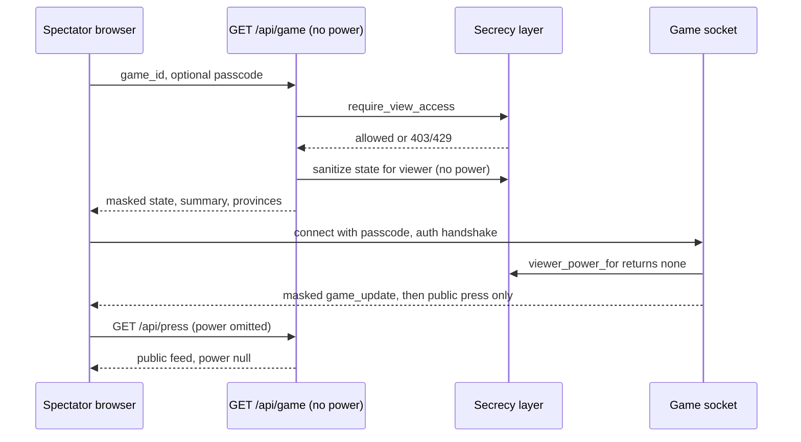

# Spectating

Spectating lets anyone open a multiplayer match without holding a seat. A spectator sees the board, standings, resolved history and the public press, but never another power's hidden orders and never sends anything. They can claim a free seat or leave at any time. Because the server derives what a caller may see from their identity and seat, spectating needs no special server mode: a spectator is simply a viewer with no power.

## Contents

- [Purpose and user-facing behavior](#purpose-and-user-facing-behavior)
- [Entry points and access](#entry-points-and-access)
- [Flow across the stack](#flow-across-the-stack)
- [What a spectator sees](#what-a-spectator-sees)
- [What a spectator cannot do](#what-a-spectator-cannot-do)
- [Invariants](#invariants)
- [Related docs](#related-docs)

## Purpose and user-facing behavior

- Watch a public or private match from the lobby browser or with *Join with code* without taking a seat.
- A **Watching** bar sits over the order panel. A flag per power chooses whose units are listed. This choice is local to the browser and is never sent to the server.
- **Claim** appears for a power whose seat is still free (a guest is asked to sign in first). **Leave** returns to the lobby; nothing is given up because no seat is held.
- Orders of every power stay hidden until each turn resolves.
- If the person opening the match already holds a seat in it, they are taken into that seat instead of being treated as a spectator.
- Only multiplayer matches can be watched; a sandbox cannot.

## Entry points and access

A match is open to watch unless it is private. A private match needs its passcode unless the caller is seated in it. Wrong guesses are counted per client address and rate-limited.

| Outcome | Meaning shown to the user |
| :--- | :--- |
| `403` | the campaign is private; passcode missing or wrong |
| `429` | too many wrong passcodes, try again in a few minutes |
| `404` | no campaign has that Game ID |

The passcode the spectator typed is remembered by the client and reused for the socket and later reads (press included).

## Flow across the stack

The client treats a view as spectating when it is in multiplayer mode with no locked power and the game is not a sandbox. The socket registers the connection with no power; every later broadcast therefore sanitizes the state for a seatless viewer and sends only public press messages.

## What a spectator sees

- **Board state**: with no viewer power every unit gets its server default order (hold, or disband for a dislodged unit) in place of the real hidden one. Validation issues are emptied, and the adjudication preview and per-unit move options are rebuilt from those defaults so nothing is inferred from them.
- **Press**: the public box only, numbered separately from seated players so gaps from private press never show. Anonymous public authors stay hidden until the game ends. Private threads are never readable, even after the game ends. See [Press and diplomacy](press-and-diplomacy.md).
- **Summaries**: sanitized like everyone else's, so email addresses are stripped.
- Once the game has a winner masking stops and the finished board is shown as is.

## What a spectator cannot do

- Send press: refused with `403` (only seated players send).
- Submit, confirm or change orders: each mutation checks that the caller holds the power it names.
- Use admin controls (see [Admin and creator controls](admin-and-creator-controls.md)).
- Read or write a saved sandbox, which is owner only.

## Invariants

- Hidden orders are shown only for seats the caller holds; absence of a seat shows nobody's.
- A spectator's power picker is presentation only; the server never receives it.
- A passcode check applies to spectators on every route (state, socket, press), with the same wrong-guess limit.
- The same sanitization functions serve spectators and players, so there is one place where secrecy is decided.

## Related docs

- [Press and diplomacy](press-and-diplomacy.md)
- [Turn clock](turn-clock.md)
- [Service interactions](../architecture/service-interactions.md)
- [State management](../frontend/state-management.md)
- [Sidebar and controls](../frontend/sidebar-and-controls.md)
