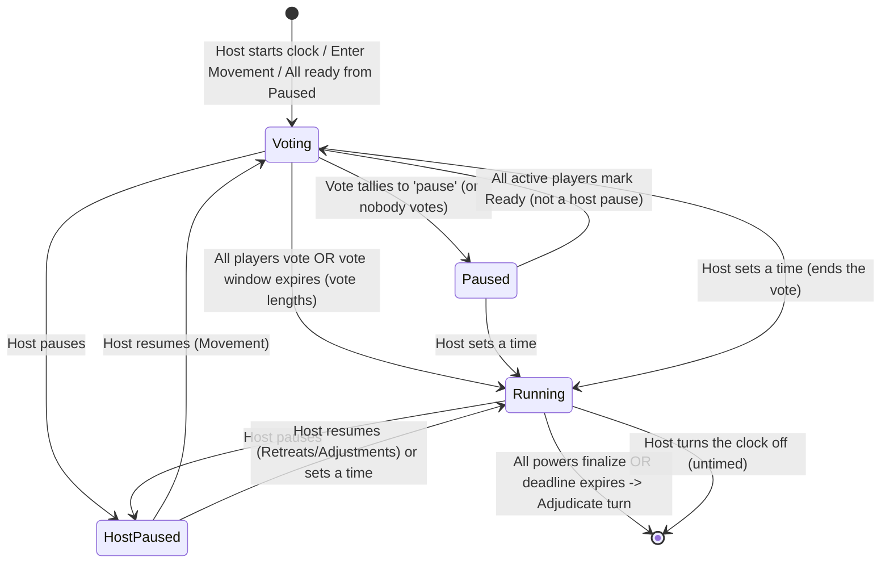

# Turn Clock (Phase Timer)

Multiplayer matches can run an optional shared phase clock (`GameState.timer`) with Movement duration voting, fixed Retreats/Adjustments timers, supermajority extensions, and pause/ready-up. The host can override all of it (issue #393): pause, resume, set the time left or the end time, nudge, turn it off, and change the lengths. Because Cloud Run scales to zero, the clock uses absolute UTC timestamps evaluated on client requests rather than a server-side background loop.

## Contents

- [Clock Lifecycle & Stages](#clock-lifecycle--stages)
- [Movement Voting, Fixed Phases & Extensions](#movement-voting-fixed-phases--extensions)
- [How Deadlines Are Enforced Without a Background Timer](#how-deadlines-are-enforced-without-a-background-timer)
- [Host Overrides](#host-overrides)
- [UI Presentation (`PhaseTimerWidget`)](#ui-presentation-phasetimerwidget)
- [Invariants](#invariants)
- [Related Docs](#related-docs)

---

## Clock Lifecycle & Stages

The host starts the match clock via `POST /api/games/{game_id}/timer/start` ([`backend/api/turns.py`](../../backend/api/turns.py)). Once started, `GameState.timer` (`PhaseTimer`) transitions through three stages ([`backend/engine/phase_timer.py`](../../backend/engine/phase_timer.py)):

---

## Movement Voting, Fixed Phases & Extensions

- **Active clock players (`timer_players`)**: Only seated, non-surrendered powers in an active match (`status == "active"`) that still have units or Supply Centers vote on and share the clock. Whenever a player joins, leaves, or surrenders, `settle_timer()` prunes stale votes/requests and immediately settles if everyone remaining now agrees.
- **Clock lengths (`GameState.timer_settings`, `TimerSettings`)**: Each match keeps its own lengths: the vote's options (`vote_minutes`, 1 to 3 distinct lengths, default 15/20/30 minutes), the vote window (`vote_window_seconds`, default 60) and the fixed Retreats/Adjustments clock (`fixed_phase_minutes`, default 5). The host changes them; see [Host Overrides](#host-overrides).
- **Movement phase (`POST /api/games/{game_id}/timer/vote`, `voting` -> `running` / `paused`)**: Opens a vote lasting `vote_window_seconds` on the match's `vote_minutes` or `'pause'`. A vote copies those lengths into `PhaseTimer.vote_minutes` when it opens, and a vote for anything else is refused (`400`). Most votes wins; ties break toward the **longer** option (`pause` is longest); if nobody votes, the game pauses.
- **Retreats & Adjustments (`running`)**: Skip voting and start a fixed clock of `fixed_phase_minutes`.
- **Extensions (`POST /api/games/{game_id}/timer/extend`)**: While `running`, players can request a **+5 minute** extension (`EXTENSION_MINUTES = 5`). Once `len(extend_requests) >= extensions_needed` (a 5/7 supermajority: `max(1, ceil(len(players) * 5 / 7))`), `deadline` advances by 5 minutes and `extend_requests` clears.
- **Ready-up (`POST /api/games/{game_id}/timer/ready`)**: While `paused` by a vote, players toggle ready; once all `timer_players` are ready, a fresh Movement vote opens. A host pause (`host_paused`) refuses ready-ups (`409`).
- **Never holds a phase back**: If all required powers finalize their orders before the deadline, the phase still adjudicates immediately.

---

## How Deadlines Are Enforced Without a Background Timer

`PhaseTimer.deadline` is an absolute Unix epoch timestamp (`time.time() + seconds`), and `tick_timer(game)` checks `has_expired(timer, time.time())` whenever:

1. A client's `PhaseTimerWidget` reaches `0:00` and sends `{"type": "refresh"}` over the WebSocket.
2. Any client connects to `/ws/games/{game_id}` or loads `GET /api/game` (so an expired deadline while the server was scaled to zero resolves as soon as someone reconnects or fetches the match).

For the full infrastructure rationale (Cloud Run `min_instance_count = 0`, `cpu_idle = true`, and 25-second heartbeats), see [Runtime & Infrastructure Model](../architecture/runtime-and-infrastructure.md).

---

## Host Overrides

The host runs these from **Wrench → Administrator → Turn and Clock Settings**, in its **Turn Clock** and **Clock Lengths** cards (`PhaseClockSection.tsx`). The routes are in [`backend/api/admin_timer.py`](../../backend/api/admin_timer.py), take only the host (`verify_admin_access`), refuse the default board, sandboxes and finished games (`409`), and each one adds an `[ADMIN OVERRIDE]` line to the turn history and an entry to the admin action log, which every other player acknowledges in the admin warning modal.

| Action | Route | What it does |
| :--- | :--- | :--- |
| Start | `POST /timer/start` | As before: opens the first vote (or the fixed clock). |
| Pause | `POST /timer/pause` | `paused` with `host_paused = true`, clearing votes, ready-ups and extension requests. Players cannot ready up out of it. |
| Resume | `POST /timer/resume` | Lifts any pause (a host pause or a voted one) the way a phase starts: a new vote in Movement, the fixed clock otherwise. |
| Set time | `POST /timer/deadline` | Exactly one of `seconds_left`, `adjust_seconds` (running clock only) or `deadline` (Unix seconds, from the host's own clock). The clock runs to it whatever its stage, which ends a vote with no winner or lifts a pause. It must leave 10 seconds to 30 days. |
| Turn off | `POST /timer/stop` | `timer = None`: the match is untimed until the host starts the clock again. |
| Lengths | `PUT /timer/settings` | Saves `TimerSettings`. They apply from the next vote or phase, never to the clock already counting, and survive a rollback. |

The clock still never holds a phase back: a host-set deadline resolves like any other, and everyone finalizing still resolves at once. A new phase starts its own clock as usual, so a host pause lasts for the phase it was set in.

---

## UI Presentation (`PhaseTimerWidget`)

`PhaseTimerWidget.tsx` renders at the top of `EuropeMap` with voting, extension, and ready-up controls (and collapses into a click-to-expand status pill such as `14:05`, `Vote · 0:42`, `Paused · 1/3 ready` or `Paused by host` in compact phone layouts). The vote buttons come from the open vote's `vote_minutes`, labelled in their two biggest units ("20 min", "1 h 30 min", "2 d 3 h"). A running clock more than a day out shows when it ends instead of ticking ("Ends Fri 21:30" over "2 d left", pill "Ends Fri 21:30"); in its last day it ticks as `h:mm:ss`. A host pause shows "Paused by the Host" with no ready-up. The host enters every length as a whole number of minutes, hours or days. In Hypothetical Mode, the widget displays `hypotheticalMatchTimer` from the underlying live match so a player never misses a deadline while testing "what-if" moves.

---

## Invariants

- **Sandboxes and finished games have no clock**: `start_phase_clock()` sets `game.timer = None` when `game.winner` is set or no `timer_players` exist.
- **Only the host lifts a host pause**: `settle_timer()` never reopens a vote from a `host_paused` clock, and the ready route refuses it.
- **Lengths are settings, not turn state**: a rollback keeps the current `timer_settings` rather than the snapshot's.
- **Resilient expiry**: If auto-adjudication fails when a deadline expires, `tick_timer()` pauses the clock rather than looping on errors.

---

## Related Docs

- [Runtime & Infrastructure Model](../architecture/runtime-and-infrastructure.md)
- [Turn Notifications & Sound Effects](notifications-and-sound.md)
- [Admin & Creator Controls](admin-and-creator-controls.md)
- [Diplomacy 1901 Rulebook Reference](../guides/rulebook-reference.md)
