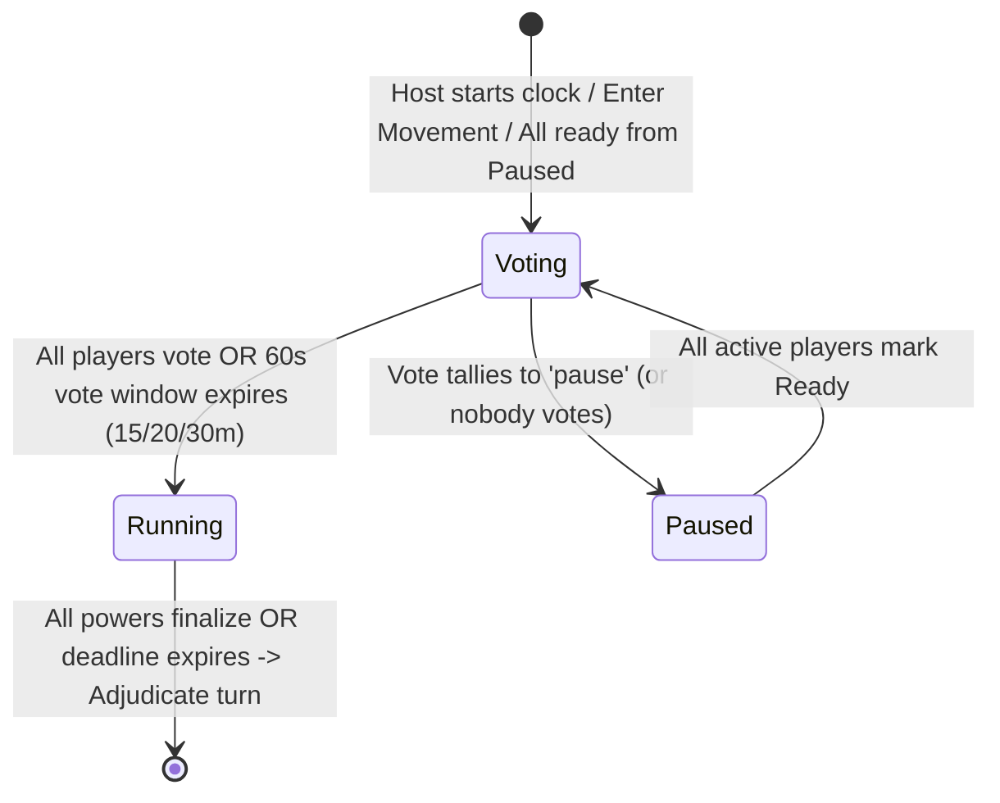

# Turn Clock (Phase Timer)

Multiplayer matches can run an optional shared phase clock (`GameState.timer`) with Movement duration voting, fixed Retreats/Adjustments timers, supermajority extensions, and pause/ready-up. Because Cloud Run scales to zero, the clock uses absolute UTC timestamps evaluated on client requests rather than a server-side background loop.

## Contents

- [Clock Lifecycle & Stages](#clock-lifecycle--stages)
- [Movement Voting, Fixed Phases & Extensions](#movement-voting-fixed-phases--extensions)
- [How Deadlines Are Enforced Without a Background Timer](#how-deadlines-are-enforced-without-a-background-timer)
- [UI Presentation (`PhaseTimerWidget`)](#ui-presentation-phasetimerwidget)
- [Invariants](#invariants)
- [Related Docs](#related-docs)

---

## Clock Lifecycle & Stages

The host starts the match clock via `POST /api/games/{game_id}/timer/start` ([`backend/api/turns.py`](../../backend/api/turns.py)). Once started, `GameState.timer` (`PhaseTimer`) transitions through three stages ([`backend/engine/phase_timer.py`](../../backend/engine/phase_timer.py)):

---

## Movement Voting, Fixed Phases & Extensions

- **Active clock players (`timer_players`)**: Only seated, non-surrendered powers in an active match (`status == "active"`) that still have units or Supply Centers vote on and share the clock. Whenever a player joins, leaves, or surrenders, `settle_timer()` prunes stale votes/requests and immediately settles if everyone remaining now agrees.
- **Movement phase (`POST /api/games/{game_id}/timer/vote`, `voting` -> `running` / `paused`)**: Opens a **60-second** vote (`VOTE_WINDOW_SECONDS = 60`) with choices `'15'`, `'20'`, `'30'` minutes, or `'pause'`. Most votes wins; ties break toward the **longer** option (`pause` is longest); if nobody votes, the game pauses.
- **Retreats & Adjustments (`running`)**: Skip voting and start a fixed **5-minute** clock (`FIXED_PHASE_MINUTES = 5`).
- **Extensions (`POST /api/games/{game_id}/timer/extend`)**: While `running`, players can request a **+5 minute** extension (`EXTENSION_MINUTES = 5`). Once `len(extend_requests) >= extensions_needed` (a 5/7 supermajority: `max(1, ceil(len(players) * 5 / 7))`), `deadline` advances by 5 minutes and `extend_requests` clears.
- **Ready-up (`POST /api/games/{game_id}/timer/ready`)**: While `paused`, players toggle ready; once all `timer_players` are ready, a fresh Movement vote opens.
- **Never holds a phase back**: If all required powers finalize their orders before the deadline, the phase still adjudicates immediately.

---

## How Deadlines Are Enforced Without a Background Timer

`PhaseTimer.deadline` is an absolute Unix epoch timestamp (`time.time() + seconds`), and `tick_timer(game)` checks `has_expired(timer, time.time())` whenever:

1. A client's `PhaseTimerWidget` reaches `0:00` and sends `{"type": "refresh"}` over the WebSocket.
2. Any client connects to `/ws/games/{game_id}` or loads `GET /api/game` (so an expired deadline while the server was scaled to zero resolves as soon as someone reconnects or fetches the match).

For the full infrastructure rationale (Cloud Run `min_instance_count = 0`, `cpu_idle = true`, and 25-second heartbeats), see [Runtime & Infrastructure Model](../architecture/runtime-and-infrastructure.md).

---

## UI Presentation (`PhaseTimerWidget`)

`PhaseTimerWidget.tsx` renders at the top of `EuropeMap` with voting, extension, and ready-up controls (and collapses into a click-to-expand status pill such as `14:05`, `Vote · 0:42`, or `Paused · 1/3 ready` in compact phone layouts). In Hypothetical Mode, the widget displays `hypotheticalMatchTimer` from the underlying live match so a player never misses a deadline while testing "what-if" moves.

---

## Invariants

- **Sandboxes and finished games have no clock**: `start_phase_clock()` sets `game.timer = None` when `game.winner` is set or no `timer_players` exist.
- **Resilient expiry**: If auto-adjudication fails when a deadline expires, `tick_timer()` pauses the clock rather than looping on errors.

---

## Related Docs

- [Runtime & Infrastructure Model](../architecture/runtime-and-infrastructure.md)
- [Turn Notifications & Sound Effects](notifications-and-sound.md)
- [Diplomacy 1901 Rulebook Reference](../guides/rulebook-reference.md)
