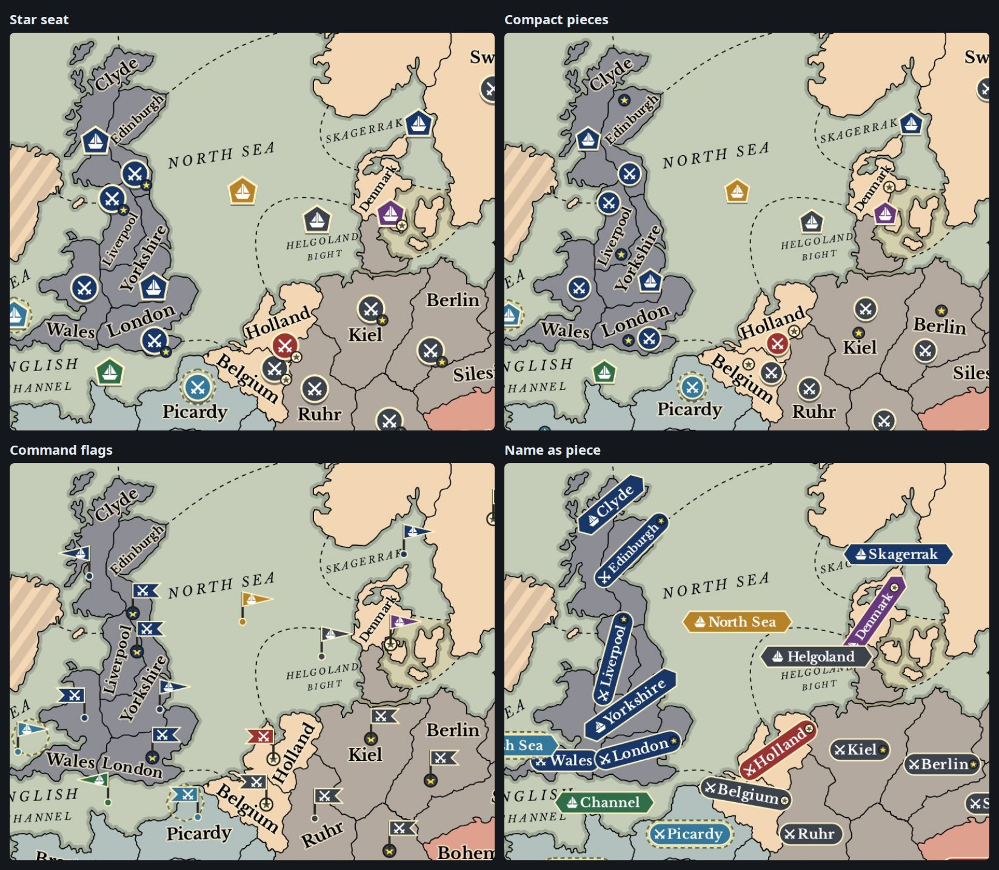
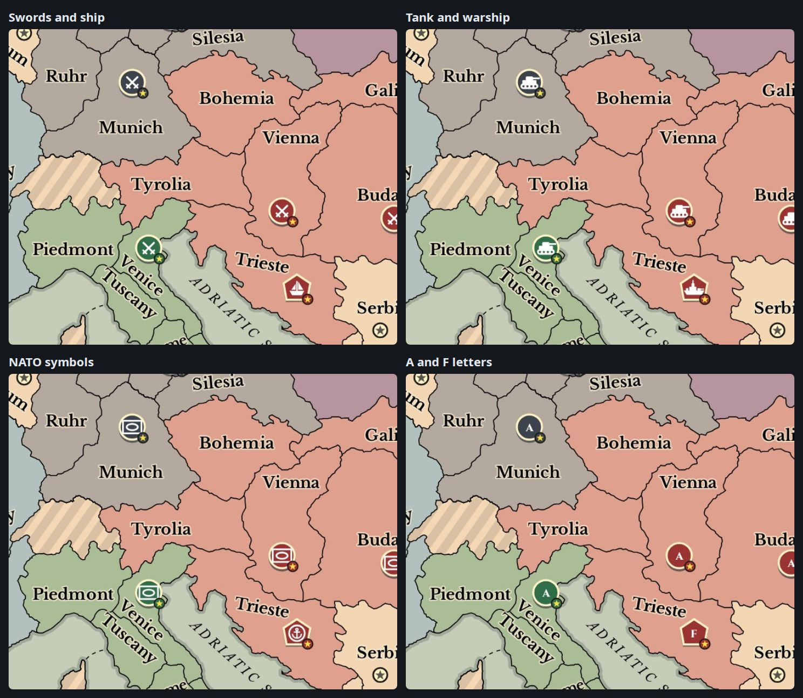
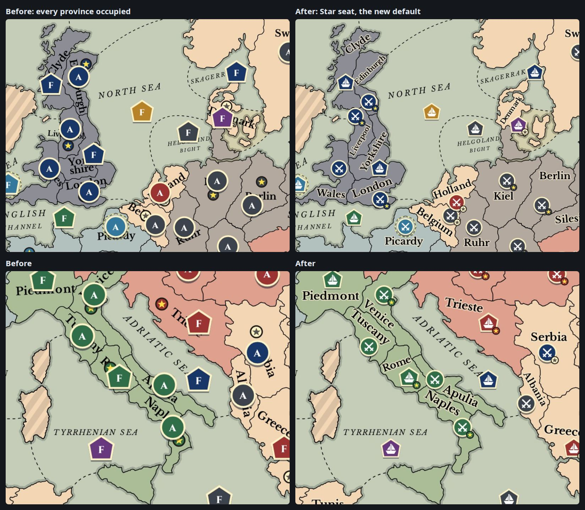

# Europe Map Renderer (`EuropeMap.tsx`)

The visual centerpiece of the application is `frontend/src/components/EuropeMap.tsx`. It is a fully vectorized, GPU-accelerated SVG cartographic map representing the European theatre in 1901.

---

## Geometry & Coordinate System

- **ViewBox**: Defined in `frontend/src/data/europeMapGeometry.ts` (`MAP_VIEWBOX = "0 0 1524 1357"`).
- **Provinces & Borders**: Exact SVG boundary paths for all 76 provinces (including neutral territories and coastal divisions) extracted from authentic historical cartography (`AUTHENTIC_BACKGROUND_SVG` and `AUTHENTIC_FOREGROUND_SVG`).
- **Centroids**: Pre-calculated `Point { x, y }` coordinates for each province and split coast (e.g. `STP_NC`, `STP_SC`), determining unit placement and vector arrow anchors.

---

## Pan & Zoom Engine

The map features smooth multi-modal navigation without external library bloat. The camera lives in `components/map/hooks/useMapCamera.ts` and the pointer gestures in `useMapGestures.ts`, next to it. `EuropeMap` spreads the gestures' pointer handlers on its `<svg>` and hands the camera a callback that moves the floating unit menu with every camera write.
1. **Drag to pan (mouse, finger or pen)**: The camera lives in a ref, and a `requestAnimationFrame` sync writes it to the camera group's SVG `transform` attribute, so panning never re-renders React:
   ```ts
   cameraGroupRef.current.setAttribute('transform', `translate(${x}, ${y}) scale(${zoom})`)
   ```
   The SVG listens for Pointer Events and has `touch-action: none`, so the browser leaves gestures to the map. A press only becomes a pan after it moves 4px (mouse) or 10px (finger or pen), and only then does the map call `setPointerCapture`: capturing on press would take the `click` away from the unit or province under the pointer. After a drag, `dragMovedRef` stops the release from also counting as a tap.
2. **Pinch zoom**: a second finger turns the gesture into a pinch. The board point under the fingers' midpoint follows them, and the zoom changes by how far they spread (`pinchStep`). Lifting one finger carries on as a pan.
3. **Bounded Panning (`mapCameraHelpers.ts`)**: Prevents dragging or zooming the map endlessly off-screen into an empty void. Panning coordinates `(x, y)` are dynamically clamped to allowable zoom-dependent boundaries via `clampCamera`, keeping the map firmly in view while allowing full inspection of border territories and split coasts without dead-zone drag lag.
4. **Wheel Zoom**: zooms about the cursor. The wheel, a pinch and the zoom buttons all go through `zoomAtPoint`, which keeps the board point under an anchor still. Its anchor is in viewBox units, and `elementPointToViewBox` allows for the letterbox that `preserveAspectRatio` leaves around the board. Zoom is clamped between `0.75x` and `3.0x` (`6.0x` on phones).
5. **Imperative Handle (`EuropeMapHandle`)**: Exposes `stepZoom(delta)`, `resetCamera()`, and `getZoom()` via React `forwardRef`, enabling seamless zoom and fit control from the Left Tools Sidebar without SVG re-renders. `stepZoom` zooms about the middle of the view.
6. **Zoom reports**: `onZoomChange` fires at most once per animation frame, and only when the rounded percentage changes. During a pinch it waits until the fingers lift, because each report re-renders App.

### Phone camera (`compact` prop)
App passes `compact` from `useCompactLayout()`. On a phone the map:
- **Starts filling the screen's height**, centred on the player's own units (`getPhoneDefaultCamera`). A portrait screen would otherwise fit the board to its width and leave a thin strip. The camera goes back to this view when the layout turns compact, when the player's power changes, and on Fit.
- **Zooms to `6.0x`** (`COMPACT_MAX_ZOOM`), because pieces are only about 27px across at `3.0x`.
- **Shows zoom buttons on the map**: zoom in, zoom out (each by 1.5×) and "Back to my units", 44px square in the bottom-right corner (`.map-zoom-controls` in `compact.css`).
- **Drops `backdrop-filter`** from the cartouche and the unit popup, since blurring what is behind them repaints the board on every pan frame.
- **Docks the unit menus**: the unit popup, the build popup and the coast picker render as one full-width `.unit-docked-bar` at the bottom of the map, with no drag header and no placement math. The bar's height goes on the map as `--docked-bar-h`, and the zoom buttons ride above it. `onDockedBarChange(visible)` tells App, which lowers the order sheet.
- **Keeps a new selection in view** (`useKeepSelectionInView`): when the selected unit or build slot changes, `keepPointInView` pans (without zooming) so it sits at least 80px inside the part of the map the bar leaves uncovered. An axis already in range doesn't move, and a later pan is left alone.
- **Makes pieces finger-sized**: every piece gets a transparent hit circle at least 22px in radius on screen (`compactHitRadius`), capped at half the distance to the nearest other piece (`halfNearestDistances`) so neighbours keep their own targets. Classic and Name as piece get one too, which they don't need on desktop. It is resized once the zoom has been still for 150ms, not on every frame of a pinch.
- **Says "Tap"** instead of "Click" in its hints.

The wide layout is unchanged: it starts on `DEFAULT_CAMERA`, keeps the `3.0x` ceiling, renders no zoom buttons, floats its popups and keeps the styles' own hit areas.

The browser pane sends mouse events. The `mobile` E2E scenario turns on Playwright's touch emulation, so its taps arrive as touch, but neither can drag or pinch: those have unit tests (`mapCameraHelpers.test.ts`, `map/hooks/useMapCamera.test.ts`, `map/hooks/useMapGestures.test.ts`, `sheetHelpers.test.ts`) and need a real phone to check by hand.

---

## SVG Rendering Layers

The map is rendered as a layered SVG pipeline decomposed into memoized subcomponents under `src/components/map/`:

```
<svg viewBox="0 0 1524 1357">
  │
  ├── 1. Static Defs Layer (StaticLayers.tsx: StaticDefsLayer):
  │      - Drop shadows, glow filters, arrow markers
  │
  ├── 2. Background Map Layer (StaticLayers.tsx: StaticBackgroundLayer, StaticForegroundLayer):
  │      - Landmass contours, ocean bathymetry, topography
  │
  ├── 3. Dynamic Province Fill Layer (ProvincePolygon.tsx: ProvincePolygon):
  │      - Semi-transparent fills colored by owning Great Power
  │      - Hover highlighting for candidate destinations
  │      - Pulsing red highlights for provinces with tactical errors
  │      - Amber glow on valid retreat destinations during Retreats phase
  │      - Gold pulsing border on vacant home SCs during Winter Adjustments
  │
  ├── 4. Province Names Layer (MapNamesLayer.tsx: MapNamesLayer):
  │      - Classic: the original typesetting from StaticNamesLayer (AUTHENTIC_NAMES_SVG)
  │      - Other styles: shared sea names and coast tags, plus land names
  │        placed by the active layout, with a parchment halo
  │
  ├── 5. Supply Center Layer (SupplyCentersLayer.tsx: SupplyCentersLayer):
  │      - Circular markers with gold star / power crest
  │      - Distinguishes neutral vs power-owned centers
  │      - Position, size and presence follow the active piece style
  │
  ├── 6. Order Vector Layer (curveGeometry.ts: computeQuadraticCurve):
  │      - Blue curved bezier arrows for MOVE orders
  │      - Teal dashed arrows with target reticles for SUPPORT orders
  │      - Purple wavy arrows for CONVOY paths
  │      - Grey circular shields for HOLD orders
  │      - Amber arrows for RETREAT orders
  │
  ├── 7. Tactical Simulation & Clash Layer:
  │      - Red crossed swords (⚔) at contested provinces
  │      - Amber bounce markers (💥) where attacks fail
  │      - Scissors (✂) denoting cut supports
  │      - Dislodged unit badges with retreat indicators
  │
  ├── 8. Unit Token Layer:
  │      - Army / fleet pieces drawn by MapPiece in the active style and mark
  │      - Offset dislodged unit tokens with dashed red border
  │      - Semi-transparent phantom tokens for pending BUILD orders
  │      - Selection ring and active power indicator
  │
  └── 9. Floating Action Menu / HUD:
         - Contextual radial quick-actions when a unit is clicked
         - Simulation summary banner
</svg>
```

---

## Piece Styles & Layouts

Each player chooses how pieces look from the display settings menu in the top bar. This changes only what that player sees, so `pieceStyle` and `unitMark` are plain props on `EuropeMap`, and neither touches game state or the server. See [State Management](state-management.md#display-preferences-usedisplayprefs).

| Style | Token | Supply center star | Names |
| :--- | :--- | :--- | :--- |
| `classic` | Full size (`r=17`) | Separate, at `scPos` | The original `AUTHENTIC_NAMES_SVG` |
| `seated` (default) | 76% size | Shares the unit point. Alone when empty, on the token's rim when occupied | Fitted around the token |
| `compact` | 65% size | Small separate coin | Fitted around the token and star |
| `flags` | Base point with a flag on a pole, which may overhang borders and sea | Coin at the base | Fitted around the base and flag |
| `nameplate` | None: the name lights up as a coloured pill | Inside the name or pill | The piece itself |



Marks show whether a piece is an army or a fleet: `icons` (crossed swords and a ship), `vehicles` (a tank and a warship), `nato` (the NATO armour symbol for armies, and an anchor in the round frame NATO uses at sea for fleets), or `letters` (`A` and `F`). Every style also tells the two apart by shape: tokens use a circle or a pentagon, flags a swallowtail or a pennant, and pills rounded or pointed ends.



**Layouts (`data/mapLayouts.ts`)** hold each non-classic style's placements. A row records only what differs from the geometry: a province with no `unit` keeps its `unitPos`, and one with no `star` keeps its `scPos`. `getMapLayout(style)` returns the full layout. Tight provinces such as Liverpool can't hold a token and a name at full size, so their tokens move and their names shrink, with a floor of 12 units (11 for Edinburgh, Denmark and Liverpool).

`mapLayouts.test.ts` checks every placement against the province outlines, so values can be edited by hand and the test reports any province that stops fitting. Text widths come from `data/mapTextMetrics.ts`, which holds Libre Baskerville Bold advance widths measured in the browser. Those widths also size the pills at render time.

**Drawing (`components/MapPiece.tsx`)** is the only place piece bodies are drawn: units, simulation ghosts, winter builds and the previews in the settings menu all use `MapPiece`. `getPieceFrame` returns a `PieceFrame` for each style, which sets ring sizes, badge offsets, banner positions, the step-aside offset for a dislodged unit, and an invisible hit area that keeps small pieces as easy to click as the original token.

`getProvincePoint` and `getUnitPoint` read the active layout, so arrows, support lines, convoy paths, reticles and the floating unit menu all follow the pieces.



**Classic must stay pixel-identical to the original map.** With `letters`, its values in `getPieceFrame` and `DISC_SHAPES` are the original numbers. One known oddity is kept for this reason: `EUROPE_PROVINCE_GEOMETRY.CLY.unitPos` lies in the North Atlantic, so a Clyde unit draws on water in Classic. The other styles move it ashore.

---

## Hover

Hovering a province brightens a reachable one, and hovering a unit rings it and highlights its sidebar card. These use `onPointerEnter`/`onPointerLeave` and ignore `pointerType === 'touch'`, because a tap would otherwise leave the hover on until the next tap. On touch, selecting a unit shows the same information.

---

## Map Overlay

`EuropeMap` renders its `overlay` prop inside the map viewport, outside the SVG, so panning and zooming do not move it and it does not trigger them. `App.tsx` uses it to place `PhaseTimerWidget` over the bottom left of the map, where it stays visible with both sidebars collapsed. Toasts are centered at the bottom of the window to keep clear of it.

---

## Past Turns (`historyView`)

With `historyView` set, `App.tsx` feeds the map a `TurnRecord` from the turn selector instead of the live state: its units, orders, ownership, phase, builds and retreats, and its `resolution` as the `simulationResult`, with `showSimulationOverlay` on.

- `isUnitOrderVisible` draws every power's orders, or only `historyPower`'s when a nation chip is picked, instead of only the player's own.
- `canEditAnyPower` is false and `controlPower` is `null`, so no unit, build slot or province click selects anything. App also passes no-op handlers and no selection.
- In an Adjustments phase the build tokens are the builds that were ordered (`adjustmentOrdersFor`), for every power. Waived slots are not drawn.
- The Hypothetical banner stays hidden.
- On phones the `TurnHistoryPill` goes into the `overlay` beside the clock.

---

## Floating Unit Menu
- **Highlighted Button**: `getActiveOrderButton` lights exactly one of Move, Hold, Support, or Convoy. The menu opens on Move, or on Hold if the unit has an explicit `HOLD` order. Pressing Move, Support, or Convoy takes the highlight from a saved Hold. The saved order itself stays until a new one replaces it.
- **Dragging**: Press and hold the menu header, then drag. The header captures the pointer, so the drag follows the cursor over the menu and outside the map, and it ends on release. Buttons in the header do not start a drag.

---

## Click-to-Order Interaction Modes

A player can only control their own units, and other powers' units are marked `foreign-locked`. Every control check goes through `canEditAnyPower`, which is true in the sandbox and for a host with Direct-Edit on (`directEditActive`). That also decides whose orders and diagnostics are drawn.

The map supports direct board-level order entry across all phases:

### 1. Movement Phase
1. **Select Unit**: Clicking an army or fleet sets `selectedUnitId` and displays valid move destinations as highlighted pulses.
2. **Click Destination (Move)**: Clicking any valid adjacent province immediately dispatches a `MOVE` order. If the destination has split coasts (e.g. `STP`), a coast-selection popup appears.
3. **Support Mode**:
   - Step 1: Select supporting unit and click **Support**.
   - Step 2: Click the friendly or foreign unit to be supported.
   - Step 3: Click the target destination province.
4. **Convoy Mode**:
   - Click a fleet in a sea zone.
   - Click the coastal Army to be transported.
   - Click the destination coastal territory.

### 2. Retreat Phase
- Dislodged units are rendered with an offset position and pulsating amber badge.
- Clicking a dislodged unit automatically queries valid retreat destinations (`getValidRetreatDestinations()`) and pulses safe candidate provinces.
- Clicking an eligible destination province immediately dispatches a `RETREAT` order; clicking the unit's action card disbands it.

### 3. Winter Adjustments Phase
- Vacant home supply centers pulse with gold recruitment rings when builds are available.
- Clicking a home center opens a unit recruitment badge (`BUILD A` or `BUILD F`, with coast pickers for `STP`).
- If in a deficit, clicking existing units marks them for `DISBAND`.
