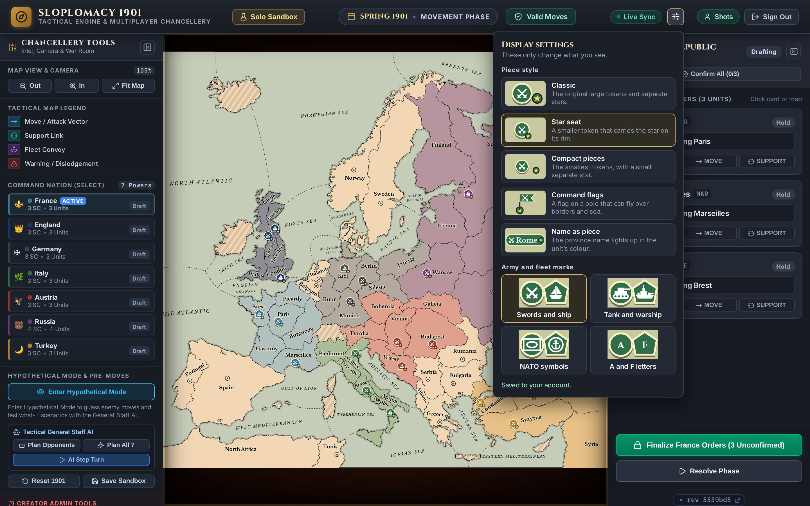

# Dual Collapsible Sidebars & Tactical Controls

The tactical workspace divides user controls into two specialized, independently collapsible sidebars flanking the interactive European map:

1. **Left Sidebar (`ToolsSidebar.tsx`)**: Dedicated to general tools, cartographic legend, map camera & zoom options, Great Powers standing, Pre-Move Sandbox testing, and creator admin tools.
2. **Right Sidebar (`MacroSidebar.tsx`)**: Dedicated strictly to core gameplay: active sovereign command, phase instructions, unit order drafting, home builds, and turn finalization/adjudication.

Both sidebars feature smooth, 44px collapsed rail views with quick tool icons and status badges, maximizing map screen estate while keeping all critical functions accessible.

Phones have no rails. The right sidebar becomes a pull-up order sheet and the left one a drawer opened from ≡ in the top bar. See [Phone Game Screen](#phone-game-screen).

---

## Layout Principles & Anti-Redundancy Rules

To prevent interface bloat and preserve a clean, focused tactical workspace, adhere to these UI design invariants:

1. **Authoritative Lobby Navigation**: The clickable brand emblem and title (`SLOPLOMACY 1901`) in the top command header is the single authoritative control to return to the match lobby; never add separate "Main Page" or "Home" tab buttons to the header. On phones the ← button at the left of `CompactTopBar` takes this role, because a phone has no tooltip to explain the brand.
2. **Sidebar Collapse & Rail Ownership**: Sidebar expand and collapse actions belong exclusively on the sidebars themselves (in their headers when expanded, and on their 44px slim rails when collapsed). Do not introduce top navigation header pill buttons to toggle sidebars. Phones are the exception, because they have no rails: ≡ in the phone top bar opens the tools drawer, and the order sheet's own handle raises and lowers it.
3. **Unobstructed Map Canvas**: The interactive SVG European map viewport must remain free of floating camera/zoom overlay boxes. All stepped zooming, percentage readout, and camera reset/fit actions belong in the Left Tools Sidebar (`ToolsSidebar.tsx`), accessible both in full view and via rail icons. The one exception is the phone layout, which has no wheel and no tools rail: there `EuropeMap` shows zoom in, zoom out and "Back to my units" in the map's bottom-right corner. See [Phone camera](map-renderer.md#phone-camera-compact-prop).
4. **Personal Display Settings in the Top Bar**: The `SlidersHorizontal` icon in the top header's right-hand actions opens `DisplaySettingsMenu.tsx`, on every screen and for guests too. See [Top Bar Display Settings](#top-bar-display-settings). On phones it sits inside the ⋯ menu instead.
5. **Tactical Map Legend Purity**: The Tactical Map Legend is strictly a visual guide for map symbology (movement vectors, support reticles, convoy anchors, and warning/dislodgement markers). Never embed rulebook mechanics or geography text footnotes (e.g. dual coasts or impassable terrain); interactive modal dialogs and cartographic text handle these directly.

---

## Top Bar Display Settings

`DisplaySettingsMenu.tsx` sits between the sync badge and the account controls. It's a popover rather than a modal, so the map stays visible and each change shows live. It closes on an outside click or Escape, and Escape returns focus to the icon.

- **Piece style**: Classic, Star seat, Compact pieces, Command flags or Name as piece.
- **Army and fleet marks**: Swords and ship, Tank and warship, NATO symbols, or A and F letters.
- **Status line**: says where the choice is saved, such as "Saved to your account" or "Saved on this device. Sign in to keep it across devices".

The previews render with the real `MapPiece`, so they always match the map. These settings only affect this player's own view.

---

## Desktop Top Bar (`TopHeader.tsx`)

On a wide screen the header is `TopHeader.tsx`. `AppHeader.tsx` picks it (or `CompactTopBar` on a phone) and passes it the data and handlers it shows, and it keeps no state of its own:

- **Left**: the brand, which goes back to the lobby, then the Solo Sandbox tab (marked while in the solo sandbox) and, in a multiplayer match, the match name with your power.
- **Center**, only on a board: the turn ("SPRING 1901 • MOVEMENT PHASE"), the winner once there is one, and the order check: a red pill with the error count (and warnings after it), an amber pill with the warning count, or a green "Valid Moves". The red and amber pills ask to finalize, and the server answers with the order check.
- **Right**: the Live Sync badge, whose tooltip names what it follows (the lobby feed or the game id), the [display settings](#top-bar-display-settings), and Guest Mode with Sign In / Register, or your name (email in the tooltip) with Sign Out.

---

## Phone Top Bar (`CompactTopBar.tsx`)

In the compact layout (see [Responsive & Layout Specifications](styling-and-themes.md#responsive--layout-specifications)) the header becomes one `52px` row:

- **Left**: in a game, a ← button back to the lobby, then ≡, which opens the [tools drawer](#phone-game-screen). In the lobby, the brand.
- **Turn**: on two lines, the season and year above the phase ("Spring 1901" over "Movement"), so the full phase name fits beside four buttons at 360px. A separator only screen readers see keeps it reading as "Spring 1901 · Movement".
- **Order problems**: a red or amber badge with the count of your errors and warnings. Tapping it does what the desktop pill does: it asks to finalize, and the server answers with the order check. With no problems it shows a green check that does nothing. Once someone has won, it shows the winner instead.
- **⋯ menu**: Live Sync status with what it follows (the lobby feed or the game id), the match and your power, Solo Sandbox, Display settings (the same choices as `DisplaySettingsMenu`, from its `DisplaySettingsOptions`), and your account with its email, Sign In / Register or Sign Out. An amber dot on ⋯ means Live Sync is reconnecting. The menu closes on an outside tap, Escape, or after any action.

---

## Phone Game Screen

In the compact layout the game screen is the map, with everything else layered over it. Both sidebars reuse their desktop pieces through a `variant` prop rather than being copied.

### Order sheet (`BottomSheet.tsx`, `MacroSidebar variant="sheet"`)
- **Stops**: peek, half and full (`utils/sheetHelpers.ts`). It starts at peek every time a game opens. Drag the handle and let go to settle on the nearest stop, or flick to go one stop further. A tap or the keyboard steps peek → half → full → peek. It only slides when it moves between stops, never when it is measured or the screen rotates.
- **Peek**: the power with its unit, supply centre and unconfirmed counts (which the desktop rail only gives in tooltips), the status badge, Confirm All, then Finalize and Resolve. In a match, Resolve is the consensus card, plus Force Adjudicate for the host.
- **Body**: the phase notes, builds and unit cards, then Surrender and the version badge. While the sheet is lowered the body is off screen and `inert`.
- **Spacer**: the sheet leaves a spacer as tall as its peek, so the map ends where the peek begins and the phone camera fits the map that is actually visible.

### Tools drawer (`ToolsSidebar variant="drawer"`)
- ≡ in the top bar opens it over the game area, below the top bar, so ≡ can close it again. Tapping the backdrop or pressing Escape also closes it, and focus goes back to ≡.
- It shows the same sections as the desktop sidebar except Map View & Camera, because the zoom buttons are on the map.
- It stays mounted while closed, and `inert`, so it can slide both ways.

### Docked unit bar and the map
- Selecting a unit or a build slot, on the map or by tapping a card's header, opens one full-width bar at the bottom of the map. It holds the unit's order buttons (44px), a Cancel button and the current step ("Tap a green province to Move"). The coast picker takes its place while it is open. It can't be dragged.
- While the bar is up the sheet drops to its peek, so the bar and the provinces to tap stay in view (`onDockedBarChange`).
- The camera pans just enough to keep what was selected clear of the bar (`keepPointInView`). It only does this when the selection changes, so a pan afterwards is left alone.
- The selected card lights up its provinces, the way hovering a card does on desktop. Raising the sheet while a unit is selected brings its card to the top of the list.

### Turn history
The selector sits at the foot of the ≡ drawer with 40px controls and the nation chips in a 4 × 2 grid, and the static Live tag is hidden to leave room for the turn's name. Picking a past turn closes the drawer and puts a pill on the map (`TurnHistoryPill`: ‹ `S1901 M` › Live), below the clock pill when there is one, so the player can step through turns or go back without reopening the drawer. The order sheet is dimmed under the same "Viewing … · Back to live" bar as on desktop, and nothing on the map can be picked up.

### Turn clock
`PhaseTimerWidget` gets `compact`. It starts as a pill at the top of the map that says what the clock is doing ("14:05", "Vote · 0:42", "Paused · 1/3 ready", "Start the clock"). Tapping it opens the full widget, which has a button to fold it back. An amber dot on the pill means the real clock is running behind Hypothetical Mode.

---

## Reusable Collapsible Section (`CollapsibleSection.tsx`)

`CollapsibleSection.tsx` standardizes all sidebar panel sections with a shared design and typographic hierarchy:
- **Collapsible or Static Modes**: Set `collapsible={true}` for sections that can fold shut (such as Tactical Map Legend, Great Powers Standing, Pre-Move Sandbox, and Creator Admin Tools), or `collapsible={false}` for action controls (such as Map View & Camera) that share identical headers and borders without toggle behavior.
- **Accessible ARIA Attributes**: Includes `aria-expanded` and `aria-controls` on the toggle button with animated chevron indicators (`ChevronDown` / `ChevronRight`).
- **Badge and Counter Support**: Accepts an optional `badge` node (such as zoom percentage badges or unit counts).
- **Controlled & Uncontrolled Support**: Supports `defaultOpen` for initial expansion state, or `isOpen` and `onToggle` for controlled state management.

---

## Left Sidebar: Chancellery Tools & Intel (`ToolsSidebar.tsx`)

### 1. Map View & Camera Controls
- Rendered via a non-collapsible `CollapsibleSection` to retain uniform visual hierarchy with action controls.
- **Zoom In (`+`) & Zoom Out (`-`)**: Stepped zooming across the SVG canvas.
- **Current Zoom Readout**: Real-time percentage indicator (e.g., `105%`).
- **Fit Map / Reset Camera**: Instantly realigns camera to the default center framing at 105% zoom. On a phone it returns to the phone view instead: the board filling the screen's height around the player's own units.

### 2. Tactical Map Cartographic Legend
- Rendered inside a collapsible `CollapsibleSection` (`defaultOpen={true}`). Commanders can collapse the legend to free vertical space for power rosters and sandbox controls.
- Laid out as a two-column grid, paired into two rows split by a vertical hairline divider, so the legend costs half the vertical space it used to.
- Displays symbolic explanations for all map vector overlays, in reading order:
  - **Move / Attack**: Blue curved arrow indicating unit repositioning.
  - **Fleet Convoy**: Purple wavy line representing naval troop transport.
  - **Support Link**: Teal dashed line with target reticle indicating defensive or offensive support.
  - **Warning**: Red/amber alert indicating illegal orders, cut supports, or retreats.

### 3. Great Powers Diplomatic Standing & Command Selector
- Lists all 7 Great Powers (Austria-Hungary, England, France, Germany, Italy, Russia, Turkey) with their authentic World War I (1901–1918) SVG flags, toggleable sorting (`By Score` vs `Default`), dynamic numeric ranking (1–7), player names in multiplayer, national colors, controlled Supply Centers, and active field units.
- **Toggleable Standings Sort**:
  - Segmented toggle at the top of the standings list allows commanders to switch between:
    - **By Score**: Dynamically sorted by victory points (Supply Centers descending, tiebreak by active unit count descending, then canonical order), with numeric ranks `1`–`7` on the left of each flag.
    - **Default**: Standard canonical order (`ALL_POWERS`: Austria, England, France, Germany, Italy, Russia, Turkey) with flush flags.
  - The commander's preference is preserved in browser storage.
- **Compact Layout & Overflow Prevention**:
  - The `Active` badge is positioned on the metrics row (`SC • Units`) rather than the country name row, preventing long commander names from crowding or pushing the `Draft` / `Finalized` / `CD` status tags outside the card.
- **Player Names**:
  - In multiplayer campaigns, each standing entry displays the claimed commander's player name (e.g. `(AdmiralNelson)`) or indicates `(Open)` if unclaimed.
- **Historical WWI Flag SVGs (`PowerFlag.tsx`)**:
  - Replaces emojis with crisp vector SVGs representing 1901–1918 flags: Austro-Hungarian dual civil ensign with Austrian and Hungarian coats of arms, British Union Flag, French Tricolour, German Empire black-white-red tricolour, Kingdom of Italy tricolour with crowned Savoy shield, Russian Empire tricolour with the 1914 imperial eagle canton, and Ottoman Empire crescent and star.
- **Sandbox Mode**: Clicking any power immediately switches active command to that nation for hypothetical experimentation.
- **Multiplayer Mode**: Displays diplomatic status (Orders Finalized, Drafting, or Civil Disorder).

### 4. War Room & Pre-Move Sandbox Tools
- Rendered inside a collapsible `CollapsibleSection` (`defaultOpen={true}`). Displays the `ACTIVE` pill in the header when hypothetical mode is engaged, even when collapsed.
- **"Enter Hypothetical Mode" / "Exit Mode"**: Toggles isolated hypothetical planning (with the Eye icon). In hypothetical mode, foreign moves can be freely drafted; exiting discards foreign guesses and restores the authoritative state. In a multiplayer match the sandbox is a private copy: other players cannot see it, it does not show their real orders, and Finalize, Resolve, Surrender and the Admin Console wait until you exit.
- **Tactical General Staff AI**:
  - **"Plan Opponents"**: Generates DATC-compliant, heuristic moves for all 6 other nations.
  - **"Plan All 7 Powers"**: Auto-generates orders for every nation across Europe.
  - **"AI Step Turn"**: Auto-plans foreign powers and steps the game clock directly to the next phase with full adjudication.
- **Foreign Guesses Counter & Clear**: Displays count of drafted foreign guesses with a one-click "Clear" button.
- **Scenario Management & Saving**: One-click "Reset 1901" scenario start and "Save Sandbox". Clicking "Save Sandbox" opens `SaveSandboxModal.tsx`, letting the commander specify a custom name (e.g., "Balkans 1901 Tactical Analysis") before promoting their personal draft sandbox in-place to a permanent saved sandbox.

### 5. Creator Administrator Controls (Game Creator Only)
- Visible exclusively to room creators, rendered inside a collapsible `CollapsibleSection` (`defaultOpen={true}`) with a warning red `ShieldAlert` icon.
- **"Open Admin Console"**: Launches `AdminToolsModal.tsx` for timeline rollbacks, unit teleportation, and arbitrary unit spawning/destruction.
  - Destroy, Roll Back and Hard Reset ask for confirmation in an in-app `ConfirmModal`, never a browser dialog. A browser dialog the player has blocked answers "no" without showing anything, which made these buttons silently do nothing (issues #75, #77). Holding Shift while clicking skips the confirmation, and the modal says so. Escape or Cancel backs out.
  - The turn form resets only when the console opens or the game reaches another turn, not on every order update, so typing is not undone and an error from the last action stays visible.
- **"Solo Sandbox"** (top bar): leaving a multiplayer match for the solo board asks through the same `ConfirmModal`.
- **"Direct-Edit Board Override"**: While on, the host can select and order any power's units on the map, and sees all their orders. Other players are unaffected, and the toggle has no effect in a game the player does not host.

### 6. Turn History footer (`TurnHistorySelector.tsx`)
- Pinned below the scrolling sections, so it is always in reach. It only appears once the game has a resolved phase, and it is not on the collapsed rail.
- **‹ [turn] ›**: steps through, or picks from, the resolved phases (newest first in the menu, after the current turn). **Live** is a quiet tag while the current turn is on show and an amber button while a past one is.
- A past turn shows on the map as it began, with every nation's orders coloured by how they resolved: green arrows succeeded, red dashed ones bounced with a "BOUNCED" label, and broken supports carry "CUT". Past winters show the builds that were ordered. Nothing can be selected or ordered on it.
- **Nation chips** (All, AUS … TUR) narrow a past turn's arrows to one nation. The row is always there, greyed out and disabled on the live turn, so picking a past turn never shifts the arrows above it and a quick run of clicks on ‹ can't land on a chip.
- While a past turn is on show, the right sidebar is dimmed and `inert` under a "Viewing Spring 1901 Movement · Back to live" bar, so no order is changed out of sight. Entering Hypothetical Mode, opening the admin console or switching games returns to live. A turn resolving does not move the player off what they are looking at.
- The data comes from `GET /api/history` and `GET /api/history/{index}` through `useTurnHistory`, always for the real game, never a private sandbox copy.

---

## Right Sidebar: Tactical Command & Orders (`MacroSidebar.tsx`)

`MacroSidebar` reads the phase flags (`isAdjustmentPhase`, `isRetreatPhase`) from its props, keeps two `useMemo`s (the powers the match is waiting on, via `getRequiredPowers`, and the consensus card text) and calls `computeOrderProgress` for the rest: the power's units, its blocking issues, its supply center count, the builds and disbands owed and the confirmed counts (`utils/orderProgress.ts`). It passes that one `OrderProgress` object, plus a few flat props, to the pieces in `components/macro/`, and arranges them for the desktop panel, the collapsed rail or the phone sheet. Fix a number or a label in the piece that draws it, not in a copy per layout:

| Piece | Draws |
| :--- | :--- |
| `PowerHeader` (with `StatusBadge`, `PhaseContext`, `HistoryLockBar`) | The power's name or crest, its unit and center counts, the status badge, the phase's instruction box and the past-turn bar |
| `UnitOrderList` | The home build slots in winter and a `UnitMacroCard` per unit, and the handler that sends the default order for a picked type |
| `UnitMacroCard` | One unit: header, status pill, behavior bar, then `OrderTypeTabs` and `OrderParameterControls`, issues and the simulation strip |
| `OrderTypeTabs` | The order-type buttons for the phase (Retreat/Disband, Keep/Disband or Hold/Move/Support/Convoy) |
| `OrderParameterControls` | The selects for the order's type, in `macro/controls/` (`RetreatControls`, `MoveControls`, `SupportControls`, `ConvoyControls`); each takes only the props it reads |
| `OrderFooter` (with `ConfirmAllButton`, `SurrenderButton`) | The Confirm All and Surrender buttons, and the footer: Finalize or Unlock, then Resolve or the consensus card. `OrderFooter` itself is a fragment, because the sheet's CSS styles these buttons as direct children of `.macro-sheet-controls` |
| `CollapsedRail` | The rail's contents. The `<aside>` stays in `MacroSidebar` so collapsing keeps one element and the width transition on `.macro-sidebar` plays |
| `useSheetSelection` | The sheet's two reactions to the selected unit (highlight its provinces, scroll its card up when the sheet is raised) |

Pieces must not be defined inside `MacroSidebar`: a component defined in a render is a new type each time and remounts its subtree, which drops select focus.

### 1. Active Sovereign Command Header & Telemetry
- Displays active nation crest, name, controlled Supply Centers, and active/dislodged unit counts.
- Real-time status badge: `Drafting Orders`, `Finalized`, `Civil Disorder`, or `X Issues`.
- Top-right collapse button for quick toggling into a compact 44px rail.

### 2. Phase-Aware Instructions & Quotas
- **Winter Adjustments**: Summarizes build allowances (`+X` home builds allowed, `Y/X` assigned) or disband requirements (`-X` units required to disband).
- **Retreats**: Prompts commanders on dislodged units requiring retreat destinations or disband orders.

### 3. Quick Action Toolbar
- **"Confirm All (X/Y)"**: Marks all unassigned units as explicitly holding, clearing `UNASSIGNED_UNIT` warnings.
- **"Surrender & Leave"** (Multiplayer): Accessible button to surrender sovereign command and place units in Civil Disorder.

### 4. Macro Force Orders Roster

#### A. Home Supply Center Builds (Winter Adjustments)
- Displays vacant home supply centers for surplus powers.
- Inline controls to toggle `+ Army`, `+ Fleet` (with coastal options for split coasts), or `Waive`. Every slot starts waived, because a build only happens if it is ordered.

#### B. Active Field Units & Dislodged Units
- **Unit Badge**: Army (`A`) or Fleet (`F`) with national color.
- **Province Code & Title**: Name and code (with coastal notation, e.g. `STP/SC`).
- **Behavior Visualizer**: Symbolic action summary (e.g. `MOVE -> BUR`, `HOLD Defending Paris`).
- **Order Mode Tabs**: `HOLD`, `MOVE`, `SUPPORT`, `CONVOY`, `RETREAT`, `DISBAND`.
- **Target & Auxiliary Selectors**: Clean, contextual dropdown menus populated strictly with valid reachable provinces and convoy routes, constrained with ellipsis truncation to prevent horizontal container blowout.
- **Scrollable Order List**: Styled with slim dark-mode scrollbars matching the left sidebar and `overflow-x: hidden` to prevent horizontal scrollbar leaks.
- **Real-Time Diagnostics**: Inline error/warning alerts explaining DATC violations.
- **Simulation Preview Results**: Instant visual feedback on simulated advances, bounces, or cut supports.

### 5. Sticky Action Footer & Consensus Resolution
- **"Finalize Orders" (`POST /api/finalize`)**: Submits orders. Opens `SanityCheckModal.tsx` if warnings or unconfirmed moves exist.
- **Consensus Auto-Adjudication (Multiplayer)**: In multiplayer matches, turns advance automatically once all required active powers finalize their orders. A power with no decision to make, such as one owed builds with every home center occupied, is not waited for, and a retreat or adjustment phase no player is involved in passes by itself. Non-creator players see a real-time consensus status card rather than a manual button. Connected clients poll state in the background to seamlessly receive phase transitions:
  - **Waiting Lobby Mode (< 2 Players)**: Multiplayer matches require a minimum of 2 players to auto-resolve turns. When a single player prepares and finalizes their orders, the status card clearly indicates `"Orders Locked • Waiting for Players (1/2 min)"` and explains that automatic resolution begins once opponents join.
  - **Active Match Mode (>= 2 Players)**: Displays `"Resolution Progress: X/Y Ready"` and `"Waiting on: [Powers]"`, transitioning to `"Consensus Reached (Y/Y)"` when all required powers finalize.
- **"Adjudicate Turn & Advance" (`POST /api/adjudicate`)**:
  - In Solo / Sandbox Mode: Commits moves and advances the season/phase.
  - In Multiplayer Mode: Restricted to the **Game Creator**. When testing solo in a waiting lobby (< 2 players), the host button explicitly displays `"Advance Phase Solo (Host Override)"` to advance turns without waiting for opponents. In active matches, it acts as `"Force Adjudicate Phase (Host Override)"` to bypass stalled or AFK players. Unauthorized non-creator calls return `403 Forbidden`. Once a power has won, the button is disabled and reads "Game Over".

---

## Collapsible Sidebar Rails

Desktop only. When either sidebar is collapsed:
- **Left Tools Rail (44px)**: Houses collapse toggle, mini Zoom In / Out / Fit buttons, Sandbox active glow indicator, and Admin icon.
- **Right Tactical Rail (44px)**: Houses collapse toggle, active nation crest, unconfirmed orders counter pill (or green checkmark when complete), and warning badge.
### 7. Version Revision Badge (`VersionBadge.tsx`)
- Sits at the sticky footer bottom of the sidebar.
- Displays the current build revision short SHA (`rev <sha>`) with one-click clipboard copy and direct link to the commit on GitHub.

