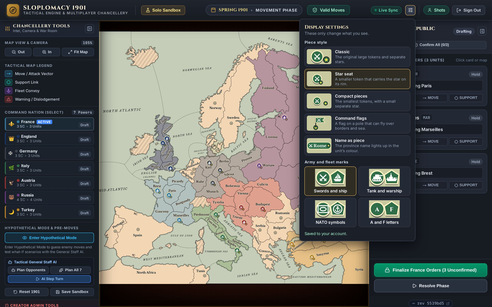

# Dual Collapsible Sidebars & Tactical Controls

The tactical workspace divides user controls into two specialized, independently collapsible sidebars flanking the interactive European map:

1. **Left Sidebar (`ToolsSidebar.tsx`)**: Dedicated to general tools, cartographic legend, map camera & zoom options, Great Powers standing, Pre-Move Sandbox testing, and creator admin tools.
2. **Right Sidebar (`MacroSidebar.tsx`)**: Dedicated strictly to core gameplay: active sovereign command, phase instructions, unit order drafting, home builds, and turn finalization/adjudication.

Both sidebars are the same width (`--sidebar-width`, 360px, in `styles/tokens.css`) and collapse to 44px rails (`--sidebar-rail-width`) with quick tool icons and status badges.

On a wide screen the sidebars float over the map instead of sitting beside it: the map fills the whole workspace underneath them. Opening or collapsing a sidebar only covers or uncovers the map's edge, so the board never moves or re-fits. The workspace (`GameWorkspace`) marks a collapsed sidebar with `data-left-collapsed` / `data-right-collapsed`, and its stylesheet turns those into `--map-inset-left` / `--map-inset-right` for whatever sits over the map. See [Map under the sidebars](map-renderer.md#map-under-the-sidebars).

Phones have no rails. The right sidebar becomes a pull-up order sheet and the left one a drawer opened from ≡ in the top bar. See [Phone Game Screen](#phone-game-screen).

## Contents

- [Layout Principles & Anti-Redundancy Rules](#layout-principles--anti-redundancy-rules)
- [Top Bar Display Settings](#top-bar-display-settings)
- [Desktop Top Bar (`TopHeader.tsx`)](#desktop-top-bar-topheadertsx)
- [Phone Top Bar (`CompactTopBar.tsx`)](#phone-top-bar-compacttopbartsx)
- [Phone Game Screen](#phone-game-screen)
- [Reusable Collapsible Section (`CollapsibleSection.tsx`)](#reusable-collapsible-section-collapsiblesectiontsx)
- [Left Sidebar: Chancellery Tools & Intel (`ToolsSidebar.tsx`)](#left-sidebar-chancellery-tools--intel-toolssidebartsx)
- [Right Sidebar: Tactical Command & Orders (`MacroSidebar.tsx`)](#right-sidebar-tactical-command--orders-macrosidebartsx)
- [Collapsible Sidebar Rails](#collapsible-sidebar-rails)

---

## Layout Principles & Anti-Redundancy Rules

To prevent interface bloat and preserve a clean, focused tactical workspace, adhere to these UI design invariants:

1. **Authoritative Lobby Navigation**: The clickable brand emblem and title (`SLOPLOMACY 1901`) in the top command header is the single authoritative control to return to the match lobby; never add separate "Main Page" or "Home" tab buttons to the header. On phones the ← button at the left of `CompactTopBar` takes this role, because a phone has no tooltip to explain the brand.
2. **Sidebar Collapse & Rail Ownership**: Sidebar expand and collapse actions belong exclusively on the sidebars themselves (in their headers when expanded, and on their 44px slim rails when collapsed). Do not introduce top navigation header pill buttons to toggle sidebars. Phones are the exception, because they have no rails: ≡ in the phone top bar opens the tools drawer, and the order sheet's own handle raises and lowers it.
3. **Overlays Keep Clear of the Sidebars**: Anything placed over the map (banners, pills, the turn clock, the coast picker, the floating unit menu) offsets or centres itself with `--map-inset-left` / `--map-inset-right`, never with a width written into its own stylesheet or script. A centred overlay uses `left: calc(50% + (var(--map-inset-left, 0px) - var(--map-inset-right, 0px)) / 2)`.
4. **Unobstructed Map Canvas**: The interactive SVG European map viewport must remain free of floating camera/zoom overlay boxes. All stepped zooming, percentage readout, and camera reset/fit actions belong in the Left Tools Sidebar (`ToolsSidebar.tsx`), accessible both in full view and via rail icons. The one exception is the phone layout, which has no wheel and no tools rail: there `EuropeMap` shows zoom in, zoom out and "Back to my units" in the map's bottom-right corner. See [Phone camera](map-renderer.md#phone-camera-compact-prop).
4. **Personal Display Settings in the Top Bar**: Both desktop and phones share `DisplaySettingsOptions` inside the unified top-bar account dropdown (`AccountDropdownMenu.tsx` -> `Display Settings`) whenever a board is open, for guests too. See [Top Bar Display Settings](#top-bar-display-settings).
5. **Tactical Map Legend Purity**: The Tactical Map Legend is strictly a visual guide for map symbology (movement vectors, support reticles, convoy anchors, and warning/dislodgement markers). Never embed rulebook mechanics or geography text footnotes (e.g. dual coasts or impassable terrain); interactive modal dialogs and cartographic text handle these directly.

---

## Top Bar Display Settings

`DisplaySettingsOptions` renders inside the unified top-bar dropdown (`AccountDropdownMenu.tsx` on both desktop and phones). It stays in a popover rather than a modal, so the map stays visible and each change shows live. It closes on an outside tap/click or Escape, and Escape returns focus to the dropdown trigger.

- **Spacing**: Compact or Normal UI spacing (tightens sidebar padding and switches order cards and past-turn rows to compact one-line rows).
- **Piece style**: Classic, Star seat, Compact pieces, Command flags or Name as piece.
- **Army and fleet marks**: Swords and ship, Tank and warship, NATO symbols, or A and F letters.
- **Status line**: says where the choice is saved, such as "Saved to your account" or "Saved on this device. Sign in to keep it across devices".

### Top Bar Administrator Menu (`AdminSettingsMenu.tsx`)

Shown to the game creator (`isGameCreator`) inside the top-bar `Game Settings` dropdown (`GameSettingsMenu.tsx` -> `Administrator` -> `AdminSettingsOptions`):

- **`Edit Board`** (`data-testid="btn-toggle-direct-edit"`): toggles interactive Direct-Edit Mode on the map (`AdminDirectEditSidebar.tsx`).
- **`Turn and Clock Settings`** (`data-testid="btn-open-admin-console"`): opens `AdminTurnClockSidebar.tsx` in the right sidebar for Revert to Past Turn (`TurnControlTab`) and Adjust Game Clock & Season.
- **`Exit Admin Mode`** (`data-testid="btn-exit-admin-mode"`): appears whenever an admin mode is active (asking for confirmation if board edits are staged).

The previews render with the real `MapPiece`, so they always match the map. These settings only affect this player's own view.

---

## Desktop Top Bar (`TopHeader.tsx`)

On a wide screen the header is `TopHeader.tsx`. `AppHeader.tsx` picks it (or `CompactTopBar` on a phone) and hands both the same shared `TopHeaderProps` data and handlers, keeping no state of its own:

- **Left**: the brand, which goes back to the lobby.
- **Center**, only on a board: the unified fixed-width turn chronicle and history viewer (`TurnChronicle.tsx`), and the winner once there is one. The top bar shows no order errors or warnings: the order sidebar on the right already lists them on each unit card.
  - The chronicle shows the `‹` and `›` step arrows beside the calendar phase `IconSelectDropdown` menu (chevron-free, e.g. `"Spring 1901 Movement"`). While viewing a past turn, a yellow revert-icon button appears beside the dropdown to jump straight back to live.
  - Before the first phase resolves, the history controls stay disabled. While viewing a past turn, `HistoryLockBar` inside `HistoryTurnPanel.tsx` provides multi-select `Nations` and `Actions` filter chips directly above the resolved order log; entering an admin mode (`Edit Board` or `Turn and Clock Settings`) returns to the live turn and locks the chronicle controls until admin mode exits.
- **Right**: the icon-only top-bar menus:
  - **`Game Settings` (`GameSettingsMenu.tsx`, shown while on a board)**: renders an amber flask icon in Solo Sandbox mode (draft or saved) or a crown icon in a multiplayer game; opens with a `Game Settings` header, `[flag] game name` (for saved sandboxes and live games; omitted in Local Sandbox mode), and a type line showing `[flask] Local sandbox`, `[flask] Saved sandbox`, or `[crown] Live game`; holds `Copy game link` (multiplayer, for players and spectators: copies `/game/<id>`, never a passcode, and reads `Link copied` for a moment), `Open in Local Sandbox` (multiplayer only), `Administrator` (for the game creator, opening `AdminSettingsOptions` with a `Back` button), `Save Sandbox` / `Save as New Sandbox` (Solo Sandbox, opening `SaveSandboxModal`), `Reset Sandbox` (Solo Sandbox, resetting the board to Spring 1901), `Delete Sandbox` (saved sandboxes only), `Return to Previous Game` (Solo Sandbox, when entered after viewing a game), and `Surrender` (for an active non-surrendered multiplayer seat).
  - **Account & Display (`AccountDropdownMenu.tsx`, user icon)**: opening it shows the player's distinct full name (if set), `@username`, and email at the top in primary font and larger text; followed by `Display Settings` (on a board, opening `DisplaySettingsOptions` with a `Back` button); `Account Settings` (when signed in, opening `AccountModal`); then `Switch Game` with the current game shown inline as subtext (expanding a list of Solo Sandbox and all current games the user is involved in, marking the current game); and `Sign Out` (or `Sign In / Register` for guests) at the bottom.

---

## Phone Top Bar (`CompactTopBar.tsx`)

In the compact layout (see [Responsive & Layout Specifications](styling-and-themes.md#responsive--layout-specifications)) the header becomes one `52px` row reusing the shared top-bar pieces:

- **Left**: in a game, a `←` button back to the lobby, then `≡`, which opens the [tools drawer](#phone-game-screen). In the lobby, the brand.
- **Center**, in a game: the shared `TurnChronicle.tsx` in a two-line compact layout (`Spring 1901` over `Movement`), keeping step arrows, the dropdown turn picker, and the Back to live button inline without a duplicate map pill. Once someone has won, an icon-only gold `Crown` button (`data-testid="game-over-pill"`) sits beside it to reopen `GameOverModal`.
- **Right**: the shared `GameSettingsMenu` (when on a board, including Solo Sandbox actions, `Open in Local Sandbox`, `Administrator` with red active indicator, and `Surrender`) and `AccountDropdownMenu` (Profile, `Display Settings`, `Account Settings`, `Switch Game`, Sign In / Sign Out). Order problem counts stay on the sheet peek's `StatusBadge` and finalization check, matching desktop.

---

## Phone Game Screen

In the compact layout the game screen is the map, with everything else layered over it. Both sidebars reuse their desktop pieces through a `variant` prop rather than being copied.

### Order sheet (`BottomSheet.tsx`, `MacroSheet.tsx`)
- **Stops**: peek, half and full (`utils/sheetHelpers.ts`). It starts at peek every time a game opens. Drag the handle and let go to settle on the nearest stop, or flick to go one stop further. A tap or the keyboard steps peek → half → full → peek. It only slides when it moves between stops, never when it is measured or the screen rotates.
- **Peek**: the active power (with a 1-tap `SheetPowerSwitcher` across all 7 powers in Solo Sandbox or Multiplayer Hypothetical Mode), unit/SC/unconfirmed counts, `StatusBadge`, and a single action row holding `Finalize` + `Resolve` (solo) or `Press` with unread badge (`mobile-press-toggle`, multiplayer). A spectator's peek holds the Watching bar (flags, Claim and Leave on one row) and `Press`, with no Finalize.
- **Body**: `PhaseContext`, the multiplayer consensus card (`MultiplayerConsensusCard`), the `Clear All Orders` utility bar (`macro-sheet-utility-bar`), and the builds and unit cards. While the sheet is lowered the body is off screen and `inert`.
- **Spacer**: the sheet leaves a spacer as tall as its peek, so the map ends where the peek begins and the phone camera fits the map that is actually visible.

### Tools drawer (`ToolsSidebar variant="drawer"`) & Dedicated Press Sheet (`MobilePressSheet.tsx`)
- ≡ in the top bar opens the Tools drawer over the game area, below the top bar, so ≡ can close it again. Tapping the backdrop or pressing Escape also closes it, and focus goes back to ≡.
- It shows the same Standings and Sandbox sections as the desktop sidebar (omitting Map View & Camera because zoom buttons sit on the map). In a match with Press, it shows a full-width `Open Press & Diplomacy` launcher button (and tapping any power's envelope in Standings opens Press directly to that thread) instead of cramming Press inside the 320px drawer.
- `MobilePressSheet.tsx` opens full-width and full-height (`dvh`-aware for on-screen keyboards) from either the sheet peek's `Press` button or the drawer, rendering `PressSection variant="sheet"` with inline `PressRecipientBar` chips (`[Public]` + each power with unread badges), horizontally scrolling channel tabs, expanded message history, and composer. Both overlays stay mounted while closed (`inert`) so animations and drafts persist.

### Docked unit bar and the map
- Selecting a unit or a build slot, on the map or by tapping a card's header, opens one full-width bar at the bottom of the map. It holds the unit's order buttons (44px), a Cancel button and the current step ("Tap a green province to Move"). The coast picker takes its place while it is open. It can't be dragged.
- Tapping order-type tabs (`Hold`, `Move`, `Support`, `Convoy`, etc.) inside the open sheet keeps the sheet open so players can finish drafting orders inline with native `<select>` pickers without the sheet dropping to `peek`.
- While the bar is up the sheet drops to its peek, so the bar and the provinces to tap stay in view (`onDockedBarChange`).
- The camera pans just enough to keep what was selected clear of the bar (`keepPointInView`). It only does this when the selection changes, so a pan afterwards is left alone.
- The selected card lights up its provinces, the way hovering a card does on desktop. Raising the sheet while a unit is selected brings its card to the top of the list.

### Turn history
Turn history uses the same `TurnChronicle.tsx` control in `CompactTopBar` (with full-width dropdown items styled in `@layer compact`). The order sheet shows the `"Viewing …"` bar (`HistoryLockBar`) in the peek, `Nations` / `Actions` filters in the sheet body (`HistoryTurnPanel.tsx`), and nothing on the map can be picked up while viewing a past turn. Tapping any past-turn order or territorial change row inside the sheet pins it on the map and drops the sheet back to `peek`, showing a compact summary bar (`HistoryPeekSelection`) with a clear (`×`) button so players can inspect the highlighted move on the unobstructed map.

### Turn clock
`PhaseTimerWidget` gets `compact`. It starts as a pill at the top of the map that says what the clock is doing ("14:05", "Vote · 0:42", "Paused · 1/3 ready", "Start the clock"). Tapping it opens the full widget, which has a button to fold it back. An amber dot on the pill means the real clock is running behind Hypothetical Mode.

---

## Reusable Collapsible Section (`CollapsibleSection.tsx`)

Every sidebar panel section shares one header and border style through `CollapsibleSection`. A section can fold shut (Standings, Press, Sandbox) or be static with the same header (Map View & Camera), and its toggle exposes `aria-expanded` and `aria-controls`. A header may carry a badge (zoom percentage, unit count, the `ACTIVE` pill) that stays visible while folded.

---

## Left Sidebar: Chancellery Tools & Intel (`ToolsSidebar.tsx`)

`ToolsSidebar` keeps the header, the drawer's focus and Escape handling, and the history footer. Each section (map controls, standings, press, sandbox tools) is its own component under `components/tools/` and receives only the props it reads. The parent decides which sections show: the zoom section is left out of the phone drawer, and Administrator controls live in the top-bar Game Settings menu, not in this sidebar.

### 1. Map View & Camera Controls
- Rendered via a non-collapsible `CollapsibleSection` to retain uniform visual hierarchy with action controls.
- **Zoom In (`+`) & Zoom Out (`-`)**: Stepped zooming across the SVG canvas.
- **Current Zoom Readout**: Real-time percentage indicator (e.g., `90%`).
- **Fit Map / Reset Camera**: Instantly realigns the camera to the home view: the board framed in the strip between the sidebars (`getWideHomeCamera`, about 90% at 1440×900). On a phone it returns to the phone view instead: the board filling the screen's height around the player's own units.

### 2. Great Powers Diplomatic Standing & Command Selector
- Lists all 7 Great Powers (Austria-Hungary, England, France, Germany, Italy, Russia, Turkey) with their authentic World War I (1901–1918) SVG flags, toggleable sorting (`By Score` vs `Default`), dynamic numeric ranking (1–7), player names in multiplayer, national colors, controlled Supply Centers, and active field units.
- **Toggleable Standings Sort**:
  - Segmented toggle at the top of the standings list allows commanders to switch between:
    - **By Score**: Dynamically sorted by victory points (Supply Centers descending, tiebreak by active unit count descending, then canonical order), with numeric ranks `1`–`7` on the left of each flag.
    - **Default**: Standard canonical order (`ALL_POWERS`: France, England, Germany, Italy, Austria, Russia, Turkey) with flush flags.
  - The commander's preference is preserved in browser storage.
- **Toggleable Map Move Visibility (Sandbox / Hypothetical Mode)**:
  - Shown when on a sandbox board (`!isMultiplayer`) or in Multiplayer Hypothetical Mode (`sandboxMode === true`).
  - Segmented **`Map Moves`** control lets commanders toggle between **`All Moves`** (renders planned orders for all 7 Great Powers) and **`Selected Nation`** (renders only the currently active/commanded power's orders).
- **Player Names**: in multiplayer each row shows the claimed commander's name, or `(Open)` if unclaimed. The `Active` badge sits on the metrics row so a long name never pushes the `Draft` / `Finalized` / `CD` tags out of the card.
- **Flags**: each power is drawn with its 1901–1918 flag as an SVG (`PowerFlag`), never an emoji.
- **Turn History Synchronization**: When viewing a past turn, the scoreboard shows that turn's Supply Center counts, unit counts and ranking (using post-edit ownership and units on `"Admin"` snapshots), disables hover/click power switching, and hides live-turn draft/finalized/surrender marks.
- **Sandbox Mode & Multiplayer Hypothetical Mode**: Clicking any power switches active command to that nation (in Hypothetical Mode, changes go to the ephemeral `sbx_` branch and never touch your real seat).
- **Multiplayer Mode (Outside Hypothetical Mode)**: Displays diplomatic status (Orders Finalized or Civil Disorder). A power still drafting has no mark; the row's tooltip says so.

### 4. Press (`tools/PressSection.tsx`)
Shown under Diplomatic Standing in a multiplayer match (never in a sandbox). Its pieces are in `tools/press/`. A spectator (watching without a seat, `power` null) gets `tools/press/SpectatorPress.tsx` instead: the public box alone, read-only, with "You are watching: only the players can send press." where the composer would be. It has no conversation chips, recipient letters or move suggestions, because the server sends a spectator nothing but public press.

- **Conversations** (`PressChannelTabs`): a chip for the public box, and one per private thread (the flags of the other powers in it), each with its unread count. Anonymous messages are posted in the conversation they were written in.
- **Messages** (`PressMessageList`): the picked conversation, oldest first, with a divider wherever the turn changes. An anonymous message shows a mask and "Anonymous"; the player's own shows "You" with an "anonymously" tag.
- **Province links**: a province named in a message, by its code in capitals (`BUR`) or its full name in any case (`Burgundy`), is a link. Hovering lights it on the map; clicking keeps it lit, and on a phone also closes the drawer.
- **Recipients are picked on the standings**: in a match with press, every other country's Diplomatic Standing row has a letter button on its right (`PressPickButton` in `StandingsSection`). Clicking it lights it and adds that country to the next message's recipients; clicking again takes it off. Nothing lit is the public box and lit countries are the thread of exactly those powers. A country with no player cannot be picked, the player's own row has no button, and the buttons go away once the game is over or the player has surrendered. Each button carries the unread count of the player's one-to-one thread with that country. The picked countries live in `pressStore`, which is how the two sections share them. Picking a country opens the Press section if it was folded.
- **Composer** (`PressComposer`): the message field (Enter sends, Shift+Enter is a new line), a mask button that posts anonymously in the open conversation, and Send. The mask is disabled (and its tooltip says why) in a one-to-one thread, where the other player would know who wrote it; it stays chosen, and comes back lit in the public box or a thread of three or more. While the mask is lit the field has a dashed purple border and reads "Write anonymously…". There is no help text: a line appears under the field only when something stops the message being sent (game over, surrendered, too long). Where the message goes is still read to screen readers with the field.
- **Move suggestions**: in a signed private thread, during a Movement phase, the composer has a lamp button (`press-suggest`) beside the mask. It starts suggest mode and the phone closes the drawer to show the map. The player then orders units on the map the usual way: the other members' units and any of their own they want to show (a joint plan; their own half starts empty and their real orders are never touched). The draft is listed above the field (`PressSuggestionDraft`), where an order can be taken off or the whole draft discarded, and it goes out with the next message, which then needs no text. The mask is put away while a draft is open, an unfinished order blocks Send, and picking other countries discards the draft so it cannot reach anyone it was not written for. A message that carries a suggestion shows it in a card under its text (`PressSuggestionCard`): the orders by power, **Show on map**, and for a recipient **Use these orders**, which copies the orders for their own units into their real orders (one atomic batch, nothing finalized, still editable). The sender is not told. Both buttons work only during the turn the message was sent in and while the live board is on screen; afterwards the card keeps the order text and says which turn it was for. While a suggestion has the board the order sidebar is locked with the bar a past turn uses ("Viewing France's suggestion", **Back to live**), and a pill on the map (`map/hud/SuggestionPill`) says what is shown, offers **Use these orders** for a received one, and closes it.
- **Unread**: a conversation is marked read only while its list is actually on screen (the section open, the drawer open, and the list scrolled into the sidebar's view). Read marks are kept per game and seat in `localStorage`, counted in the player's own message numbers. Revealed press is numbered for the whole game, so its marks are kept apart, and when the game ends everything already on screen starts as read rather than the whole revealed history counting as unread.
- **Game over**: every thread and every anonymous author is shown to all players. The letter buttons and the mask button go away and only the public box can still be written to.
- A surrendered player can read but not write.

### 5. War Room & Pre-Move Sandbox Tools
- Rendered inside a collapsible `CollapsibleSection` (`defaultOpen={true}`). Displays the `ACTIVE` pill in the header when hypothetical mode is engaged, even when collapsed.
- **"Enter Hypothetical Mode" / "Exit Mode"**: Toggles isolated ephemeral hypothetical planning (with the Eye icon). In hypothetical mode, you can switch nations, draft moves for any power, and step turns forward (`Step Turn Forward`) to preview outcomes without touching real game state; exiting restores the real board and orders. Re-entering on the same live turn resumes your ephemeral branch, which is automatically cleared when the real turn ends. In a multiplayer match the branch is a private copy: other players cannot see it, it does not show their real orders, and Finalize, Unlock, Surrender and the Admin Console wait until you exit.
- **Foreign Guesses Counter & Clear**: Displays count of drafted foreign guesses with a one-click "Clear" button.
- **Scenario Management & Saving**: Accessed from the top-bar `Game Settings` menu in Solo Sandbox mode (`Save Sandbox` opens `SaveSandboxModal.tsx` to promote a personal draft sandbox to a permanent saved sandbox; `Reset Sandbox` resets the board to Spring 1901). Clicking `Open in Local Sandbox` in `Game Settings` while viewing any active game board exports that board's visible state into a new personal draft sandbox (overriding any previous draft sandbox).

### 6. Interactive Direct-Edit Mode & Administrator Controls (Game Creator Only)
- **Top Bar Administrator Menu (`AdminSettingsMenu.tsx`)**: Room creators access `Edit Board`, `Turn and Clock Settings`, and `Resolve Turn` from `Game Settings -> Administrator` in the top bar on both desktop and phones. `Resolve Turn` prompts `ConfirmModal` before calling `POST /api/adjudicate` and, in multiplayer matches, records an `AdminActionLogEntry` that triggers `AdminActionWarningModal` for other players.
- **Turn and Clock Settings (`AdminTurnClockSidebar.tsx`)**: Repurposes the right sidebar (or phone bottom sheet) for turn and clock arbitration (`TurnControlTab`: Revert to Past Turn with snapshot dropdown and Adjust Game Clock & Season).
- **Interactive Direct-Edit Mode (`useAdminDirectEdit.ts`, `AdminTileInspector.tsx`)**:
  - Suppresses reachability reticles and green/amber/purple province highlights on the map.
  - Clicking any province or unit opens `AdminTileInspector` (floating on desktop, docked on phones), allowing the host to reassign Supply Center ownership, spawn or modify a unit (`Power`, `A`/`F`, split coast), relocate a unit anywhere on the board without adjacency checks, set its order, or destroy it.
  - All edits stage locally (`stagedUnits`, `stagedOwnership`, `stagedOrders`) and update the map immediately without network requests until committed via the Staged Diff Bar (`Apply All Changes` -> `POST /api/admin/board-edit` with `expected_revision` optimistic concurrency check, or `Discard Changes`).
  - Leaving Direct-Edit Mode or the live board with unapplied staged edits prompts `ConfirmModal`.
- **Per-Participant Warning Modal (`AdminActionWarningModal.tsx`)**: Whenever an admin action modifies a match, participants receive `AdminActionWarningModal` (live via WebSocket or on first load) and acknowledge via `POST /api/admin/acknowledge`. Consecutive admin actions within the same turn are consolidated into a single `"Admin"` phase entry in `TurnChronicle`.

### 7. Turn History (`TurnChronicle.tsx`)
- Both desktop and phone top bars share `TurnChronicle.tsx`: `‹`, `›`, the turn dropdown (with a directional turn-switch text animation), and an icon-only `Back to live` button to the right when viewing a past turn.
- **‹ [turn] ›**: steps through, or picks from, the resolved phases (newest first in the menu, after the current turn). **Back to live** appears beside it whenever a past turn is viewed.
- A past turn shows on the map as it began, with every nation's orders coloured by how they resolved: green arrows succeeded, red dashed ones bounced with a "BOUNCED" label, and broken supports carry "CUT". Past winters show the builds that were ordered. Nothing can be selected or ordered on it.
- **Nations & Actions filter chips**: `Nations` (AUS … TUR) and `Actions` (`Hold`, `Support`, `Convoy`, `Move` on Movement turns; `Build`, `Disband`, `Waive` on Winter Adjustments turns, exported from `TurnHistorySelector.tsx`) sit left-justified under a regular-weight `Filters` heading inside `HistoryTurnPanel.tsx` / `HistoryLockBar`, each with a right-side `X` button to clear active selections. Selecting nations and/or actions filters both the map orders/build tokens and the right sidebar's past-turn movement/adjustment log (while `Nations` also filters territorial change entries and shading; stepping into a different phase resets `Actions` cleanly).
- While a past turn is on show, the right sidebar (`HistoryTurnPanel.tsx`) replaces live-turn controls with a scrolling container holding the `"Viewing [turn]"` banner (no redundant `"Back to live"` button since `TurnChronicle` already provides one) and the `Filters` section (`Nations` + `Actions` rows) above the log: when any province or supply center changed ownership on that turn, a dedicated `"Territorial Changes"` section appears first at the top (marking supply centers with the map's `<SupplyStar />`), separated from the unit orders/adjustments section below it. Compact row rendering (`compactOrders`) is implemented and preserved behind a hidden toggle (`SHOW_COMPACT_TOGGLE`) pending relocation to Display Settings. Each row renders the player's selected `unitMark` piece icon beside the province name (grouped by nation without verb badges or item counts). Mousing over or clicking any row highlights its unit, involved provinces, and order arrow on the map while dimming unrelated orders. While previewing a Press move suggestion on the live board, the right sidebar keeps the dimmed `inert` lock (with its `"Back to live"` button and without filter chips) instead. Entering Hypothetical Mode, opening the admin console or switching games returns to live. A turn resolving does not move the player off what they are looking at.
- The data comes from `GET /api/history` and `GET /api/history/{index}` through `useTurnHistory`, always for the real game, never a private sandbox copy.

---

## Right Sidebar: Tactical Command & Orders (`MacroSidebar.tsx`)

`MacroSidebar` derives the phase flags, the powers the match is waiting on and the consensus card text, and computes one `OrderProgress` (the power's units, blocking issues, supply center count, builds and disbands owed, confirmed counts). It passes that, plus a few flat props, to the pieces in `components/macro/` and arranges them for the desktop panel, the collapsed rail or the phone sheet. The pieces are shared across all three layouts, so fix a number or label in the piece that draws it, not in a per-layout copy. The panel is, top to bottom: a power header (crest, counts, status badge, phase instruction box, past-turn bar), the home build slots in winter plus one card per unit (order-type tabs, then the parameter selects for that type, with issues and the simulation strip), and a footer (Clear All, then Finalize or Unlock, then Resolve or the consensus card). The footer is a fragment because the sheet's CSS styles its buttons as direct children of `.macro-sheet-controls`. The collapsed rail's `<aside>` stays in `MacroSidebar` so collapsing keeps one element and the width transition plays.

**Picking an order type opens the order, it does not fill it in.** Choosing MOVE, SUPPORT or CONVOY on a card sends an order with no destination, supported unit or convoyed army, the way the map's unit menu waits for a click. The card shows `Choose a destination` (or unit, or army), an `Incomplete` pill, and blank selects (`Choose a destination…`), and no arrow is drawn. A default would look like an order the player meant. Until they pick, the server's validator reports it (`Missing Destination`, `Incomplete Support Order`) and the adjudicator leaves the unit holding. HOLD, DISBAND and RETREAT are complete at once (a retreat still starts on the first legal province). The MOVE destination is the same hover-aware dropdown as the SUPPORT and CONVOY selects (and the compact row's), so hovering a province in the menu previews it on the map; only the retreat select and the phone's native selects are plain `<select>`s.

**Compact rows keep a warning folded away.** The desktop panel's Compact/Detailed button (`btn-toggle-compact-orders`, remembered in `localStorage` as `sloplomacy_compact_orders`) draws unit order cards and Winter build slots as one-line rows across Movement, Retreats, and Adjustments. A row with a warning and no error (`data-compact="true"` with `data-status="warning"`) glows amber like the warning box itself, and a ⚠ button at its end (`btn-unit-warning-toggle`, `aria-expanded`, "Show warning"/"Hide warning") opens and closes the warning's explanation under the row. It starts closed, the state is local to the card, and the button stops the click so it never selects or deselects the unit. Errors still show their explanation at once, as do info notes; detailed cards and the phone sheet are unchanged.

Pieces must not be defined inside `MacroSidebar`: a component defined in a render is a new type each time and remounts its subtree, which drops select focus.

**Watching without a seat.** When `spectator` is set (from `useSpectate`), the panel lists the units of the power on screen as compact read-only rows under `macro/SpectatorBar.tsx` instead of the past-turn bar. The bar holds a flag per power (picking one changes only this screen, never the shared `active_power`), **Claim** for that power while its seat is free, and **Leave**. The list is `inert` but not dimmed (`data-spectating`), there is no Clear All and no footer, and the phone sheet's peek has no Finalize. Every order a spectator is sent is masked to `HOLD`, so the unconfirmed count is not shown. The compact preference itself lives in `macro/useCompactOrders.ts`.

### 1. Header & Phase-Aware Instructions
- The header shows the active nation, its centers and unit counts, and a status badge: `Drafting Orders`, `Finalized`, `Civil Disorder`, or `X Issues`.
- **Winter Adjustments**: Summarizes build allowances (`+X` home builds allowed, `Y/X` assigned) or disband requirements (`-X` units required to disband).
- **Retreats**: Prompts for retreat destinations or disbands. Until the player picks, a dislodged unit's card reads `NO ORDER · Disbands unless it retreats` and neither button is pressed: the server's default DISBAND (`is_explicit: false`) is what happens if nobody acts, not a choice.

### 2. Quick Action Toolbar
- **"Clear All Orders"**: Resets every order of the power to its phase default (units hold, dislodged units disband, build slots blank) and withdraws its finalization via `POST /api/orders/clear-all`. The first click only asks: the button's spot splits in half into **Yes** (left, red, `btn-clear-all-confirm`, clears) and **Cancel** (right, `btn-clear-all-cancel`), inside a `clear-all-confirm` group. Focus moves to Cancel; Cancel, Yes or Escape put the button back. The question never times out, but `MacroSidebar` keys the button by season and phase, so it closes when the turn moves on. The desktop quick-action row and the phone sheet's controls row show the same component (the sheet gives its two buttons the 44px touch height).

### 3. Orders Roster
- **Home builds (Winter)**: vacant home centers for a power owed builds, each with `+ Army`, `+ Fleet` (with coast options) or `Waive`. Every slot starts waived, because a build only happens if it is ordered.
- **Unit cards**: each unit shows its order tabs and contextual selects populated only with valid reachable provinces and convoy routes, inline DATC errors/warnings from the validator, and simulation feedback (advances, bounces, cut supports).

### 4. Sticky Action Footer & Consensus Resolution
- **"Finalize Orders" (`POST /api/finalize`)**: Submits orders. Opens `SanityCheckModal.tsx` if warnings or unconfirmed moves exist.
- **Consensus Auto-Adjudication (Multiplayer)**: In multiplayer matches, turns advance automatically once all required active powers finalize their orders. A power with no decision to make, such as one owed builds with every home center occupied, is not waited for, and a retreat or adjustment phase no player is involved in passes by itself. Non-creator players see a real-time consensus status card rather than a manual button. Connected clients poll state in the background to seamlessly receive phase transitions:
  - **Waiting Lobby Mode (< 2 Players)**: Multiplayer matches require a minimum of 2 players to auto-resolve turns. When a single player prepares and finalizes their orders, the status card clearly indicates `"Orders Locked • Waiting for Players (1/2 min)"` and explains that automatic resolution begins once opponents join.
  - **Active Match Mode (>= 2 Players)**: Displays `"Resolution Progress: X/Y Ready"` and `"Waiting on: [Powers]"`, transitioning to `"Consensus Reached (Y/Y)"` when all required powers finalize.
- **"Adjudicate Turn & Advance" / "Step Turn Forward" (`POST /api/adjudicate`)**:
  - In Solo / Sandbox Mode: Commits moves and advances the season/phase.
  - In Hypothetical Mode (Solo or Multiplayer): Steps the ephemeral hypothetical branch forward (`draftGameId`) via **Step Turn Forward** so players can inspect multi-turn outcomes without mutating the real game.
  - In Multiplayer Mode (Outside Hypothetical Mode): Restricted to the **Game Creator** via the **Game Settings -> Administrator -> Resolve Turn** option (`btn-admin-resolve-turn`) in the top bar on both desktop and phones, rather than in the order footer. Prompts `ConfirmModal` before calling `POST /api/adjudicate`, and logs an `AdminActionLogEntry` so other participants receive `AdminActionWarningModal`. Unauthorized non-creator calls return `403 Forbidden`. Once a power has won, the option is disabled.

---

## Collapsible Sidebar Rails

Desktop only. When either sidebar is collapsed:
- **Left Tools Rail (44px)**: Houses collapse toggle, mini Zoom In / Out / Fit buttons, Sandbox active glow indicator, and Admin icon. In a match with press it also has a Press button with the unread count, which expands the sidebar.
- **Right Tactical Rail (44px)**: Houses collapse toggle, active nation crest, unconfirmed orders counter pill (or green checkmark when complete), and warning badge.

### 8. Version Revision Badge (`VersionBadge.tsx`)
- Sits in the main lobby footer (`LobbyView.tsx`).
- Displays the current build revision short SHA (`rev <sha>`) with one-click clipboard copy and direct link to the commit on GitHub.

