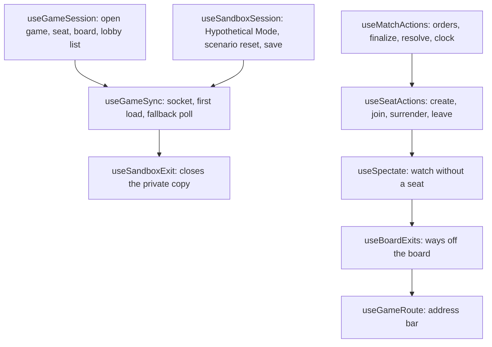

# State Management & API Synchronization

The frontend architecture prioritizes server-authoritative truth, immediate reactive UI feedback, multiplayer lobby management, and risk-free hypothetical experimentation via Sandbox checkpointing.

## Contents

- [State Variables (`App.tsx`)](#state-variables-apptsx)
- [Display Preferences (`useDisplayPrefs`)](#display-preferences-usedisplayprefs)
- [Server Synchronization Loop](#server-synchronization-loop)
- [Lobby & Match Management Flow](#lobby--match-management-flow)
- [Game Links & Routing (`useGameRoute`)](#game-links--routing-usegameroute)
- [Hypothetical Mode & State Isolation](#hypothetical-mode--state-isolation)
- [Real-Time WebSocket Synchronization (`useDiplomacyWebSocket`)](#real-time-websocket-synchronization-usediplomacywebsocket)

---

## State Variables (`App.tsx`)

`App.tsx` is the one state coordinator. It owns almost no logic itself: it calls a chain of state hooks, each named for what it does, and hands their values to `AppHeader`, `LobbyView` or `GameWorkspace`, and `AppModals`. None of those three keeps game state.



### Concepts

| Concern | Where it lives | Principle |
| :--- | :--- | :--- |
| Open game, seat, board, lobby list | `useGameSession` | The board (`gameState`, `provinces`) is always the server's last answer. The seat (`lockedPower`) is what `resolvePlayerPower` turns into the player's power: the seat in multiplayer, `gameState.active_power` in a sandbox. `gamesList` holds the player's own games (`/api/games/mine`) followed by public matches, each game once. |
| Keeping it current | `useGameSync` | Owns the socket, the first load and the fallback poll. Its effects run in a fixed order relative to the other App effects (after display-prefs, layout-reset and turn-history, before `useSandboxExit`), so reordering the hook calls in App changes behavior. |
| Hypothetical Mode and scenario reset | `useSandboxSession` | `sandboxGameId` is the private server copy used inside a multiplayer match. Drafts, power switches, previews and hypothetical resolves go to `draftGameId`: `sandboxGameId` when set, else `activeGameId`. The real match's clock is held aside (`hypotheticalMatchTimer`) because the copy has none. |
| What a player does in a match | `useMatchActions` | Order edits, finalize (through the Sanity Check modal), unfinalize, resolve (guarded against a double click) and clock buttons. Each applies the server's reply through `applyServerState`. |
| Taking and leaving seats | `useSeatActions`, `useSpectate`, `useBoardExits` | Seat changes and every route off the board; the exits ask first while staged Edit Board changes exist. A spectator holds a match with `lockedPower` null and the client never sends a `power` for them. |
| Selection | `useSidebarSelection` | One `selectedUnitId` shared by map and sidebar, so a pick on either side lights the other. The hook records where the pick happened so the map does not float a unit menu over a unit whose card is already on screen. |
| Identity | `useAuthSession` | `authReady` turns true after the first saved-user read, so a game link can know the player's seat. Sign-in and sign-out are followed afterwards. |
| Layout | `useWorkspaceLayout`, `useCompactLayout` | Desktop rails collapse automatically on narrow screens (left below `1200px`, both below `960px`); phones have a bottom order sheet (`peek`/`half`/`full`) and a tools drawer, both reset when the game, view or layout changes. `isCompact` is written on the shell as `data-layout` for the `@layer compact` CSS. |
| Admin Direct-Edit | `useAdminDirectEdit` | Board edits are staged locally and committed atomically (`POST /api/admin/board-edit`, which answers `409` on a concurrent change). Leaving with staged edits asks first; admin audit entries must be acknowledged per participant. |
| Turn history | `useTurnHistory` | The resolved-phase list is refetched whenever the live turn changes (covers socket updates and rollbacks); a phase on show is re-found by season, year and phase, and the view returns to live if it is gone. It always reads `activeGameId`, never `sandboxGameId`. While a past turn is set the map is read-only and the orders panel is dimmed. |
| Toast | `useToast` | A new message replaces the current one; each clears after 4.5 seconds. |

State the workspace alone uses (`mapRef`, `zoomPercent`, `hoveredUnitId`) and the turn-selector helpers stay in App so they survive a trip to the lobby. Hover ignores touch pointers, since a finger has no hover and a tap would leave the highlight on. `EuropeMap` reports zoom at most once per frame so zooming does not re-render App on every event. Derived values such as the order panel's progress counts are recomputed on render and never stored.

### Press and suggestions live outside React

Press (chat) is the one piece of game data that is not App state. `lib/pressStore.ts` is a small store holding the messages of the match on screen for the player's seat, read marks, the countries picked as recipients, and whether the socket is up. The game socket pushes `press` messages into it, `usePressSync` (called by `GameWorkspace`) loads `GET /api/press`, catches up with `?after=` when the socket returns, and polls while it is down. Components read it with `useSyncExternalStore`, so the Press section, the collapsed rail and the phone button share it without props. It drops anything for another match or seat and is emptied when the player leaves the board. A spectator's store has `power` null: the public feed only.

A move suggestion is held the same way (`lib/suggestionStore.ts`): either a draft being written or a received message being viewed, never both. `useSuggestionBoard` turns it into the board the map draws (suggested orders, a hold for every other unit) and ends it when the turn resolves, the phase is not Movement, the game is over, the screen is left, or the board is needed for Hypothetical Mode, Direct-Edit or a past turn. A draft never reaches the server until it is sent as press. Adopting a suggestion is one `POST /api/orders/batch` for the player's own units and turn.

---

## Display Preferences (`useDisplayPrefs`)

`hooks/useDisplayPrefs.ts` holds each player's choice of piece style and marks. It never touches game state or the FastAPI backend, because it only changes what that player sees.

| Situation | What happens |
| :--- | :--- |
| Page load | The copy in `localStorage` applies at once, so the wrong style never flashes. Anyone with none gets `DEFAULT_DISPLAY_PREFS`. |
| Changing a setting | Applies immediately and saves on the device, then saves to the account after 600ms, so clicking through options doesn't send a request per click. |
| Signing in, account has a saved value | The account wins, and the device copy is updated. |
| Signing in, account has none | The device's choice is uploaded. Someone who never chose uploads nothing, so they keep following the default. |
| Changing a setting while the account is loading | The newer change is kept and saved over what the account held. |
| An account read or save fails | The local value stays, and the menu says so. **A failed read is never treated as an empty account**, because the upload that follows would overwrite the player's saved choice. |
| Signing out | The device keeps its last choice. |

Accounts store the value in Supabase `user_metadata.display_prefs`, next to `display_name`. It needs no table, migration or backend route. `fetchAccountDisplayPrefs` calls `supabase.auth.getUser()` rather than reading the cached session, so a choice made on another device appears on the next page load. Tabs already open pick up a change on their next load.

Players can edit their own metadata, so everything read back goes through `sanitizeDisplayPrefs` before it reaches the map. Local demo accounts use a per-user `localStorage` key instead, so the same flow works without Supabase.

---

## Server Synchronization Loop

Every mutation action follows a predictable unidirectional data loop scoped by `activeGameId`:

```
User Click (e.g. Move Army)
         │
         ▼
EuropeMap.tsx or MacroSidebar.tsx
         │
         ▼
App.handleUpdateOrder(order)
         │
         ├──► HTTP POST /api/order?game_id={activeGameId}
         │      Payload: { order: Order, turn: "Spring 1901 Movement" }
         │
         ├──► HTTP 200 OK: Returns refreshed authoritative GameState
         │
         ▼
App.applyServerState(st)
         │
         ├──► setGameState(st)
         ├──► setSimulationResult(st.preview)
         └──► Triggers re-render of map arrows & diagnostics
```

---

## Lobby & Match Management Flow

1. **Viewing Matches (`GET /api/games`, `GET /api/games/mine`, `GET /api/games/browse`)**:
   - `useGameSession` keeps the lobby list: the player's own games from `/api/games/mine` (private campaigns and saved sandboxes included) merged with the public list from `/api/games` and the lobby socket.
   - **A player with games** gets the map-first homepage. `sortMyGames` (`utils/heroGame.ts`) orders their games: the ones waiting on their orders first (soonest clock deadline first, untimed ones after), then the ones waiting on others, finished campaigns, and saved sandboxes; ties go to a game that has resolved a turn, then to the most recently played. `pickHeroGame` takes the first that is not a sandbox for `lobby/FeaturedGameHero.tsx`, and the rest go to `lobby/OtherGamesStrip.tsx`. Both draw `lobby/MiniMap.tsx` from the summary's `board`, which only `GET /api/games/mine` sends; a game with no `board` yet draws the bare map. Leave, Surrender and Delete sit behind the ⋯ menu (`lobby/GameActionsMenu.tsx`) and still open the surrender dialog.
   - **A guest, or a player with no games** (or only saved sandboxes), keeps the `LobbyHero` banner. `MyGamesSection` now holds only the guest's sign-in box and the no-games hint.
   - The public games are the browser (`lobby/GameBrowser.tsx`). `lobby/hooks/useLobbyBrowse.ts` holds its filters (seats open, full or all; countries that must be free; a turn at, before or after a season and year) and its page, and asks `GET /api/games/browse` for that one page. Changing a filter goes back to page 1, an older reply never replaces a newer one, and a page emptied since the last look steps back to the new last page. The lobby list is its refresh signal: whenever the lobby socket or Refresh replaces it, the open page is asked for again, so a seat someone just took turns taken without a reload. The query and the row helpers are pure functions in `utils/lobbyBrowse.ts`.
   - Each row (`lobby/GameBrowserRow.tsx`) shows the name, turn, host and a strip of the seven seats, each `data-seat` `free`, `taken` or `mine`, with its buttons. A browse row carries no user ids, so the player's seat comes from their own games (`myPowerIn`): a game they are in offers **Resume**; otherwise **Watch** opens it without a seat (signed out too) and **Join** opens the row into the seats, where a seat is claimed. A guest's claim opens the sign-in prompt. Public games never have a passcode, so the browser never asks for one; private games are joined, or watched with **Watch without a seat**, from **Join with code**.
2. **Creating a Match (`POST /api/games`)**:
   - Users create custom rooms or isolated sandboxes.
   - The lobby's **Host game** and **Join with code** buttons (`lobby/LobbyActionRow.tsx`) each open their form in a dialog (`lobby/LobbyFormDialog.tsx`: closes on Escape, the ✕ or a click outside). `LobbyView` holds only which dialog is open. The fields and submit handlers live in `lobby/hooks/useHostGameForm.ts` and `useJoinWithCodeForm.ts`, so what was typed survives closing the dialog, and an old error is cleared when it opens again. A dialog closes itself once the game is created or the seat claimed, or when a guest is sent to sign in.
3. **Joining & Claiming Seats (`POST /api/games/{id}/join`)**:
   - Claims an available Great Power for the user, setting `lockedPower` so moves cannot be submitted for rival nations.
   - Joining never changes what other players see: the server leaves the shared game's `active_power` alone in multiplayer.
4. **Surrender & Civil Disorder (`POST /api/games/{id}/surrender`)**:
   - When a player concedes, the power enters Civil Disorder, defaulting to passive hold without player command.
5. **Leaving / Vacating (`POST /api/games/{id}/leave`)**:
   - Frees the claimed seat or deletes saved sandboxes.
6. **Watching (`useSpectate`)**:
   - Opens a match with `viewMode` `multiplayer` and `lockedPower` null. `isSpectating` is that state, and while it holds the client never sends a `power` (`fetchGame`, the fallback poll, the socket and press): without a token, a named `power` would claim a seat taken without an account.
   - The map takes no clicks (`readOnly`), Hypothetical Mode is hidden (it needs a seat), and press is the public box alone (`pressStore` with `power` null, which the socket's `power: null` pushes land in). Leaving does not remember the match as the previous game, since there is no seat to return to.

## Game Links & Routing (`useGameRoute`)

There is no router library: the address bar is kept by `hooks/useGameRoute.ts` (the request flow and Back/Forward are drawn in [Service Interactions § E](../architecture/service-interactions.md#e-game-links--spa-routing-gameid)), and the pure pieces (`parseGameRoute`, `isLinkableGameId`, `urlFor`, `gameLink`) are in `utils/gameRoute.ts`.

- **Addresses.** A multiplayer match is at `/game/<id>` and everything else is `/`. Only `mp_` ids are linkable: a `solo_`, `saved_` or `sbx_` sandbox belongs to one player (`saved_sandbox_guard`), and `proto_1901` has no lobby summary to open it by, so a link to any of them opens the lobby. `?view=sandbox` and `#sandbox` still open the Solo Sandbox (`initialViewMode`), and a sandbox opened that way keeps its address; any other sandbox is at `/`, so a reload opens the lobby as it always has.
- **Opening a link** (on load, once `authReady`, and on Forward/Back to a game) reads `GET /api/games/{id}`:
  - a player who holds a seat there (`myPowerIn`) is taken into it through `handleJoinOrEnterMultiplayerGame`;
  - otherwise, a private match (`has_passcode`) whose passcode was not typed this visit opens the lobby's **Join with code** dialog with the Game ID filled in (`passcodeRequest`, which `LobbyView` turns into `join.prefill(id)` and the open dialog);
  - otherwise the match is watched (`watchGame`);
  - a `404` (or any other refusal) shows the lobby and a toast.
- **Keeping the address in step.** Each change of `viewMode` or `activeGameId` is a `pushState`, so Back goes from a match to the lobby. The first write after a load is a `replaceState`, so Back never lands on the page that was just replaced. While a link or a Back/Forward is being followed the address is left alone, and written once the screen has settled. The address never holds a passcode; a private match's link asks for it.
- **Back and Forward** (`popstate`): to `/`, the board is left through `handleBackToLobby`, which keeps the seat; if the player chooses to keep staged Edit Board changes, the game's address is pushed back. To `/game/<id>`, another board is left through the lobby first (closing its private sandbox), then the link is opened as above. To `?view=sandbox`, the Solo Sandbox opens.
- **Copy game link.** The top-bar `GameSettingsMenu` (desktop and phone) has **Copy game link** in a multiplayer match, for players and spectators alike, and `PrivateCampaignCreatedModal` shows the link beside the Game ID and passcode. Both copy `location.origin + '/game/' + id` through `hooks/useCopyFeedback.ts`, which `LobbyView` also uses for its Copy buttons.
- **Serving the path.** The Vite dev server answers any path with `index.html`, and in production `backend/main.py`'s `serve_spa` does the same for every path that is not a file, `/api/`, `/ws/` or the API docs. Built assets are linked as `/assets/...` (Vite's `base` is unset), so they load from `/game/<id>` too.

---

## Hypothetical Mode & State Isolation

When a user enables **Hypothetical Mode** (`Eye` icon in tools sidebar):

1. **Entering Hypothetical Mode (`handleToggleSandboxMode`)**:
   - Captures `sandboxOriginTurn` from the live board's `turnLabel(gameState)` before applying the sandbox state.
   - Dispatches `POST /api/sandbox/enter?game_id={activeGameId}`.
   - In a multiplayer match the backend returns (or resumes, if on the same live turn) an ephemeral private copy (`sbx_`) stored in `sandboxGameId`. Elsewhere it checkpoints the real board (`SANDBOX_CHECKPOINTS[game_id]`) and resumes any same-turn `SANDBOX_BRANCHES[game_id]`.
   - The UI displays an indicator banner: `"HYPOTHETICAL PLANNING & OUTCOME PREVIEW"`.
2. **Multi-Power Operations, Move Visibility & Stepping Turns**:
   - Clicking any nation in Diplomatic Standings switches active command (`handleSelectPower` posts to `draftGameId`, allowed in multiplayer when `sandboxMode` is true via `resolvePlayerPower(..., sandboxMode)`).
   - `GameWorkspace` holds `showAllSandboxMoves` (`All Moves` vs `Selected Nation` in `StandingsSection`) so commanders can view all 7 powers' orders or focus on `activePower`.
   - `Step Turn Forward` (`handleAdjudicateTurn`) adjudicates `draftGameId` when `sandboxMode` is true, advancing the ephemeral branch across turns without touching the live match.
   - The outcome overlay is on while in Hypothetical Mode, so the map shows how all hypothetical forces interact.
3. **Exiting Hypothetical Mode & Live Turn Advancement**:
   - Dispatches `POST /api/sandbox/exit?game_id={draftGameId}`.
   - The backend restores the real match or pre-sandbox checkpoint and real orders without mutating real game state (never carrying hypothetical orders back to the live match).
   - The ephemeral branch (`sbx_` or `SANDBOX_BRANCHES`) persists across exit/re-enter for the duration of the live turn and is erased when the real turn ends (resolution, admin rollback/set-turn/board-edit, scenario load/seed).
   - While `sandboxGameId` is set, if `useGameSync` receives a WebSocket update or poll response whose `turnLabel` differs from `sandboxOriginTurn`, it automatically exits Hypothetical Mode, clears `sandboxGameId` / `sandboxOriginTurn`, applies the live board, and notifies the player with a toast.
4. **Clearing Foreign Orders**:
   - Dispatches `POST /api/sandbox/clear-foreign?game_id={draftGameId}`.
   - Cleans all hypothetical enemy orders while remaining in Hypothetical Mode.

While `sandboxGameId` is set, the board shows the ephemeral private copy and is kept apart from the real match:

- WebSocket updates (and fallback polling when disconnected) for the match update `activeGameSummary` and `hypotheticalMatchTimer`. The clock continues to run via WebSocket heartbeats or fallback polling.
- Finalize, Unlock, Surrender and the Admin Console are refused with a toast (`requireRealBoard`), because they act on the real match and the player would be looking at a hypothetical board.
- Leaving the match view by any route closes Hypothetical Mode through the effect in `useSandboxExit`, which watches `viewMode`.

### Solo Sandbox Isolation, Session Persistence & In-Place Promotion

1. **Entering, Resuming & Exporting to Solo Sandbox (`handleEnterSoloSandbox`)**:
   - Reads `sloplomacy_solo_sandbox_id` from `localStorage` (`readStoredSoloSandboxId`) and dispatches `POST /api/games/solo-sandbox` (passing `?resume_game_id=<storedId>` when present).
   - When invoked from any active board (`viewMode !== 'lobby'`), also sends `source_game_id` (`draftGameId ?? activeGameId`) and any match `X-Passcode`: the backend validates view access, sanitizes live multiplayer state (masking opponent orders to `HOLD`), deletes any previous draft sandbox (`solo_*`, `is_draft: true`), and creates a new draft seeded from that snapshot, resetting `sandboxGameId` to `null`.
   - From the lobby, if the stored draft ID is still active (or if the signed-in user already owns an unpromoted draft), the backend resumes it with all orders and turns intact. Otherwise, it initializes a fresh isolated draft sandbox (`solo_<uuid>`, `is_sandbox: true`, `is_draft: true`) and stores the ID in `localStorage`.
   - Draft sandboxes are excluded from public lobby lists and `/ws/lobby` broadcasts, ensuring that two visitors launching Solo Sandbox never interact or see each other's moves.
2. **Promoting to Saved Sandbox (`handleSaveSandboxToAccount`)**:
   - Clicking "Save Sandbox" opens `SaveSandboxModal` (`saveSandboxModalOpen = true`), allowing the commander to specify a custom name.
   - Dispatches `POST /api/games/save-sandbox` with the custom name and caller's credentials.
   - For draft sandboxes (`is_draft: true`), the backend promotes the session in-place (`is_draft: false`), updates the name and creator attribution, and records it in the saved games list. The frontend clears `sloplomacy_solo_sandbox_id` so future Solo Sandbox launches start a fresh draft while the promoted scenario remains in the user's saved campaigns.


---

## Real-Time WebSocket Synchronization (`useDiplomacyWebSocket`)

To guarantee seamless multiplayer coordination, the frontend maintains a persistent WebSocket connection via the custom hook `useDiplomacyWebSocket`, which `useGameSync` calls with its two handlers:

```
                           CLIENT BROWSER (useGameSync)
                                      │
            ┌─────────────────────────┴─────────────────────────┐
            │ viewMode === 'lobby'                              │ viewMode !== 'lobby'
            ▼                                                   ▼
     ws://.../ws/lobby                                   ws://.../ws/games/{activeGameId}
            │                                                   │
            ▼                                                   ▼
  handleWsLobbyUpdate                                  handleWsGameUpdate
  - Update gamesList (public part)                     - Update gameState
  - Re-read /api/games/mine
  - Update participant counts                          - Update activeGameSummary
                                                       - Trigger phase-advance toast
```

### Key Capabilities:
1. **Live Room State Synchronization**:
   - Order submissions, finalizations, adjudications, and admin overrides by other players are immediately pushed to all connected clients without page reloads.
2. **Phase Advance Alerts**:
   - Automatically detects when `season`, `year`, or `phase` transitions occur and triggers a persistent toast announcement to notify the commander.
3. **Connection Resilience**:
   - Sends a `{ type: 'ping' }` heartbeat every 25 seconds to keep proxies and serverless Cloud Run instances active. Each socket owns its heartbeat, and a late close event from a replaced socket is ignored.
   - Reconnects 2 seconds after an unexpected drop. It stops for good on `4004` (game deleted), `4403` (passcode missing or wrong) and `4429` (too many wrong passcodes), because a retry cannot fix them (`shouldReconnect`). The fallback HTTP poll then takes over.
   - Game sockets ask for the auth handshake (`?handshake=1`) and send `{ type: 'auth', token }` as their first message, with the token from `getAuthHeaders`. The server works out the player's seat from it, so it shows them their own orders and lets a seated player into a private match without the passcode. The socket reconnects when the player signs in or out (`authKey`).
   - The passcode a player types when joining or watching a private match is kept in `matchPasscodes` for this visit only and sent with the socket, `fetchGame` and the fallback poll (`X-Passcode`), for anyone not yet seated.
   - When the turn clock reaches zero, `PhaseTimerWidget` calls `onExpire`, and the app sends `{ type: 'refresh' }`. Only `refresh` makes the server run the clock; `ping` just keeps the connection open. Without a socket, the fallback poll runs the clock within 4 seconds. The countdown keeps `onExpire` in a ref, so a new callback never restarts it from an old server value.
5. **Requests and stale replies**:
   - Every call that acts on a game sends the player's token, through `authedFetch` (`lib/supabase.ts`) or `getAuthHeaders`. The server finds the player's seat and their saved sandboxes from it, so a call sent without it is treated as a stranger's.
   - `handleAdjudicateTurn` (in `useMatchActions`) ignores a click while a resolve is in flight and sends the turn it means (`?turn=`), so a double-click resolves one phase.
   - `fetchGame` (in `useGameSession`) and joining a match bump `boardRequestSeq`. A `GET /api/game` reply that comes back after a newer request is dropped, so the startup load of `proto_1901` cannot replace a match the player has just joined.
6. **Visual Telemetry**:
   - On phones, the `⋯` overflow menu displays the real-time connection row (`Live Sync` or `Connecting…`, plus an amber dot on `⋯` when offline).
